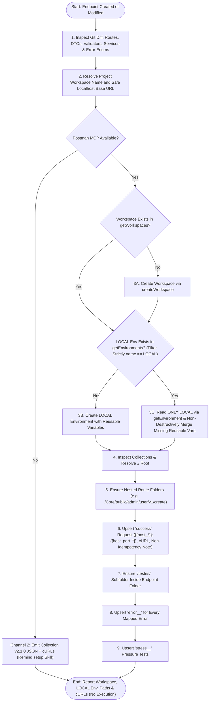

# Postman Endpoint Synchronization Skill (`postman`)

## 1. Overview & Purpose

This skill defines the standard protocol for automatically registering and updating **Postman** workspaces, the **`LOCAL`** environment with reusable variables, collections, folders, `cURL`-documented `success` requests, and `/testes/` error/pressure test requests whenever an HTTP/REST endpoint is created or modified in any language or framework (`.NET`, `Python`, `Node.js/TypeScript`, `Java`, `Go`, etc.).

It operates primarily when triggered by the documentation workflow ([documentation.md](../documentation.md) / [documentation-admin.md](../../../agents/documentation-admin.md)) — for example, right after endpoint creation or before committing — and may also be invoked directly as a standalone skill.

> [!IMPORTANT]
> **Strict Creation-Only, `LOCAL`-Only Environment & Zero `.env` Boundary**:
> - This skill **ONLY creates and updates** Postman artifacts (workspaces, the `LOCAL` environment, collections, folders, requests, payloads, `cURL` descriptions, and static `pm.test(...)` assertion metadata).
> - **Strict `LOCAL`-Only Postman Environment Isolation**: This skill may **ONLY** read (`getEnvironment`) and update (`putEnvironment` / `updateEnvironment`) the Postman environment named **`LOCAL`**. It **MUST NEVER** read, inspect, copy variables/tokens from, or modify any other Postman environment (`DEV`, `QA`, `HML`, `HOMOLOG`, `STAGING`, `PROD`, `PRODUCTION`, or any non-`LOCAL` environment).
> - **Zero `.env` Reads**: It **MUST NEVER** read any standard project `.env` file (`.env`, `.env.local`, `.env.development`, `.env.staging`, `.env.production`, `.env.*`, `mcp_secrets.env`).
> - **No Execution / No Runtime Validation**: It **MUST NEVER execute HTTP requests or validate runtime responses**: do **not** run `curl`, `wget`, `httpie`, `Invoke-RestMethod`, `Invoke-WebRequest`, Postman Collection Runner, Newman, MCP `run*` tools, or start local application servers. Runtime validation belongs strictly to the developer or automated test suites (`dotnet test`, `pytest`, etc.), never to `postman`.

---

## 2. Postman MCP Integration & Fallback Channels

When configured, `postman` interacts with Postman through the **`postman`** server bundled inside the project-scoped **`nievo_ai` Docker MCP Gateway** (`.agents/plugins/nievo/mcp_config.json`, reading `postman.postman-api-key` from the project-local `mcp_secrets.env` configured via the [setup](../../setup/setup.md) skill).

> [!NOTE]
> **Tool Name & Prefix Variations**:
> Depending on the active MCP client and server version, Postman MCP tools may appear prefixed by the plugin/gateway name (e.g., `nievo_nievo_ai`) or exposed with slightly different casing/aliases. Always inspect and invoke the exact registered Postman MCP tool names available in the active runtime.

### 2.1 Channel Priority

1. **Channel 1 — Primary (Postman MCP Server)**:
   Use Postman MCP tools to inspect existing workspaces/collections and create or update workspaces, collections, folders, and requests directly in Postman.
2. **Channel 2 — Manual / Offline Fallback (When MCP Is Unavailable or Unauthenticated)**:
   If the `postman` MCP server is unavailable or missing `postman.postman-api-key`:
   - **Never** read `.env` or `mcp_secrets.env` to inspect credentials.
   - Notify the user clearly, referencing the [setup](../../setup/setup.md) skill and reminding them to populate `postman.postman-api-key` in their project-local `mcp_secrets.env`.
   - Generate and present a ready-to-import **`LOCAL` Postman Environment JSON** alongside the **Postman Collection v2.1.0 JSON** artifact and complete **`cURL`** commands for `success` and every `/testes/*` item so nothing is lost.

### 2.2 Capability-to-Tool Mapping

| Capability | Primary Postman MCP Tool(s) | Purpose in `postman` Skill |
| :--- | :--- | :--- |
| **List workspaces** | `getWorkspaces` | Check whether a workspace matching the project name (e.g., `Nievo-portal`) already exists. |
| **Create workspace** | `createWorkspace` | Create the project workspace automatically when absent (`type: "personal"` or `"team"` per project context). |
| **Manage `LOCAL` environment** | `getEnvironments`, `getEnvironment`, `createEnvironment`, `putEnvironment` / `updateEnvironment` | Filter `getEnvironments` strictly for `name == "LOCAL"`; create `LOCAL` if missing, or read **only** `LOCAL` via `getEnvironment` before `putEnvironment` to preserve existing variables. **Never** call `getEnvironment` or mutate any non-`LOCAL` environment. |
| **List & inspect collections** | `getCollections`, `getCollection` | Locate the target collection inside the workspace and inspect existing folders/requests to avoid duplicates. |
| **Create or replace collection** | `createCollection`, `putCollection` | Create the collection if missing, or perform structured Collection v2.1.0 upserts when granular folder/request tools are unavailable. |
| **Create folder hierarchy** | `createCollectionFolder` | Build the language-agnostic `./<Module>/<endpoint-path>` and `/testes/` folder hierarchy. |
| **Create or update requests** | `createCollectionRequest`, `updateCollectionRequest` | Create or update `success`, `error_<enum_name>_<status>`, and `stress_<scenario>_<status>` items targeting `localhost`. |

### 2.3 Forbidden Tools, Commands & Environment Reads

The following operations are **strictly prohibited** inside this skill:
- Reading or modifying any non-`LOCAL` Postman environment: **never** call `getEnvironment`, `putEnvironment`, `updateEnvironment`, or `deleteEnvironment` on `DEV`, `QA`, `HML`, `HOMOLOG`, `STAGING`, `PROD`, `PRODUCTION`, or any environment whose `name` is not `"LOCAL"`.
- Reading standard project `.env` files: **never** read `.env`, `.env.local`, `.env.development`, `.env.staging`, `.env.production`, `.env.*`, or `mcp_secrets.env`.
- Postman MCP execution/monitoring tools: `runCollection`, `runMonitor`, `createMonitor` (for live execution), or any runner trigger.
- Shell HTTP clients: `curl`, `wget`, `http`, `Invoke-RestMethod`, `Invoke-WebRequest`, Python `requests`/`httpx`, Node `fetch`.
- Local server startup/probing commands intended to hit endpoints (`dotnet run`, `uvicorn`, `npm run dev`, etc.).

---

## 3. End-to-End Workflow Flowchart



---

## 4. Context Resolution & Hierarchy Mapping Rules (Language-Agnostic)

### 4.1 Project Workspace Resolution

- Derive the Postman **Workspace** name directly from the project/repository context (e.g., repository folder name, Git remote repo name, solution/package root such as `Nievo-portal`).
- Query `getWorkspaces` (case-insensitive normalization check to avoid duplicate workspaces such as `nievo-portal` vs. `Nievo-portal`).
- If no matching workspace exists, create it automatically via `createWorkspace` before creating any collection or folder.

### 4.2 Language-Agnostic Module Folder (`./<Module>`)

Every endpoint lives under a top-level folder equivalent to its bounded module/project name (`./<Module>`), **regardless of programming language or framework**, by stripping the project/workspace prefix and generic structural directories (`src`, `apps`, `services`, `packages`, `Code`, `modules`):

| Stack / Language | Raw Project / Package / Directory | Resolved Postman Folder |
| :--- | :--- | :--- |
| **.NET** | `Nievo.Portal.Core`, `Code/Nievo.Portal.Core` | `./Core` |
| **.NET** | `Nievo.Portal.Auth.Api` | `./Auth` *(or `./Auth.Api` if distinct sub-APIs exist)* |
| **Python (FastAPI / Django / Flask)** | `services/core`, `apps/billing`, `nievo_portal/core` | `./Core`, `./Billing` |
| **Node.js / TypeScript (NestJS / Express)** | `apps/core`, `packages/payments`, `nievo-portal-core` | `./Core`, `./Payments` |
| **Java / Kotlin (Spring Boot)** | `com.nievo.portal.core`, `modules/core` | `./Core` |
| **Go** | `cmd/core`, `internal/core`, `services/core` | `./Core` |

*(For single-module repositories where no sub-module segmentation exists, use `./Api` or the primary service folder name consistently.)*

### 4.3 Collection vs. Module Folder Handling

1. **Default Layout**: Inside Workspace `<ProjectName>`, locate or create the collection `<ProjectName>` (e.g., `Nievo-portal`), then place the module folder (`Core`) at the collection root followed by the nested route path (`./Core/public/admin/user/v1/create`).
2. **Compatibility Layout**: If the target workspace already contains a dedicated collection explicitly named `<Module>` (e.g., a collection named `Core`), reuse that collection and create the route hierarchy directly at its root (`public/admin/user/v1/create`) to avoid redundant `Core/Core` nesting.

### 4.4 Endpoint Route Nesting & HTTP Method Collisions

- Normalize the endpoint's full HTTP route (combining controller/router prefix + action route, trimming leading/trailing slashes):
  - Example: `public/admin/user/v1/create` becomes nested folders:
    `Core` -> `public` -> `admin` -> `user` -> `v1` -> `create`.
- **Path Parameters**: Preserve parameter segments cleanly as named folders (e.g., `{id}` or `:id` -> folder `{id}` or `by-id`, matching existing collection conventions if present).
- **Multiple HTTP Methods on the Same Path**:
  - If an endpoint folder (e.g., `v1/users`) hosts only one method, use `success` directly.
  - If multiple methods share the exact same route path (e.g., `GET` and `POST` on `/v1/users`), group by method (`GET/success`, `POST/success`) or prefix cleanly only when a collision exists, without overwriting existing methods.

### 4.5 `LOCAL` Environment & Reusable Variables Standard (Safe Config Only)

Every endpoint registered in Postman **MUST** rely on reusable variables stored in the workspace's **`LOCAL`** environment (using Postman double-brace syntax `{{variable_name}}`).

#### 4.5.1 Auto-Create & Non-Destructively Merge `LOCAL`
1. Query `getEnvironments` in the target workspace and filter strictly for the environment where `name == "LOCAL"`.
2. If **`LOCAL`** does not exist in the workspace, create it automatically via `createEnvironment` (`name: "LOCAL"`).
3. If **`LOCAL`** already exists, **always** fetch its full current definition via `getEnvironment` before calling `putEnvironment` or `updateEnvironment`, append **only missing** reusable variables, and **never** overwrite or delete existing variables or values already populated by the developer (such as `bearer_token_core` or custom local ports).
4. **Strict `LOCAL`-Only Read Boundary**: Ignore every non-`LOCAL` environment returned in `getEnvironments` metadata. **NEVER** invoke `getEnvironment`, inspect variables/tokens, or call `putEnvironment`/`updateEnvironment` on `DEV`, `QA`, `HML`, `HOMOLOG`, `STAGING`, `PROD`, `PRODUCTION`, or any environment other than `LOCAL`.

#### 4.5.2 Localhost Port Discovery & Standard Reusable Variables
Discover the local host/port strictly from non-secret configuration files (**never** read `.env`, `.env.local`, `.env.development`, `.env.staging`, `.env.production`, `.env.*`, or `mcp_secrets.env`):
- **Allowed inspection sources**:
  - `.NET`: `Properties/launchSettings.json`, `appsettings.Development.json`, `Program.cs` / `Startup.cs`
  - **Containers / Tooling**: `docker-compose.yml`, `Makefile`, `Dockerfile`
  - **Node / Python / Java / Go**: `package.json`, `pyproject.toml`, `application.yml`, `env-example.txt` / `.env-example`
- **Stack Default Fallbacks** (when no explicit local port is declared):
  - `.NET`: `5000` (or `5001` / `launchSettings.json` port)
  - `Python`: `8000`
  - `Node.js / TypeScript`: `3000`
  - `Java / Go`: `8080`

Create and reference these reusable variables in **`LOCAL`** (using lowercase `snake_case` and `<module>` matching the normalized module name, e.g., `core`, `auth`, `billing`):

| Variable Name Pattern | Type | Default / Initial Value | When to Create & Use |
| :--- | :--- | :--- | :--- |
| `host_<module>` | `default` | `http://localhost` *(or `https://localhost`)* | Always create for the module so requests use `{{host_<module>}}`. |
| `host_port_<module>` *(or existing `host_port`)* | `default` | Discovered local port (e.g., `5000`) | Always create for the module; if the workspace's `LOCAL` env already standardizes on a shared `host_port`, reuse `{{host_port}}` instead of duplicating it. |
| `bearer_token_<module>` | `secret` | `<SEU_TOKEN_JWT>` | Always create when any endpoint in the module uses Bearer/JWT auth, and use `Authorization: Bearer {{bearer_token_<module>}}` across protected requests. |
| `api_key_<module>` / `tenant_id_<module>` | `secret` / `default` | Non-secret placeholder | Create only when a custom header/key is shared across multiple endpoints of that module. |
| `default_page` | `default` | `1` | Create and use in paginated/search endpoints (`?page={{default_page}}`). |
| `default_page_size` | `default` | `10` | Create and use in paginated/search endpoints (`&page_size={{default_page_size}}`). |
| `default_active` / `default_sort_order` | `default` | `true` / `asc` *(or codebase default)* | Create only when the query filter is a standard cross-endpoint search convention in the project. |

**Canonical URL & Header Example**:
```text
GET {{host_core}}:{{host_port_core}}/admin/private/users-list?page={{default_page}}&page_size={{default_page_size}}
Authorization: Bearer {{bearer_token_core}}
```
*(In the request's `cURL` documentation inside `description`, expand `localhost:<port>` concretely so the snippet works directly in a terminal without Postman variable resolution, while keeping `<SEU_TOKEN_JWT>` as a safe placeholder.)*

#### 4.5.3 Reusable vs. Specific Values (No Over-Parametrization)
- **Use `LOCAL` variables ONLY for shared/reusable context**: host, port, module auth tokens/headers, and common cross-endpoint query defaults (`default_page`, `default_page_size`).
- **Keep endpoint-specific values LITERAL in the request**: never pollute `LOCAL` with one-off payloads or domain fields such as `name`, `email`, `cpf`, `amount`, `roleId`, single-endpoint filters, invalid error triggers in `/testes/error_*`, or oversized payloads in `/testes/stress_*`.
- **`/testes/` variable usage**: Error and stress requests still reference `{{host_<module>}}:{{host_port_<module>}}` and `{{bearer_token_<module>}}` from `LOCAL` — except authentication-failure tests (such as `error_unauthorized_401`), which intentionally omit the `Authorization` header or send a literal invalid token.

### 4.6 Canonical Hierarchy Example (`Nievo-portal`)

```text
Workspace: Nievo-portal
└── Collection: Nievo-portal
    └── Core/
        └── public/
            └── admin/
                └── user/
                    └── v1/
                        └── create/
                            ├── success
                            └── testes/
                                ├── error_invalid_email_400
                                ├── error_weak_password_400
                                ├── error_user_already_exists_400
                                ├── error_unauthorized_401
                                ├── error_forbidden_403
                                ├── stress_oversized_payload_400
                                └── stress_concurrent_duplicate_400
```

---

## 5. Request Item & Naming Specifications

### 5.1 Happy-Path Request: `success`

Every endpoint folder **MUST** contain a request named exactly **`success`** (lowercase).

1. **Method & URL**: Exact HTTP verb (`GET`, `POST`, `PUT`, `PATCH`, `DELETE`) and `LOCAL`-parameterized URL (e.g., `{{host_core}}:{{host_port_core}}/public/admin/user/v1/create` or `{{host_core}}:{{host_port_core}}/admin/private/users-list?page={{default_page}}&page_size={{default_page_size}}`), with endpoint-specific params kept literal.
2. **Headers & Auth**:
   - Include `Content-Type: application/json` (or `multipart/form-data` if file upload) and `Accept: application/json`.
   - If the endpoint requires authorization (`[Authorize]`, JWT bearer, API key header), reference the `LOCAL` environment variable (`Authorization: Bearer {{bearer_token_<module>}}`) — **never** real tokens.
3. **Request Body**: Valid, realistic literal JSON payload adhering strictly to every field, type, format, and validation constraint in the endpoint's Request DTO / Validator / Schema (do **not** create `LOCAL` variables for specific body fields).
4. **Mandatory Description Block (Contract + `LOCAL` Variables + `cURL` + Non-Idempotency Caveat)**:
   The Postman request `description` **MUST** include:
   - Endpoint summary, required `LOCAL` environment variables (`host_<module>`, `host_port_<module>`, `bearer_token_<module>`, and `default_page`/`default_page_size` if paginated), expected success HTTP status (e.g., `201 Created` or `200 OK`), and expected Response contract shape.
   - Complete, copy-pasteable **`cURL`** command targeting `http://localhost:<port>` with all headers and payload.
   - **Non-Idempotency / First-Run Execution Note (Mandatory for Mutating Unique-State Endpoints)**:
     Whenever calling the endpoint with the same payload cannot succeed repeatedly (for example, `create` user with unique email/document/username, single-use token confirmation, or `DELETE` on a fixed ID), explicitly document this caveat in the request description:
     - State clearly that the request is guaranteed to succeed on the **first execution** against clean state, and explain which field(s) must be rotated (e.g., `email`, `cpf`, `{{$guid}}` / `{{$timestamp}}`) or which prerequisite/cleanup is required for subsequent runs.

Example **`success`** description snippet (Postman Request URL: `{{host_core}}:{{host_port_core}}/public/admin/user/v1/create`, Header: `Authorization: Bearer {{bearer_token_core}}`):

````markdown
**Endpoint**: `POST /public/admin/user/v1/create`  
**Environment (`LOCAL`)**: `host_core`, `host_port_core`, `bearer_token_core`  
**Expected Success Status**: `201 Created` (Contract: `ResponseApiSucess<PostCreateUserResponse>`)

> **Execution Note (Non-Idempotent Endpoint)**: Because this endpoint creates a user with unique `email`/`document` constraints, sending this fixed payload repeatedly will succeed only on the **first run** and return `error_user_already_exists_400` on subsequent attempts. To repeat a successful call, update `email`/`document` (or use Postman dynamic variables such as `user_{{$timestamp}}@nievo.test`) or reset the test record.

### cURL
```bash
curl --location 'http://localhost:5000/public/admin/user/v1/create' \
  --header 'Content-Type: application/json' \
  --header 'Authorization: Bearer <SEU_TOKEN_JWT>' \
  --data-raw '{
    "name": "Maria Silva",
    "email": "maria.silva@nievo.test",
    "roleId": 1
  }'
```
````

---

### 5.2 Subfolder `/testes/` — Application Error Requests (`error_<enum_name>_<expected_status>`)

Inside every endpoint folder, create a subfolder named exactly **`testes`**.

#### Mandatory Naming Convention
Every error handled by the endpoint (validation, domain/service rule, authentication/authorization, database conflict, external failure) **MUST** have a dedicated request named:

```text
error_<enum_name>_<expected_status>
```

- **Prefix**: `error`
- **Error Identifier (`<enum_name>`)**: Exact error name derived from the application **ENUM**, formatted in lowercase `snake_case`.
- **Expected Status (`<expected_status>`)**: Exact HTTP status code returned by the endpoint (`400`, `401`, `403`, `404`, `409`, `422`, `500`, etc.).
- **Canonical Example**: `USER_ALREADY_EXISTS` returning HTTP `400` -> **`error_user_already_exists_400`**.

#### Enum Normalization Rule (NIEVO `.NET` `EnumErrosApi` & Multi-Stack Enums)
- In NIEVO `.NET` projects, `EnumErrosApi` members follow `<ENDPOINT>_<SERVICE>_<HTTP_STATUS>_<ERROR_NAME>` (for example, `POSTCREATEUSERASYNC_CORESERVICE_400_USER_ALREADY_EXISTS`).
  - Strip the `<ENDPOINT>_<SERVICE>_<HTTP_STATUS>_` prefix so the request name remains concise and matches the pattern `error_<enum_name>_<expected_status>` -> `error_user_already_exists_400`.
  - Always record the **full original Enum symbol** (`EnumErrosApi.POSTCREATEUSERASYNC_CORESERVICE_400_USER_ALREADY_EXISTS`), its **numeric code**, and its **`[Description]` message** inside the Postman request `description`.
- In other languages/frameworks (`Python Enum`, `TypeScript enum`, `Java enum`, `Go const iota` / error codes): convert the canonical error enum symbol directly to lowercase `snake_case` after `error_` and append `_<expected_status>`.
- If an endpoint handles an HTTP error without an explicit enum member yet (e.g., framework middleware `[Authorize]` -> `401` / `403`), use `error_unauthorized_401` / `error_forbidden_403` and note the middleware source in the description.

#### Required Content for Each `error_*` Request
1. **100% Error Coverage**: Inspect FluentValidation rules, controller attributes/filters, service guards, and repository/model error branches to ensure **every** error scenario has its own request in `/testes/`.
2. **Reuse `LOCAL` Infrastructure Vars + Literal Trigger Input**: Use `{{host_<module>}}:{{host_port_<module>}}` (and `{{bearer_token_<module>}}` unless testing `401`/`403` auth failure), while keeping the exact invalid field, nonexistent ID, or duplicate payload literal inside the request (never create `LOCAL` variables for error-trigger data).
3. **Description with `cURL` & Enum Metadata**: Include the original Enum name, numeric error code, expected response message, any precondition (e.g., *"Requires running `success` once first so the user already exists"*), and the complete equivalent **`cURL`** command.
4. **Optional Static Assertion Script (Never Executed)**: You may attach a static Postman `test` event script checking `pm.response.to.have.status(<expected_status>)` and the expected `code` field, strictly as collection metadata without running it.

---

### 5.3 Subfolder `/testes/` — Pressure & Stress Requests (`stress_<scenario>_<expected_status>`)

Inside the same **`/testes/`** subfolder, analyze the endpoint's contract, payload limits, rate/concurrency sensitivity, and database/pagination behavior to create contextual pressure and stress test requests using the pattern:

```text
stress_<scenario>_<expected_status>
```

Choose scenarios that genuinely fit the endpoint type (do not invent irrelevant tests):

| Endpoint Characteristic | Recommended Stress Test Name(s) | Purpose & Runner Configuration Notes |
| :--- | :--- | :--- |
| **JSON Create / Update Payload** | `stress_oversized_payload_400` *(or `_413`)*<br>`stress_max_length_fields_400` | Large JSON array/string exceeding max payload or DTO field length bounds. |
| **Unique Constraint / Idempotency Sensitive** | `stress_concurrent_duplicate_400` *(or `_409`)* | Burst parallel execution (e.g., 10–20 concurrent iterations with fixed unique key) to stress race conditions / unique index locking. |
| **Paginated List / Search (`GET` / `POST`)** | `stress_excessive_page_size_400`<br>`stress_high_frequency_search_200` | Very large `pageSize` / `limit` boundary check and sustained burst read throughput. |
| **Auth / Public / High-Traffic Endpoint** | `stress_rate_limit_exceeded_429` | Rapid burst exceeding rate-limiter threshold (suggest Postman Runner iterations/delay in description). |

Each `stress_*` request uses `{{host_<module>}}:{{host_port_<module>}}` and `{{bearer_token_<module>}}` from `LOCAL` (keeping stress payloads/extreme query params literal) and **MUST** include in its `description`:
- The stress scenario rationale and expected status/behavior.
- Suggested **Postman Collection Runner** parameters (e.g., `Iterations: 50`, `Delay: 0ms`, concurrent runs) for manual execution by the developer.
- Complete equivalent **`cURL`** command.

---

## 6. Step-by-Step Execution Protocol

### Step 1: Inspect Diff & Endpoint Artifacts
1. Inspect active branch changes (`git status --short`, `git diff HEAD`, or target files provided by the user/orchestrator).
2. Read the endpoint's Controller / Route handler, Request DTO, Response DTO, Validator, Service implementation, and Error Enum definitions (`EnumErrosApi.cs` or language equivalent).
3. Inspect safe non-secret config files (`launchSettings.json`, `appsettings.Development.json`, `docker-compose.yml`, `env-example.txt`, etc.) to resolve the `localhost` port and base path. **Never read `.env` or `mcp_secrets.env`.**

### Step 2: Build Endpoint Synchronization Matrix
Before calling Postman MCP, list explicitly for each changed/new endpoint:
- **Workspace Name** (e.g., `Nievo-portal`)
- **`LOCAL` Environment Variables to Ensure**: reusable variables only (`host_<module>`, `host_port_<module>`, `bearer_token_<module>`, and `default_page`/`default_page_size` if paginated/search — never endpoint-specific fields)
- **Collection & Module Path** (e.g., `Nievo-portal` -> `./Core/public/admin/user/v1/create`)
- **HTTP Method + `{{host_*}}:{{host_port_*}}` URL + Auth Requirement**
- **`success` Payload & Non-Idempotency Note** (whether repeating the payload fails after first run)
- **Full Error List**: Every `(EnumSymbol, NumericCode, Description, HttpStatus)` mapped to `error_<enum_name>_<expected_status>`
- **Contextual Stress List**: Every `stress_<scenario>_<expected_status>`

### Step 3: Upsert Workspace, `LOCAL` Environment, Collection & Folder Tree via Postman MCP
1. Call `getWorkspaces`; if `<ProjectName>` does not exist, call `createWorkspace`.
2. Call `getEnvironments` in that workspace and filter strictly for `name == "LOCAL"` (never call `getEnvironment` on any other environment); if `LOCAL` does not exist, call `createEnvironment` with the reusable variables; if `LOCAL` already exists, call `getEnvironment` on `LOCAL` only and non-destructively merge only missing reusable variables via `putEnvironment` / `updateEnvironment` (preserving all existing values).
3. Call `getCollections` (and `getCollection` if found) inside that workspace.
4. Resolve whether the collection is `<ProjectName>` (containing `./<Module>/...`) or an existing `<Module>` collection, and ensure the nested folders (`<Module>` -> route segments -> `testes`) exist via `createCollectionFolder` (creating only missing segments and preserving all existing unrelated folders/requests).

### Step 4: Upsert `success` and `/testes/` Requests (No Execution)
1. Create or update **`success`** inside the endpoint folder using `{{host_<module>}}:{{host_port_<module>}}`, `{{bearer_token_<module>}}` (if protected), `{{default_page}}`/`{{default_page_size}}` (if paginated), literal endpoint-specific params/body, `cURL`, and non-idempotency note if applicable.
2. Create or update every **`error_<enum_name>_<expected_status>`** inside `<endpoint-folder>/testes/`.
3. Create or update every **`stress_<scenario>_<expected_status>`** inside `<endpoint-folder>/testes/`.
4. **Stop immediately after creation/update** — do **not** run or validate any HTTP call.

### Step 5: Report Results
Return a concise summary containing:
- Workspace & Collection name (created or reused).
- **`LOCAL` Environment** status (created or updated) and reusable variables added or reused.
- Exact Postman folder paths created/updated (e.g., `./Core/public/admin/user/v1/create` and `./Core/public/admin/user/v1/create/testes`).
- List of requests created/updated (`success`, every `error_*`, every `stress_*`) with expected HTTP status and non-idempotency caveats.
- Clear statement confirming **creation-only mode** (requests were not executed/validated against a live server).

---

## 7. Critical Safety Rules

1. **Creation-Only, Zero Execution**: Never run `curl`, HTTP clients, Collection Runner, Newman, or Postman MCP `run*` tools, and never start local servers to test endpoints.
2. **Never Read Secrets or `.env` Files**: Never read standard project `.env` files (`.env`, `.env.local`, `.env.development`, `.env.staging`, `.env.production`, `.env.*`, `mcp_secrets.env`), and never embed real JWTs, passwords, or API keys inside Postman environments, headers, payloads, or `cURL` examples.
3. **Strict `LOCAL`-Only Postman Environment & Variable Hygiene**: Read (`getEnvironment`) and update (`putEnvironment`/`updateEnvironment`) **exclusively** the Postman environment named `LOCAL` — **never** read, inspect, copy from, or modify `DEV`, `QA`, `HML`, `STAGING`, `PROD`, or any non-`LOCAL` environment. Always inspect `LOCAL` before updating, never overwrite developer-populated variables (such as `bearer_token_<module>`), and never create `LOCAL` variables for endpoint-specific values.
4. **Preserve Unrelated Postman Assets**: Never delete or overwrite unrelated workspaces, environments, collections, folders, or requests belonging to other endpoints.
5. **100% Error Enum Fidelity**: Never skip an error handled by the endpoint, and always derive `error_<enum_name>_<expected_status>` from the real Enum definition (not invented names).
6. **No Git Commits Inside `postman`**: Leave `changelog.md`, staging, commits, and pushes strictly to [git-admin.md](../../../agents/git-admin.md) / `git-*` skills.

---

## 8. Verification Checklist

- [ ] Target endpoint(s), Request/Response contracts, Validators, Service rules, and Error Enums inspected from diff/source.
- [ ] Workspace exists or was created matching project context (e.g., `Nievo-portal`).
- [ ] **`LOCAL`** environment exists or was created/merged non-destructively with reusable variables (`host_<module>`, `host_port_<module>`, `bearer_token_<module>`, `default_page`, `default_page_size`) and **zero** endpoint-specific variable pollution; **zero** non-`LOCAL` Postman environments (`DEV`, `QA`, `STAGING`, `PROD`, etc.) read or modified.
- [ ] Language-agnostic module folder (`./Core`, etc.) and nested route hierarchy (`./Core/public/admin/user/v1/create`) created cleanly without duplicating module names.
- [ ] `success` request created/updated using `{{...}}` `LOCAL` variables, literal endpoint-specific fields, complete `cURL`, and non-idempotency first-run note when applicable.
- [ ] `/testes/` subfolder created inside the endpoint folder containing one `error_<enum_name>_<expected_status>` request per handled application error and contextual `stress_<scenario>_<expected_status>` requests.
- [ ] Zero `.env` / `.env.*` / `mcp_secrets.env` reads and zero real secrets exposed.
- [ ] **Zero** HTTP requests, `curl` calls, or Postman Runner executions performed (creation-only verified).
