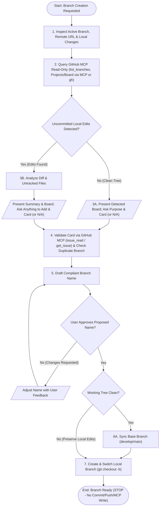

# Git Branching Strategy & Creation Skill

## 1. Overview & Purpose

This skill establishes the branch management policy, Official GitHub MCP read-only context enrichment, interactive naming workflow, and naming conventions for creating git branches in the project, aligned with the branching guidelines referenced in [README.md](../../../README.md).

Its purpose is strictly to determine an accurate, pattern-compliant branch name with the user and create/switch to that branch locally.

> [!IMPORTANT]
> **Strict Scope: Local Branch Creation Only (No Commits, No Staging, No Pushing, No MCP Writes)**:
> The `git-branch` skill is strictly limited to inspecting the local repository state, querying GitHub **read-only** for repository/branch/card context, confirming the proposed branch name with the user, and creating/switching to the topic branch locally (`git checkout -b <branch-name>`).
> It **must NEVER execute `git add`, `git commit`, `git push`**, nor invoke remote GitHub MCP mutation tools (`create_branch`, `create_or_update_file`, `push_files`, `delete_file`, `create_pull_request`).
> Staging and committing belong exclusively to [commit.md](./commit.md), while pushing and Pull Requests belong exclusively to [push-request.md](./push-request.md) and [pull-request.md](./pull-request.md).

---

## 2. GitHub MCP Compatibility & Dual-Channel Integration

When available, `git-branch` integrates with the **Official GitHub MCP Server (`github-official`)** bundled in the project-scoped **`nievo_ai` Docker MCP Gateway** (configured via `.agents/plugins/nievo/mcp_config.json` and `mcp_secrets.env` using `github.personal_access_token` — see the `setup` skill).

> [!NOTE]
> **Tool Name Versioning**: Official `github/github-mcp-server` tools may appear with consolidated names (`issue_read`) or classic aliases (`get_issue`), and MCP clients may prefix them by server/plugin name (e.g., `nievo_nievo_ai`). Always invoke the exact registered GitHub MCP tool name present in the active runtime.

### 2.1 Channel Priority
1. **Channel 1 — Primary (Official GitHub MCP `github-official`)**: Read-only inspection of remote branches, target base branches, issue/card metadata, and GitHub Projects (when the `projects` toolset is enabled).
2. **Channel 2 — Complement & Fallback (GitHub CLI `gh`)**: Query GitHub Projects v2 via `gh api graphql` / `gh project list` when the MCP `projects` toolset is unavailable, and act as fallback for `gh repo view` / `gh issue view` if GitHub MCP is unavailable.
3. **Channel 3 — Local / Manual Fallback**: If neither GitHub MCP nor `gh` is available or authenticated, inform the user clearly (pointing to the `setup` skill and reminding them to configure `github.personal_access_token` in `mcp_secrets.env` manually — **never** read `.env` or `mcp_secrets.env`), inspect remote refs locally (`git ls-remote --heads origin`), and ask the user for any missing card/board context without fabricating metadata.

### 2.2 Capability-to-Tool Mapping

| Capability | Official GitHub MCP (`github-official`) | Complement / Fallback (`gh` or Local Git) | Purpose in `git-branch` |
| :--- | :--- | :--- | :--- |
| **Derive `<owner>/<repo>` & default base** | `get_file_contents` / repo context (if needed) | `git remote get-url origin` and `gh repo view --json nameWithOwner,defaultBranchRef` | Identify target repo slug and default base branch (`develop` when present, else repo default; `main` for `hotfix/`). |
| **List remote branches & duplicate card guard** | `list_branches` | `git branch -r` / `git ls-remote --heads origin` | Detect whether `develop` / `staging` / `main` exists and check if a remote topic branch already exists for the card. |
| **Validate card / issue metadata** | `issue_read` / `get_issue`, `list_issues` | `gh issue view <card> --json number,title,state,labels,url` | Infer accurate `<prefix>` (`feature/`, `fix/`, `hotfix/`, `docs/`, `refactor/`) and `<short-description>` from title/labels. |
| **Discover linked GitHub Project / Board** | MCP `projects` toolset (when enabled) | `gh api graphql` (`repository.projectsV2`) / `gh project list --owner "<owner>"` | Populate `[board-]` segment automatically instead of asking the user. |

### 2.3 Read-Only MCP Boundary
- **Never call MCP `create_branch` inside `git-branch`**: Creating a branch remotely via GitHub MCP before `git checkout -b` bypasses local uncommitted-edit preservation and can leave local edits stranded on a protected base branch. Always create the approved branch locally with `git checkout -b <approved-branch-name>`.
- **Never read `.env` or `mcp_secrets.env`**: Only inspect `.env-example` or `mcp_secrets_example.txt` if checking setup instructions.

---

## 3. Core Repository Branches

| Branch | Stability | Role | Direct Commits Allowed? |
| :--- | :--- | :--- | :---: |
| **`main`** | Production | Stable, production-ready code. Deployed to production environments. | ❌ Forbidden |
| **`staging`** / **`develop`** | Pre-production | Integration branch for testing and reviewing staged features. | ❌ Forbidden |

---

## 4. Topic Branch Naming Conventions

All development must occur on dedicated topic branches branched off `develop` (or `main` for urgent `hotfix/` patches / GitHub Flow models).

### 4.1 Prefix & Pattern

Use the standard structure:
`<prefix>/[board-][card-number-]<short-description>`

- `[board-]` and `[card-number-]` are optional segments omitted only when `N/A` (or when no board/card applies). When provided, format them in lowercase kebab-case (e.g., `feature/core-card-14-refresh-token` or `feature/card-14-refresh-token`).

| Branch Type | Prefix | Description & Example |
| :--- | :--- | :--- |
| **New Features** | `feature/` | New user-facing or platform functionality.<br>`feature/core-card-14-refresh-token` |
| **Bug Fixes** | `fix/` or `bugfix/` | Bug fixes developed against `develop`/`staging`.<br>`fix/api-card-22-pool-timeout` |
| **Hotfixes** | `hotfix/` | Critical urgent patches applied directly against `main`.<br>`hotfix/sec-card-31-auth-bypass` |
| **Documentation** | `docs/` | Exclusively documentation and diagram updates.<br>`docs/api-checkout-diagrams` |
| **AI / Tooling** | `Update/` or `chore/` | Project rules, CI configs, and AI skill maintenance.<br>`Update/git-branch-skill` |
| **Refactoring** | `refactor/` | Structural code changes without functional modifications.<br>`refactor/user-service-di` |

### 4.2 Formatting Rules
- Separate words using hyphens (`-`).
- Never use spaces, underscores, uppercase characters (except standard prefixes like `Update/`), or special characters (`!`, `@`, `#`).
- Keep `<short-description>` concise, typically under **30 characters**.

---

## 5. Interactive Branch Creation Workflow



### Step 1: Inspect Active Branch, Remote URL & Working Tree
Always inspect the local branch, remote slug, and uncommitted changes before prompting the user:
```bash
git remote get-url origin
git branch --show-current
git branch -a
git status --porcelain
git diff --stat
git diff
```

### Step 2: Read-Only GitHub MCP Discovery (Branches & Board)
Using `<owner>/<repo>` derived from `git remote get-url origin`:
1. Call Official GitHub MCP `list_branches` (fallback: `git ls-remote --heads origin`) to verify available base branches (`develop`, `staging`, `main`) and detect existing topic branches.
2. Discover linked GitHub Project(s)/Board(s) via the MCP `projects` toolset (when enabled) or `gh api graphql` / `gh project list --owner "<owner>"`.
   - If a single linked board is detected automatically, store it and do **not** ask the user to supply the board manually.
   - If no linked board exists, record `N/A`.

### Step 3: Context Gathering & Card Validation Protocol

#### Case 3.1: Clean Working Tree (No Uncommitted Edits)
When `git status --porcelain` is empty, present the detected repository/board and ask the user:
1. **Purpose**: What is the purpose and scope of this branch?
2. **Card**: What is the associated card or issue number (or `N/A`)?
3. **Board**: Ask only if GitHub MCP / `gh` could not resolve a linked board automatically or if multiple boards are ambiguous.

#### Case 3.2: Pre-Existing Uncommitted Edits Detected
Users often start editing files before creating the branch. When modified, staged, or untracked files already exist:
1. **Analyze the edits directly** (`git status --porcelain`, `git diff`, and untracked file contents as needed) to determine the accurate `<prefix>` and `<short-description>`.
2. **Do NOT ask the user what will be done from scratch.**
3. Present a concise summary of the detected changes and detected board, then ask the user:
   - **Additional Context**: Do you want to add anything else to the scope for the branch name?
   - **Card**: What is the associated card or issue number (or `N/A`)?
   - **Board**: Ask only if unresolved or ambiguous after Step 2.

#### Card Validation & Duplicate Branch Check (When Card != `N/A`)
- Query Official GitHub MCP `issue_read` / `get_issue` (fallback: `gh issue view <card> --json number,title,state,labels,url`) to confirm the issue exists and refine `<prefix>` / `<short-description>` from its title and labels.
- Check the remote/local branch list (`list_branches` + `git branch -a`) for an existing branch matching `card-<card>`. If one already exists, warn the user and confirm whether to switch to the existing branch instead of creating a duplicate.

### Step 4: Propose Branch Name & Mandatory User Confirmation
1. Combine the gathered context into `<prefix>/[board-][card-number-]<short-description>` following Section 4 rules.
2. Present the proposed branch name and target base branch clearly to the user and **explicitly ask if the proposed name is OK**.
3. Wait for the user's confirmation. If the user requests changes, adjust the name and ask for confirmation again. **Never create a branch without explicit user approval.**

### Step 5: Create & Switch to Topic Branch Locally (Preserving Local Edits)
- **When the working tree is clean**: synchronize the base branch before creating the topic branch:
  ```bash
  git checkout develop
  git pull origin develop
  git checkout -b <approved-branch-name>
  ```
  *(Use `main` instead of `develop` when creating a `hotfix/` branch, or the repository's default branch if `develop` does not exist.)*
- **When uncommitted edits exist**: preserve all local changes untouched (never commit, stage, reset, or discard them).
  - If already on the appropriate base branch (`develop`, or `main` for `hotfix/`), create and switch directly so the local edits carry over into the new branch:
    ```bash
    git checkout -b <approved-branch-name>
    ```
  - If currently on an unrelated branch or if pulling upstream changes is required first, warn the user and ask how they prefer to proceed (e.g., branching from current `HEAD` vs. stashing before switching base) rather than risking data loss or creating an unauthorized commit.

> [!CAUTION]
> **STOP Immediately After Creating the Branch**:
> Once `git checkout -b <approved-branch-name>` succeeds, the `git-branch` workflow is complete. **Do NOT run `git add`, `git commit`, `git push`, or any GitHub MCP write tool.**

---

## 6. Post-Creation Lifecycle Reference (Maintenance Only)

The commands below are for later maintenance outside initial branch creation:

- **Keep Branch Updated (Rebase Strategy)**:
  ```bash
  git fetch origin develop
  git rebase origin/develop
  ```
- **Deletion After Merge**:
  ```bash
  # Delete local branch
  git branch -d <branch-name>

  # Delete remote branch
  git push origin --delete <branch-name>
  ```

---

## 7. Critical Safety Rules

1. **Never Commit, Stage, Push, or Mutate via MCP in `git-branch`**: Strictly forbid `git add`, `git commit`, `git push`, and GitHub MCP mutation tools (`create_branch`, `create_or_update_file`, `push_files`, `create_pull_request`).
2. **Read-Only GitHub MCP Only**: Use Official GitHub MCP (`list_branches`, `issue_read`/`get_issue`, `list_issues`, `projects`) strictly for read-only discovery and validation.
3. **Mandatory Name Confirmation**: Never execute `git checkout -b` before the user explicitly confirms the proposed branch name.
4. **Preserve Pre-Existing Local Edits**: Never commit, discard, or overwrite uncommitted working tree changes when opening a branch.
5. **No Direct Commits to Protected Branches**: Never commit directly to `main`, `staging`, or `develop`.
6. **Never Force Push to Shared Branches**: `git push --force` is strictly forbidden on shared branches (`main`, `develop`, `staging`). On personal rebased feature branches, use `--force-with-lease` only when pushing via the PR skills.
7. **Always Check Active Branch & Never Read Secrets**: Run `git branch --show-current` before any branch operation, and never read `.env` or `mcp_secrets.env`.

---

## 8. Verification Checklist

- [ ] Active branch, remote URL, and working tree inspected (`git remote get-url origin`, `git branch --show-current`, `git status --porcelain`, `git diff`).
- [ ] Remote branches and linked board/project checked read-only via Official GitHub MCP (`list_branches`, `projects`) and/or `gh` fallback.
- [ ] If uncommitted edits existed, changes were analyzed (without asking from scratch what will be done) and the user was asked if they wanted to add anything; if clean, the user was asked for the branch purpose.
- [ ] Card number requested (or `N/A`) and validated via Official GitHub MCP (`issue_read` / `get_issue`) or `gh issue view` fallback; existing card branches checked before creating a duplicate.
- [ ] Proposed branch name adheres to `<prefix>/[board-][card-number-]<short-description>` formatting rules.
- [ ] Proposed branch name was explicitly confirmed by the user before local branch creation.
- [ ] Branch created cleanly (`git checkout -b <branch-name>`) while preserving any pre-existing uncommitted edits.
- [ ] **No `git add`, `git commit`, `git push`, or remote GitHub MCP write operations were executed, and no `.env` / `mcp_secrets.env` files were read.**
