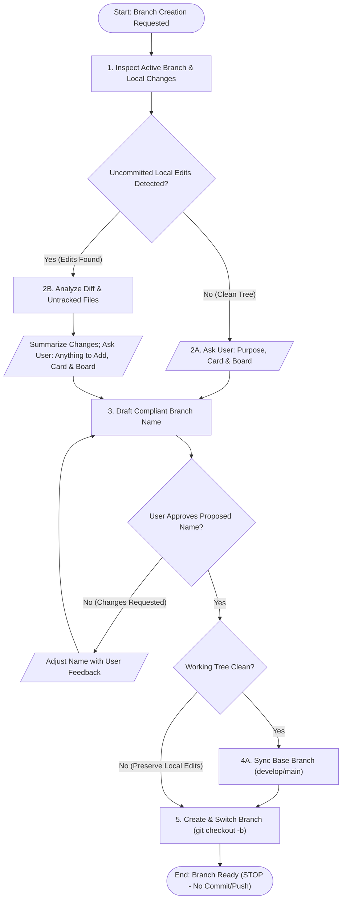

# Git Branching Strategy & Creation Skill

## 1. Overview & Purpose

This skill establishes the branch management policy, interactive naming workflow, and naming conventions for creating git branches in the project, aligned with the branching guidelines referenced in [README.md](../../../README.md).

Its purpose is strictly to determine an accurate, pattern-compliant branch name with the user and create/switch to that branch cleanly.

> [!IMPORTANT]
> **Strict Scope: Branch Creation Only (No Commits, No Staging, No Pushing)**:
> The `git-branch` skill is strictly limited to inspecting the local repository state, gathering branch context, confirming the proposed branch name with the user, and creating/switching to the topic branch (`git checkout -b <branch-name>`).
> It **must NEVER execute `git add`, `git commit`, `git push`**, or create Pull Requests.
> Staging and committing belong exclusively to [commit.md](./commit.md), while pushing and Pull Requests belong exclusively to [pull-request.md](./pull-request.md) and [push-request.md](./push-request.md).

---

## 2. Core Repository Branches

| Branch | Stability | Role | Direct Commits Allowed? |
| :--- | :--- | :--- | :---: |
| **`main`** | Production | Stable, production-ready code. Deployed to production environments. | ❌ Forbidden |
| **`staging`** / **`develop`** | Pre-production | Integration branch for testing and reviewing staged features. | ❌ Forbidden |

---

## 3. Topic Branch Naming Conventions

All development must occur on dedicated topic branches branched off `develop` (or `main` for urgent `hotfix/` patches / GitHub Flow models).

### 3.1 Prefix & Pattern

Use the standard structure:
`<prefix>/[board-][card-number-]<short-description>`

- `[board-]` and `[card-number-]` are optional segments omitted only when the user indicates `N/A`. When provided, format them in lowercase kebab-case (e.g., `feature/core-card-14-refresh-token` or `feature/card-14-refresh-token`).

| Branch Type | Prefix | Description & Example |
| :--- | :--- | :--- |
| **New Features** | `feature/` | New user-facing or platform functionality.<br>`feature/core-card-14-refresh-token` |
| **Bug Fixes** | `fix/` or `bugfix/` | Bug fixes developed against `develop`/`staging`.<br>`fix/api-card-22-pool-timeout` |
| **Hotfixes** | `hotfix/` | Critical urgent patches applied directly against `main`.<br>`hotfix/sec-card-31-auth-bypass` |
| **Documentation** | `docs/` | Exclusively documentation and diagram updates.<br>`docs/api-checkout-diagrams` |
| **AI / Tooling** | `Update/` or `chore/` | Project rules, CI configs, and AI skill maintenance.<br>`Update/git-branch-skill` |
| **Refactoring** | `refactor/` | Structural code changes without functional modifications.<br>`refactor/user-service-di` |

### 3.2 Formatting Rules
- Separate words using hyphens (`-`).
- Never use spaces, underscores, uppercase characters (except standard prefixes like `Update/`), or special characters (`!`, `@`, `#`).
- Keep `<short-description>` concise, typically under **30 characters**.

---

## 4. Interactive Branch Creation Workflow



### Step 1: Inspect Active Branch & Working Tree
Always inspect the current branch and local uncommitted changes before asking the user any questions:
```bash
git branch --show-current
git status --porcelain
git diff --stat
git diff
```

### Step 2: Context Gathering Protocol

#### Case 2.1: Clean Working Tree (No Uncommitted Edits)
When `git status --porcelain` is empty, **always ask the user**:
1. **Purpose**: What is the purpose and scope of this branch?
2. **Card**: What is the associated card or issue number (or `N/A`)?
3. **Board**: Which board or project does this card belong to (or `N/A`)?

#### Case 2.2: Pre-Existing Uncommitted Edits Detected
Users often start editing files before creating the branch. When modified, staged, or untracked files already exist:
1. **Analyze the edits directly** (`git status --porcelain`, `git diff`, and untracked file contents as needed) to determine the accurate `<prefix>` and `<short-description>`.
2. **Do NOT ask the user what will be done from scratch.**
3. Present a concise summary of the detected changes and ask the user:
   - **Additional Context**: Do you want to add anything else to the scope for the branch name?
   - **Card**: What is the associated card or issue number (or `N/A`)?
   - **Board**: Which board or project does this card belong to (or `N/A`)?

### Step 3: Propose Branch Name & Mandatory User Confirmation
1. Combine the gathered context into `<prefix>/[board-][card-number-]<short-description>` following Section 3 rules.
2. Present the proposed branch name and target base branch clearly to the user and **explicitly ask if the proposed name is OK**.
3. Wait for the user's confirmation. If the user requests changes, adjust the name and ask for confirmation again. **Never create a branch without explicit user approval.**

### Step 4: Create & Switch to Topic Branch (Preserving Local Edits)
- **When the working tree is clean**: synchronize the base branch before creating the topic branch:
  ```bash
  git checkout develop
  git pull origin develop
  git checkout -b <approved-branch-name>
  ```
  *(Use `main` instead of `develop` when creating a `hotfix/` branch.)*
- **When uncommitted edits exist**: preserve all local changes untouched (never commit, stage, reset, or discard them).
  - If already on the appropriate base branch (`develop`, or `main` for `hotfix/`), create and switch directly so the local edits carry over into the new branch:
    ```bash
    git checkout -b <approved-branch-name>
    ```
  - If currently on an unrelated branch or if pulling upstream changes is required first, warn the user and ask how they prefer to proceed (e.g., branching from current `HEAD` vs. stashing before switching base) rather than risking data loss or creating an unauthorized commit.

> [!CAUTION]
> **STOP Immediately After Creating the Branch**:
> Once `git checkout -b <approved-branch-name>` succeeds, the `git-branch` workflow is complete. **Do NOT run `git add`, `git commit`, or `git push`.**

---

## 5. Post-Creation Lifecycle Reference (Maintenance Only)

The commands below are for later maintenance outside initial branch creation:

- **Keep Branch Updated (Rebase Strategy)**:
  ```bash
  git fetch origin develop
  git rebase origin/develop
  ```
- **Deletion After Merge**:
  ```bash
  # Delete local branch
  git branch -d <branch-name>

  # Delete remote branch
  git push origin --delete <branch-name>
  ```

---

## 6. Critical Safety Rules

1. **Never Commit, Stage, or Push in `git-branch`**: Strictly forbid `git add`, `git commit`, and `git push` during branch creation.
2. **Mandatory Name Confirmation**: Never execute `git checkout -b` before the user explicitly confirms the proposed branch name.
3. **Preserve Pre-Existing Local Edits**: Never commit, discard, or overwrite uncommitted working tree changes when opening a branch.
4. **No Direct Commits to Protected Branches**: Never commit directly to `main`, `staging`, or `develop`.
5. **Never Force Push to Shared Branches**: `git push --force` is strictly forbidden on shared branches (`main`, `develop`, `staging`). On personal rebased feature branches, use `--force-with-lease` only when pushing via the PR skills.
6. **Always Check Active Branch**: Run `git branch --show-current` before any branch operation.

---

## 7. Verification Checklist

- [ ] Active branch and working tree inspected (`git branch --show-current`, `git status --porcelain`, `git diff`).
- [ ] If uncommitted edits existed, changes were analyzed (without asking from scratch what will be done) and the user was asked if they wanted to add anything; if clean, the user was asked for the branch purpose.
- [ ] User was asked for both **card** and **board**.
- [ ] Proposed branch name adheres to `<prefix>/[board-][card-number-]<short-description>` formatting rules.
- [ ] Proposed branch name was explicitly confirmed by the user before branch creation.
- [ ] Branch created cleanly (`git checkout -b <branch-name>`) while preserving any pre-existing uncommitted edits.
- [ ] **No `git add`, `git commit`, or `git push` commands were executed.**
