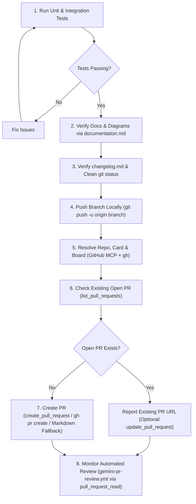

# Git Push & Pull Request Skill

## 1. Overview & Purpose

This skill defines the protocol for pushing code branches to the remote repository, validating quality gates, and checking, creating, updating, and inspecting Pull Requests (PRs) through **Official GitHub MCP (`github-official`)** with `gh` CLI and manual Markdown fallbacks.

Every Pull Request must strictly conform to the repository template at [.github/pull_request_template.md](../../../.github/pull_request_template.md) and fulfill all project quality gates prior to submission.

---

## 2. GitHub MCP Integration & Dual-Channel Strategy

`git-pull-request` uses the **Official GitHub MCP Server (`github-official`)** bundled inside the project-scoped **`nievo_ai` Docker MCP Gateway** (configured via `.agents/plugins/nievo/mcp_config.json` and `mcp_secrets.env` using `github.personal_access_token` — see the `setup` skill).

> [!NOTE]
> **Tool Name Versioning**: Official `github/github-mcp-server` tools may appear with consolidated names (`issue_read`, `pull_request_read`) or classic aliases (`get_issue`, `get_pull_request`, `get_pull_request_files`, `get_pull_request_reviews`, `get_pull_request_status`), and MCP clients may prefix them by server/plugin name (e.g., `nievo_nievo_ai`). Always invoke the exact registered GitHub MCP tool name present in the active runtime.

### 2.1 Channel Priority
1. **Channel 1 — Primary (Official GitHub MCP `github-official`)**: Remote branch checks, card/issue validation, duplicate PR guard, PR creation, PR body/title updates, and post-creation review/check inspection.
2. **Channel 2 — Complement & Fallback (GitHub CLI `gh`)**: Query GitHub Projects v2 (`gh api graphql` / `gh project list`) when the MCP `projects` toolset is unavailable, and act as full fallback (`gh repo view`, `gh issue view`, `gh pr list`, `gh pr create`, `gh pr edit`, `gh pr view`, `gh pr checks`) whenever GitHub MCP is unavailable or unauthenticated.
3. **Channel 3 — Manual Fallback**: If neither GitHub MCP nor `gh` is available or authenticated, report the connectivity/auth gap clearly (pointing to the `setup` skill and reminding the user to configure `github.personal_access_token` in `mcp_secrets.env` manually — **never** read `.env` or `mcp_secrets.env`), never fabricate PR/card URLs, and render the PR Title + formatted Markdown body in chat for manual creation on GitHub.

### 2.2 Capability-to-Tool Mapping

| Capability | Official GitHub MCP (`github-official`) | Complement / Fallback (`gh` or Local Git) | Purpose in `git-pull-request` |
| :--- | :--- | :--- | :--- |
| **Verify base & pushed head branches** | `list_branches` | `git ls-remote --heads origin` / `gh repo view --json defaultBranchRef` | Confirm `$BASE_BRANCH` (`develop`, or `main` for `hotfix/`) and pushed `$BRANCH` exist remotely. |
| **Validate linked issue / card** | `issue_read` / `get_issue` | `gh issue view <card> --json number,title,url,state` | Confirm issue exists and capture its number/URL for PR title and `Card :` line. |
| **Discover linked Project / Board** | MCP `projects` toolset (when enabled) | `gh api graphql` (`repository.projectsV2`) / `gh project list --owner "<owner>"` | Resolve real board URL dynamically without hardcoding. |
| **Duplicate PR guard (check open PR)** | `list_pull_requests` (`owner`, `repo`, `head: "<owner>:<branch>"`, `state: "open"`) | `gh pr list --head "<branch>" --state open --json number,url,title` | Prevent duplicate PRs for the same head branch. |
| **Create Pull Request** | `create_pull_request` (`owner`, `repo`, `title`, `head`, `base`, `body`, `draft`) | `gh pr create --base ... --head ... --title ... --body ...` | Open the Pull Request cleanly against `$BASE_BRANCH`. |
| **Update existing Pull Request** | `update_pull_request` (`owner`, `repo`, `pullNumber`, `title`, `body`) | `gh pr edit <number> --title ... --body ...` | Update title/body when an open PR already exists and needs refreshing. |
| **Inspect PR diff, reviews & checks** | `pull_request_read` (`get`, `get_files`, `get_reviews`, `get_review_comments`, `get_status`) or `get_pull_request*` | `gh pr view <number> --comments` and `gh pr checks <number>` | Inspect `gemini-pr-review.yml` feedback and CI status checks after creation. |

---

## 3. Pre-Push Quality Gate

Before pushing any branch or opening a PR, verify that all mandatory criteria are met:



1. **Automated Tests**:
   - Backend unit and integration tests must pass cleanly.
   - Frontend tests must execute without failures.
2. **Documentation, Diagrams & Postman Sync**:
   - Verify that affected diagrams (Class, Sequence, DBML, Use Case, Decision Flow) were updated or created under `Documentation/config/docs/` and any new/modified HTTP endpoints were synchronized via [postman.md](../documentation/postman/postman.md) (creation-only, without executing requests) as orchestrated by [documentation.md](../documentation/documentation.md).
3. **Changelog Updated**:
   - Verify [changelog.md](../../../changelog.md) contains an entry matching its format:
     `YYYY-MM-DD - [TYPE] - [GENERAL-DESCRIPTION]`
4. **Clean Git Diff**:
   - Inspect `git status --short` to ensure no untracked temp files, build caches, `.env`, or `mcp_secrets.env` files are accidentally committed.

---

## 4. Pushing Changes (Local Git Only)

Push your topic branch to the remote origin with upstream tracking (or delegate pre-push sync and `changelog.md` conflict handling to [push-request.md](./push-request.md) first):

```bash
# Push branch to remote repository
git push -u origin "<branch-name>"
```

> [!WARNING]
> Never use `git push --force` on shared branches, and **never** use GitHub MCP `push_files` or `create_or_update_file` as a substitute for `git push`. If working on a rebased personal topic branch, use `git push --force-with-lease origin "<branch-name>"`.

---

## 5. Pull Request Title & Description Template

When drafting or creating the Pull Request on GitHub, use the exact structure from [.github/pull_request_template.md](../../../.github/pull_request_template.md):

### 5.1 PR Title
Format the title using Conventional Commits / Karma syntax:
`<type>(<scope>): <summary of change> (#<card>)` *(omit `(#<card>)` when `N/A`)*

Example:
`feat(auth): implement refresh token rotation mechanism (#14)`

### 5.2 PR Body Template
Fill out all sections of [.github/pull_request_template.md](../../../.github/pull_request_template.md) (preserving all 11 checkboxes under `### Contain`):

```markdown
### Contain

- [x] Features
- [ ] Bugfix
- [ ] Change
- [x] Documentation
- [x] Test
- [ ] Refactor
- [ ] Performance
- [ ] Security
- [ ] Breaking change
- [ ] Rollback
- [ ] Other

### About

Brief summary explaining the rationale and scope of the changes.

### Add to document

- [x] Yes
- [ ] No

### Details

- Add refresh token rotation service and Redis store.
- Add unit and integration tests for token expiry and reuse detection.
- Update sequence diagram in Documentation/config/docs/api/endpoints/auth.md.
- Update changelog.md with feature record.

Card : <board-or-issue-url>
```

*(When linking a GitHub Issue directly, you may also include `Closes #<card>` or `Refs #<card>` below `Card : <board-or-issue-url>`.)*

---

## 6. Step-by-Step PR Execution Protocol via Official GitHub MCP

### Step A: Resolve Repository, Branches, Card & Board
1. Derive `<owner>` and `<repo>` from `git remote get-url origin` and `$BRANCH` from `git branch --show-current`.
2. Determine `$BASE_BRANCH`: `develop` when present in `list_branches` (fallback: `git branch -r`), `main` for `hotfix/` branches, or the repository's default branch if `develop` does not exist.
3. Validate any linked card (`issue_read` / `get_issue`, fallback `gh issue view`) and board URL (`projects` toolset if enabled, else `gh api graphql` / `gh project list`). Use `N/A` if none exists.

### Step B: Duplicate PR Guard (`list_pull_requests`)
Always check whether an open PR already exists for `$BRANCH` **before** attempting to create one:
- **Official GitHub MCP**: Call `list_pull_requests` with `owner: "<owner>"`, `repo: "<repo>"`, `head: "<owner>:<branch>"`, `state: "open"`.
- **Fallback (`gh`)**:
  ```bash
  gh pr list --head "$BRANCH" --state open --json number,url,title
  ```
- **If an open PR already exists**: Report its URL to the user and **do not** create a duplicate PR. Only call `update_pull_request` (fallback: `gh pr edit`) if the title/body needs updating.

### Step C: Create Pull Request (`create_pull_request`)
When no open PR exists for `$BRANCH`:
1. **Channel 1 — Official GitHub MCP (`create_pull_request`)**:
   Invoke `create_pull_request` with:
   - `owner`: `"<owner>"`
   - `repo`: `"<repo>"`
   - `title`: `"<pr-title>"`
   - `head`: `"<branch>"` *(or `"<fork-owner>:<branch>"` for fork PRs)*
   - `base`: `"<base-branch>"`
   - `body`: `"<assembled-pr-body>"`
   - `draft`: `false` *(set `true` only if explicitly requested by the user)*
2. **Channel 2 — Fallback (`gh` CLI)**:
   ```bash
   gh pr create --base "$BASE_BRANCH" --head "$BRANCH" --title "<pr-title>" --body "<assembled-pr-body>"
   ```
3. **Channel 3 — Manual Fallback**:
   If both GitHub MCP and `gh` fail authentication/connectivity, report the exact error clearly (pointing to `setup` / `mcp_secrets.env` without reading secrets) and print the PR Title + formatted Markdown body inside a fenced code block so the user can open the PR manually.

### Step D: Output PR URL & Formatted Markdown
Present the created (or existing) PR URL alongside the formatted PR Markdown summary.

---

## 7. Automated Review Pipeline

Once submitted, the PR triggers the automated review pipeline defined in [.github/workflows/gemini-pr-review.yml](../../../.github/workflows/gemini-pr-review.yml). The automated reviewer inspects:
- Adherence to SOLID principles and clean architecture.
- Exception handling and resource lifecycle management.
- SQL and database query performance.
- Presence of required unit/integration tests and documentation updates.

You can inspect review feedback, changed files, and CI check status directly via Official GitHub MCP (or `gh` fallback):
- **Official GitHub MCP**: `pull_request_read` (methods: `get`, `get_files`, `get_reviews`, `get_review_comments`, `get_status`) or classic aliases `get_pull_request`, `get_pull_request_files`, `get_pull_request_reviews`, `get_pull_request_status`.
- **Fallback (`gh`)**: `gh pr view <number> --comments` and `gh pr checks <number>`.

---

## 8. Critical Safety Rules

1. **Never Auto-Merge**: Never invoke `merge_pull_request` (or `gh pr merge`) unless the user explicitly instructs you to merge the PR.
2. **Never Bypass `git push` with MCP File Writes**: Never call `push_files` or `create_or_update_file` instead of local `git push -u origin <branch>`.
3. **Never Create Duplicate Open PRs**: Always run `list_pull_requests` (or `gh pr list`) before `create_pull_request`.
4. **Never Fabricate Metadata or Read Secrets**: Never invent card/board URLs when unauthenticated, and never read `.env` or `mcp_secrets.env`.

---

## 9. Verification Checklist

- [ ] All local tests pass and required documentation/diagrams (plus Postman MCP creation-only sync for changed endpoints) are updated before pushing.
- [ ] `changelog.md` is updated and `git status --short` is clean (no `.env` or `mcp_secrets.env` committed/staged).
- [ ] Branch pushed to remote with local `git push -u origin <branch-name>`.
- [ ] Open PR check executed via Official GitHub MCP `list_pull_requests` (or `gh pr list` fallback) to avoid duplicates.
- [ ] PR title adheres to Conventional Commits format and PR body matches all 11 checkboxes and sections of [.github/pull_request_template.md](../../../.github/pull_request_template.md).
- [ ] PR created via Official GitHub MCP `create_pull_request` (or `gh pr create` / manual Markdown fallback) and PR URL + Markdown summary presented to the user.
- [ ] No `merge_pull_request` executed without explicit user instruction and no `.env` / `mcp_secrets.env` files read.
