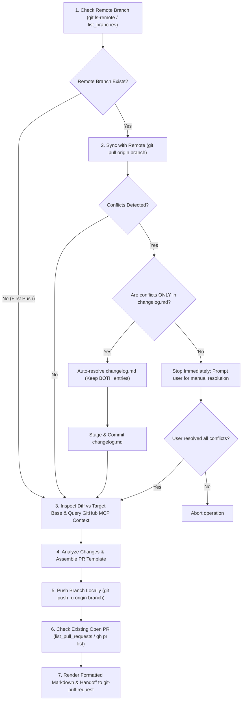

# Git Push Request Skill

## 1. Overview & Purpose

This skill defines the complete protocol for synchronizing the active topic branch, resolving upstream conflicts safely, validating remote branch/card/PR context via Official GitHub MCP (`github-official`), pushing changes to the remote repository, and assembling the formatted Pull Request (PR) markdown description based on the repository template [.github/pull_request_template.md](../../../.github/pull_request_template.md).

Unlike a basic push, this skill:
1. **Checks remote tracking and performs an initial pull/sync** when a remote branch already exists, avoiding out-of-sync errors.
2. **Automatically resolves conflicts exclusively in `changelog.md`**, ensuring entries from both the branch and upstream are fully preserved.
3. **Halts execution on conflicts in any other file**, delegating resolution strictly to the human user.
4. **Inspects the delta/diff against the destination branch** and validates card/board/existing-PR metadata via **Official GitHub MCP (`github-official`)** with `gh` CLI fallback.
5. **Populates the PR template** (`Contain`, `About`, `Add to document`, and `Details`).
6. **Pushes the branch** via local `git push -u origin "$BRANCH"`, checks whether an open PR already exists via GitHub MCP, and renders the ready-to-use PR markdown in chat (handing off new PR creation to [pull-request.md](./pull-request.md) when automated PR creation is part of the workflow).

---

## 2. GitHub MCP Compatibility & Local-vs-Remote Boundary

`git-push-request` integrates with the **Official GitHub MCP Server (`github-official`)** bundled in the project-scoped **`nievo_ai` Docker MCP Gateway** (configured via `.agents/plugins/nievo/mcp_config.json` and `mcp_secrets.env` — see the `setup` skill).

> [!NOTE]
> **Tool Name Versioning**: Official `github/github-mcp-server` tools may appear with consolidated names (`issue_read`, `pull_request_read`) or classic aliases (`get_issue`, `get_pull_request`), and MCP clients may prefix them by server/plugin name. Always invoke the exact registered GitHub MCP tool name in the active runtime.

### 2.1 Strict Local-vs-MCP Boundary
- **Must remain local Git CLI**:
  - `git ls-remote --heads origin "$BRANCH"`, `git pull origin "$BRANCH"`, `git status --porcelain`, conflict detection, automated `changelog.md` conflict resolution, halting on non-`changelog.md` conflicts, `git log` / `git diff`, and `git push -u origin "$BRANCH"`.
- **Strictly forbidden MCP anti-patterns**:
  - **NEVER** replace local `git push` with GitHub MCP `push_files` or `create_or_update_file` (doing so bypasses `git pull` conflict detection, local merge history, and local `.gitignore` protections).
  - **NEVER** read `.env` or `mcp_secrets.env`.

### 2.2 Capability-to-Tool Mapping

| Capability | Official GitHub MCP (`github-official`) | Complement / Fallback (`gh` or Local Git) | Purpose in `git-push-request` |
| :--- | :--- | :--- | :--- |
| **Confirm target base & remote branch existence** | `list_branches` | `git ls-remote --heads origin "$BRANCH"` / `git branch -r` | Verify `$BASE_BRANCH` (`develop` or `main`) and whether `$BRANCH` already exists on `origin`. |
| **Validate linked card / issue metadata** | `issue_read` / `get_issue` | `gh issue view <card> --json number,title,url,state` | Enrich `### About` and populate the real issue/card link when applicable. |
| **Discover Project / Board URL** | MCP `projects` toolset (when enabled) | `gh api graphql` (`repository.projectsV2`) / `gh project list --owner "<owner>"` | Resolve the real repository board URL dynamically (never hardcode personal project URLs). |
| **Check if an open PR already exists** | `list_pull_requests` (`owner`, `repo`, `head: "<owner>:<branch>"`, `state: "open"`) | `gh pr list --head "$BRANCH" --state open --json number,url,title` | Detect existing PR after push to prevent duplicates. |
| **Update existing PR or hand off creation** | `update_pull_request` (existing PR) / delegate `create_pull_request` to `git-pull-request` | `gh pr edit <number>` / `gh pr create` / formatted Markdown in chat | Sync PR body if an open PR already exists, or hand off to `git-pull-request` / manual paste. |

---

## 3. Push Request Workflow



---

## 4. Step-by-Step Execution Protocol

### Step 1: Check Remote Tracking & Pre-Push Synchronization (`git pull`)

Before any push or diff analysis, identify the active branch, repository slug, and whether the branch already exists on `origin` (`git ls-remote --heads origin "$BRANCH"` or Official GitHub MCP `list_branches`):

```bash
# Verify current branch name and repository remote
BRANCH=$(git branch --show-current)
git remote get-url origin

# Check if remote branch exists before pulling
if git ls-remote --exit-code --heads origin "$BRANCH" >/dev/null 2>&1; then
  git pull origin "$BRANCH"
fi
```

- If no remote branch exists yet (first push of a newly created topic branch), skip `git pull origin "$BRANCH"` and proceed to **Step 3**.
- If `git pull` succeeds cleanly with no conflicts, proceed immediately to **Step 3**.

---

### Step 2: Conflict Detection & Resolution Strategy

When `git pull` results in merge conflicts:

```bash
# Check status for unmerged paths
git status --porcelain
```

#### Case 2.1: Conflict ONLY in `changelog.md` (Automated Resolution)
If `git status --porcelain` indicates that **only** `changelog.md` has conflict markers (`UU changelog.md`):
1. Read `changelog.md`.
2. Locate the conflict region marked by `<<<<<<< HEAD`, `=======`, and `>>>>>>>`.
3. **Rule**: Both changes MUST be kept. Merge both sets of entries under `### Changelog`:
   - Combine the entries chronologically or append the new records without dropping any entry from either branch.
   - Remove the git conflict markers (`<<<<<<<`, `=======`, `>>>>>>>`).
4. Stage and commit the resolved changelog:
   ```bash
   git add changelog.md
   git commit -m "chore(changelog): resolve merge conflicts preserving all entries"
   ```
5. Continue with the workflow.

#### Case 2.2: Conflict in Any Other File (Mandatory Human Intervention)
If **any** file other than `changelog.md` has a conflict (e.g. source code, configuration, tests, documentation):
1. **DO NOT** attempt to guess or automatically resolve the conflict.
2. Stop the execution immediately.
3. List all conflicted files clearly to the user in the prompt.
4. Instruct the user to resolve the conflicts manually and notify the agent once resolved.
5. Only resume once the working tree is clean and `git status` shows no unresolved conflicts.

---

### Step 3: Diff Inspection & GitHub MCP Context Validation

Once the branch is synchronized and clean, determine `<owner>/<repo>` from `git remote get-url origin`, determine `$BASE_BRANCH` (`develop` when present, otherwise the repository's default branch via `list_branches` / `gh repo view`, or `main` for `hotfix/`), and inspect the delta introduced by the branch:

```bash
# Inspect commits ahead of target base branch
git log "origin/$BASE_BRANCH..HEAD" --oneline

# Inspect file modification statistics
git diff "origin/$BASE_BRANCH...HEAD" --stat --name-status
```

Also query **Official GitHub MCP (`github-official`)** (with `gh` fallback, or manual fallback if unauthenticated):
- Validate the associated card/issue (`issue_read` / `get_issue`, fallback `gh issue view`) if a card number is present in the branch name, commits, or `changelog.md`.
- Resolve the linked GitHub Project/Board URL via MCP `projects` toolset (if enabled) or `gh api graphql` / `gh project list --owner "<owner>"` (or `N/A` if none exists).

Analyze the commit messages, changed paths, and diff additions/deletions to identify:
- Which areas were touched (features, fixes, changes, tests, docs, build, refactor, perf, sec).
- Whether documentation or diagrams were added/updated.
- Specific functional items that were added, modified, or removed.

---

### Step 4: Assemble PR Template ([pull_request_template.md](../../../.github/pull_request_template.md))

Map the inspected changes into the exact four sections of [.github/pull_request_template.md](../../../.github/pull_request_template.md):

#### 4.1 Section `### Contain`
Mark with `[x]` all categories matching the template (`Features`, `Bugfix`, `Change`, `Documentation`, `Test`, `Refactor`, `Performance`, `Security`, `Breaking change`, `Rollback`, `Other`):
- `[x] Features`: If new user-facing or system capabilities were introduced (commits `feat(...)`).
- `[x] Bugfix`: If defects or erroneous behaviors were corrected (commits `fix(...)`).
- `[x] Change`: If existing behavior, skills, or configurations were altered.
- `[x] Documentation`: If files in `Documentation/`, `AI/`, `.agents/`, or `README.md` were modified.
- `[x] Test`: If unit, integration, or e2e test files were created or updated.
- `[x] Refactor`: If code was reorganized without changing behavior (commits `refactor(...)`).
- `[x] Performance`: If queries, caching, or execution speed were optimized (commits `perf(...)`).
- `[x] Security`: If security policies, credentials, or vulnerability fixes were applied.
- `[x] Breaking change`: If breaking changes or non-backwards-compatible updates were introduced.
- `[x] Rollback`: If changes were reverted (commits `revert(...)`).
- `[x] Other`: If maintenance tasks, chores, or environment files were touched.

#### 4.2 Section `### About`
Write a clear, concise summary (2–4 lines) explaining the purpose, scope, and technical justification of the PR.

#### 4.3 Section `### Add to document`
- Check `[x] Yes` if documentation, architecture pages, or diagrams (Mermaid, DBML) under `Documentation/` or `AI/` were created or updated.
- Check `[x] No` if the PR did not introduce architectural, endpoint, or business rule changes requiring documentation.

#### 4.4 Section `### Details`
Provide actionable, bulleted details categorized by action:
- `- Add ...` (for new features, classes, endpoints, skills, tests)
- `- Update ...` (for modified logic, documentation, configurations)
- `- Remove ...` (for deleted obsolete code, assets, or configs)
- Append `Card : <board-or-issue-url>` (or `Card : N/A` if no linked board or card exists).

---

### Step 5: Push Branch to Remote (Local Git Only)

Push the active branch to origin with upstream tracking:

```bash
git push -u origin "$BRANCH"
```

> [!WARNING]
> Never use `git push --force` on shared branches, and **never** replace `git push` with GitHub MCP `push_files` or `create_or_update_file`. If working on a rebased personal topic branch, use `git push --force-with-lease origin "$BRANCH"`.

---

### Step 6: Check Existing PR via GitHub MCP, Render Markdown & Handoff

After pushing:
1. Check whether an open Pull Request already exists for `$BRANCH`:
   - **Primary**: Official GitHub MCP `list_pull_requests` (`owner`, `repo`, `head: "<owner>:<branch>"`, `state: "open"`).
   - **Fallback**: `gh pr list --head "$BRANCH" --state open --json number,url,title`.
2. If an open PR already exists, report its URL and, if requested or needed, update its body via Official GitHub MCP `update_pull_request` (fallback: `gh pr edit <number> --body ...`).
3. If no open PR exists and automated PR creation is desired, hand off the assembled PR Title + Markdown Body to [pull-request.md](./pull-request.md) (`create_pull_request` / `gh pr create`).
4. Always output the filled markdown template directly into the chat inside a fenced markdown block for transparency and manual fallback:

````markdown
```markdown
### Contain

- [x] Features
- [ ] Bugfix
- [ ] Change
- [x] Documentation
- [x] Test
- [ ] Refactor
- [ ] Performance
- [ ] Security
- [ ] Breaking change
- [ ] Rollback
- [ ] Other

### About

Implement git-push-request skill providing automated sync, changelog conflict auto-resolution, and automated PR template generation from branch diff.

### Add to document

- [x] Yes
- [ ] No

### Details

- Add git-push-request skill in AI/GEMINI/skills/git/push-request.md.
- Add symlink in .agents/skills/git-push-request/SKILL.md.
- Update changelog.md with skill addition record.

Card : <board-or-issue-url>
```
````

---

## 5. Verification Checklist

Before completing the skill execution:

- [ ] Checked remote branch existence (`git ls-remote` / `list_branches`) and ran `git pull` when remote branch existed.
- [ ] If conflicts arose in `changelog.md`, resolved keeping all entries from both branches.
- [ ] If conflicts arose in any other file, stopped and requested manual resolution from the user.
- [ ] Inspected delta against target base branch using `git log` and `git diff`.
- [ ] Validated card/board context via Official GitHub MCP (`issue_read` / `get_issue`, `projects`) or `gh` fallback (or recorded `N/A` without fabricating URLs).
- [ ] All matching categories checked in `### Contain` matching [.github/pull_request_template.md](../../../.github/pull_request_template.md).
- [ ] Summary provided in `### About`, `### Add to document` accurately marked, and bullet points populated in `### Details`.
- [ ] Branch successfully pushed via local `git push -u origin <branch>` (never via MCP `push_files` / `create_or_update_file`).
- [ ] Checked for an existing open PR via Official GitHub MCP `list_pull_requests` (or `gh pr list` fallback) and rendered the formatted PR markdown in chat.
- [ ] Never read `.env` or `mcp_secrets.env`.
