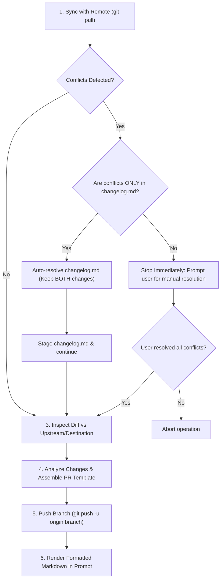

# Git Push Request Skill

## 1. Overview & Purpose

This skill defines the complete protocol for synchronizing the active topic branch, resolving upstream conflicts safely, pushing changes to the remote repository, and assembling the formatted Pull Request (PR) markdown description based on the repository template [.github/pull_request_template.md](../../../.github/pull_request_template.md).

Unlike a basic push, this skill:
1. **Performs an initial pull/sync** before pushing to avoid remote out-of-sync errors.
2. **Automatically resolves conflicts exclusively in `changelog.md`**, ensuring entries from both the branch and upstream are fully preserved.
3. **Halts execution on conflicts in any other file**, delegating resolution strictly to the human user.
4. **Inspects the delta/diff against the destination branch** to compute exactly what changed.
5. **Populates the PR template** (`Contain`, `About`, `Add to document`, and `Details`).
6. **Pushes the branch** and prints the ready-to-use PR markdown in the terminal/chat for the user to paste into GitHub.

---

## 2. Push Request Workflow



---

## 3. Step-by-Step Execution Protocol

### Step 1: Pre-Push Synchronization (`git pull`)

Before any push or diff analysis, synchronize the current branch with its upstream tracking branch:

```bash
# Verify current branch name
BRANCH=$(git branch --show-current)

# Pull latest remote changes
git pull origin "$BRANCH"
```

If the pull succeeds cleanly with no conflicts, proceed immediately to **Step 3**.

---

### Step 2: Conflict Detection & Resolution Strategy

When `git pull` results in merge conflicts:

```bash
# Check status for unmerged paths
git status --porcelain
```

#### Case 2.1: Conflict ONLY in `changelog.md` (Automated Resolution)
If `git status --porcelain` indicates that **only** `changelog.md` has conflict markers (`UU changelog.md`):
1. Read `changelog.md`.
2. Locate the conflict region marked by `<<<<<<< HEAD`, `=======`, and `>>>>>>>`.
3. **Rule**: Both changes MUST be kept. Merge both sets of entries under `### Changelog`:
   - Combine the entries chronologically or append the new records without dropping any entry from either branch.
   - Remove the git conflict markers (`<<<<<<<`, `=======`, `>>>>>>>`).
4. Stage the resolved changelog:
   ```bash
   git add changelog.md
   git commit -m "chore(changelog): resolve merge conflicts preserving all entries"
   ```
5. Continue with the workflow.

#### Case 2.2: Conflict in Any Other File (Mandatory Human Intervention)
If **any** file other than `changelog.md` has a conflict (e.g. source code, configuration, tests, documentation):
1. **DO NOT** attempt to guess or automatically resolve the conflict.
2. Stop the execution immediately.
3. List all conflicted files clearly to the user in the prompt.
4. Instruct the user to resolve the conflicts manually and notify the agent once resolved.
5. Only resume once the working tree is clean and `git status` shows no unresolved conflicts.

---

### Step 3: Diff Inspection Against Destination / Upstream

Once the branch is synchronized and clean, determine the delta introduced by the branch:

```bash
# Inspect commits ahead of upstream
git log @{u}..HEAD --oneline
# Or against the target base branch (e.g., origin/develop or origin/main):
git log origin/develop..HEAD --oneline

# Inspect file modification statistics
git diff @{u}..HEAD --stat
# Or against target base branch:
git diff origin/develop...HEAD --stat --name-status
```

Analyze the commit messages, changed paths, and diff additions/deletions to identify:
- Which areas were touched (features, fixes, tests, docs, build, refactor).
- Whether documentation or diagrams were added/updated.
- Specific functional items that were added, modified, or removed.

---

### Step 4: Assemble PR Template ([pull_request_template.md](../../../.github/pull_request_template.md))

Map the inspected changes into the four sections of the template:

#### 4.1 Section `### Contain`
Mark with `[x]` all categories that correspond to the changes found in the diff:
- `[x] Features`: If new user-facing or system capabilities were introduced (commits `feat(...)`).
- `[x] Bugfix`: If defects or erroneous behaviors were corrected (commits `fix(...)`).
- `[x] Change`: If existing behavior or configurations were altered.
- `[x] Documentation`: If files in `Documentation/`, `AI/`, `.agents/skills/`, or `README.md` were modified.
- `[x] Test`: If unit, integration, or e2e test files were created or updated.
- `[x] Refactor`: If code was reorganized without changing behavior (commits `refactor(...)`).
- `[x] Performance`: If queries, caching, or execution speed were optimized (commits `perf(...)`).
- `[x] Security`: If security policies, credentials, or vulnerability fixes were applied.
- `[x] Breaking change`: If breaking changes or non-backwards-compatible updates were introduced.
- `[x] Rollback`: If changes were reverted (commits `revert(...)`).
- `[x] Other`: If maintenance tasks, chores, or environment files were touched.

#### 4.2 Section `### About`
Write a clear, concise summary (2–4 lines) explaining the purpose, scope, and technical justification of the PR.

#### 4.3 Section `### Add to document`
- Check `[x] Yes` if documentation, architecture pages, or diagrams (Mermaid, DBML) under `Documentation/` or `AI/` were created or updated.
- Check `[x] No` if the PR did not introduce architectural, endpoint, or business rule changes requiring documentation.

#### 4.4 Section `### Details`
Provide actionable, bulleted details categorized by action:
- `- Add ...` (for new features, classes, endpoints, skills, tests)
- `- Update ...` (for modified logic, documentation, configurations)
- `- Remove ...` (for deleted obsolete code, assets, or configs)

---

### Step 5: Push Branch to Remote

Push the active branch to origin with upstream tracking:

```bash
git push -u origin "$BRANCH"
```

> [!WARNING]
> Never use `git push --force` on shared branches. If working on a rebased topic branch, use `git push --force-with-lease origin "$BRANCH"`.

---

### Step 6: Render PR Markdown in the User Prompt

After pushing, output the filled markdown template directly into the prompt/chat, enclosed in a markdown code block so the user can easily copy and paste it into GitHub:

````markdown
```markdown
### Contain

- [x] Features
- [ ] Bugfix
- [x] Documentation
- [x] Test
- [ ] Refactor
- [ ] Performance
- [ ] Security
- [ ] Breaking change
- [ ] Rollback
- [ ] Other

### About

Implement git-push-request skill providing automated sync, changelog conflict auto-resolution, and automated PR template generation from branch diff.

### Add to document

- [x] Yes
- [ ] No

### Details

- Add git-push-request skill in AI/GEMINI/skills/git/push-request.md.
- Add symlink in .agents/skills/git-push-request/SKILL.md.
- Update changelog.md with skill addition record.

Card : https://github.com/users/pedrovotf/projects/6/views/1
```
````

---

## 4. Verification Checklist

Before completing the skill execution:

- [ ] `git pull` executed prior to any push.
- [ ] If conflicts arose in `changelog.md`, resolved keeping all entries from both branches.
- [ ] If conflicts arose in any other file, stopped and requested manual resolution from the user.
- [ ] Inspected delta against upstream/target branch using `git log` and `git diff`.
- [ ] All matching categories checked in `### Contain`.
- [ ] Summary provided in `### About`.
- [ ] `### Add to document` accurately marked (`Yes` or `No`).
- [ ] Specific bullet points populated in `### Details`.
- [ ] Branch successfully pushed with `git push -u origin <branch>`.
- [ ] Fully formatted markdown template displayed in the prompt for the user.
