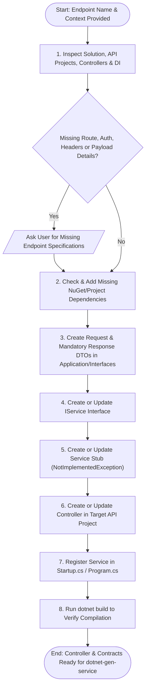

# .NET Controller Generator Skill

## 1. Overview & Purpose

This skill defines the standard workflow for generating or extending **.NET Web API Controllers**, along with their required **Request/Response contracts**, **Service interface definitions**, **Dependency Injection (DI) / package dependencies**, and **unimplemented Service stubs**.

Controllers in NIEVO `.NET` backends are thin HTTP adapters: they handle routing, authorization attributes, OpenAPI metadata, claim/header extraction into Request DTOs, and delegate execution directly to an `I<Context>Service` method.

> [!IMPORTANT]
> **Two Mandatory Rules**:
> 1. **Mandatory Service Stub Rule (`NotImplementedException`)**:
>    Whenever a new endpoint establishes a link between a Controller and a Service (`I<Context>Service`), this skill **MUST** add the corresponding method signature to the Service interface AND create (if missing) or update the concrete Service class with a generic stub method that throws `new NotImplementedException();`.
>    Business logic implementation belongs exclusively to `dotnet-gen-service` ([dotnet-gen-service.md](./dotnet-gen-service.md)).
> 2. **Mandatory Response Contract on Every Endpoint**:
>    Every endpoint scaffolded by this skill **MUST ALWAYS** create a dedicated Response DTO contract in `Application/Interfaces/Response/<Verb><Action>Response.cs` (for data payloads, paginated item responses wrapped in `ResponsePaginationBase<<Verb><Action>Response>`, and confirmation/status endpoints alike). Never leave an endpoint without an explicit Response contract.

---

## 2. Controller Scaffolding Workflow



### Step 1: Collect Inputs & Inspect Project Structure
Require at minimum the **endpoint name** and **context/domain** from the user. Then inspect the solution (`.slnx`/`.sln`), target Web API projects (e.g., `Core`, `Auth`), `Startup.cs`/`Program.cs`, existing controllers, `Application/Interfaces/{Request,Response,Services}`, and `Application/Services/Base/`.

If any of the following are unclear from context, ask the user before scaffolding:
- **Target API Project**: e.g., `NievoEasyFin.Core` vs `NievoEasyFin.Auth` (or equivalent microservice project).
- **Visibility Scope & API Version**: `Public`, `Private`, or `Admin`, and version segment (default `v1`).
- **HTTP Verb & Route**: e.g., `[HttpGet("status")]`, `[HttpPost("")]`, `[HttpPatch("reset")]`.
- **Authorization & Headers/Claims**: `[Authorize]` (requires `[FromHeader] string authorization` and JWT claim extraction via `JsonWebTokenService.GetClaimValue(authorization, "email")`) vs `[AllowAnonymous]` (optionally `[FromHeader(Name = "User-Agent")]` / `[FromHeader(Name = "Host")]`).
- **Request & Response Shape**: Query/body fields, pagination (`PaginationRequestBase` or `PaginationClaimRequestBase`), or claim-only (`ClaimRequestBase`), plus expected response fields.

### Step 2: Dependencies & Packages
- Verify whether the target `.csproj` already references `Application`, `Microsoft.AspNetCore.Authentication.JwtBearer`, `Swashbuckle.AspNetCore`, or any newly required dependency.
- Add missing `<PackageReference>` or `<ProjectReference>` entries only when strictly required by the new endpoint.

### Step 3: Create Contracts (`Request` & Mandatory `Response`)
1. **Request DTO** (`Application/Interfaces/Request/<Verb><Action>Request.cs`):
   - Inherit `ClaimRequestBase` when authenticated user email claim is injected by the controller.
   - Inherit `PaginationRequestBase` for paginated queries, or `PaginationClaimRequestBase` for authenticated paginated queries.
   - Annotate JSON properties with `[JsonPropertyName("snake_case")]` and query parameters with `[FromQuery(Name = "snake_case")]`.
   - Include XML summary documentation on class and properties.
2. **Mandatory Response DTO** (`Application/Interfaces/Response/<Verb><Action>Response.cs`):
   - **ALWAYS** create `<Verb><Action>Response.cs` for **every** endpoint, regardless of HTTP verb or whether it returns domain data, a paginated list, or a status/confirmation message.
   - Annotate all properties with `[JsonPropertyName("snake_case")]` and XML summary documentation.
   - Standardize API envelopes using `ResponseApiSucess` and `ResponseApiError` in `[ProducesResponseType]` attributes, where `ResponseApiSucess.Data` holds `<Verb><Action>Response` (or `ResponsePaginationBase<<Verb><Action>Response>` for paginated endpoints).

#### Typed Data / Paginated Response Example:
```csharp
using System.Text.Json.Serialization;
using <RootNamespace>.Application.Data.Views;

namespace <RootNamespace>.Application.Interfaces.Response;

/// <summary>
/// Response contract for <Verb><Action>.
/// </summary>
public class <Verb><Action>Response
{
    public <Verb><Action>Response() { }

    public <Verb><Action>Response(<Domain>View view)
    {
        Id = view.Id;
        Name = view.Name;
    }

    /// <summary>
    /// Identifier
    /// </summary>
    [JsonPropertyName("id")]
    public int Id { get; set; }

    /// <summary>
    /// Name
    /// </summary>
    [JsonPropertyName("name")]
    public string Name { get; set; }
}
```

#### Confirmation / Status Response Example (carrying Enum ID + Message):
```csharp
using System.Text.Json.Serialization;
using <RootNamespace>.Application.Extensions.Enum;

namespace <RootNamespace>.Application.Interfaces.Response;

/// <summary>
/// Response contract for <Verb><Action> operation status.
/// </summary>
public class <Verb><Action>Response
{
    /// <summary>
    /// Numeric identifier of the enum entry.
    /// </summary>
    [JsonPropertyName("code")]
    public int Code { get; set; }

    /// <summary>
    /// Human-readable confirmation message.
    /// </summary>
    [JsonPropertyName("message")]
    public string Message { get; set; }

    public <Verb><Action>Response() { }

    public <Verb><Action>Response(System.Enum enumValue)
    {
        Code = Convert.ToInt32(enumValue);
        Message = enumValue.GetDescription();
    }
}
```

### Step 4: Create or Update Service Interface
Create (if missing) or update `Application/Interfaces/Services/I<Context>Service.cs` (or split `IPublic<Context>Service` / `IPrivate<Context>Service` when a domain separates public and private endpoints):

```csharp
using Microsoft.AspNetCore.Mvc;
using <RootNamespace>.Application.Interfaces.Request;

namespace <RootNamespace>.Application.Interfaces.Services;

/// <summary>
/// Interface for <context> services, handling <context> operations.
/// </summary>
public interface I<Context>Service
{
    /// <summary>
    /// <Concise summary of the endpoint operation.>
    /// </summary>
    /// <param name="request"><Verb><Action>Request</param>
    Task<IActionResult> <MethodName>(<Verb><Action>Request request);
}
```

### Step 5: Create or Update Concrete Service Stub (`NotImplementedException`)
Whenever a controller delegates to a service method, create `Application/Services/Base/<Context>Service.cs` (if it does not exist) or append the new method to it, throwing `NotImplementedException`:

```csharp
using Microsoft.AspNetCore.Mvc;
using <RootNamespace>.Application.Interfaces.Request;
using <RootNamespace>.Application.Interfaces.Services;

namespace <RootNamespace>.Application.Services.Base;

/// <summary>
/// Service responsible for <context> operations.
/// </summary>
public class <Context>Service : Controller, I<Context>Service
{
    /// <summary>
    /// <Concise summary of the endpoint operation.>
    /// </summary>
    /// <param name="request"><Verb><Action>Request</param>
    /// <returns>An <see cref="IActionResult"/> representing the operation outcome.</returns>
    public Task<IActionResult> <MethodName>(<Verb><Action>Request request)
    {
        throw new NotImplementedException();
    }
}
```

### Step 6: Create or Update the Controller
Create `<ApiProject>/Controllers/<Scope>/v1/<Context>Controller.cs` (if missing) or add the endpoint action to the existing controller:
- Namespace convention: `<ApiProject>.Controllers.<Scope>` (e.g., `NievoEasyFin.Core.Controllers.Public`).
- Route convention: `[Route("api/<scope_lower>/v1/[controller]")]` (e.g., `[Route("api/public/v1/[controller]")]`).
- Class attributes: `[ApiController]`, inheriting `Controller`.
- Constructor injection: `I<Context>Service` (and `JsonWebTokenService` when `[Authorize]` extracts JWT claims).
- Action attributes: `[Http<Verb>("<subroute>")]`, `[Authorize]` or `[AllowAnonymous]`, `[ProducesResponseType(typeof(ResponseApiSucess), StatusCodes.Status200OK)]` (or `201Created`), `[ProducesResponseType(typeof(ResponseApiError), StatusCodes.Status400BadRequest)]`.
- Action body: extract claims/headers onto `request` when required and immediately return `await _<context>Service.<MethodName>(request);`. Never place validation or business logic inside the controller.

```csharp
using Microsoft.AspNetCore.Authorization;
using Microsoft.AspNetCore.Mvc;
using <RootNamespace>.Application.Interfaces.Request;
using <RootNamespace>.Application.Interfaces.Response;
using <RootNamespace>.Application.Interfaces.Services;
using <RootNamespace>.Application.Services.Security;

namespace <ApiProject>.Controllers.<Scope>;

/// <summary>
/// Controller responsible for <context> operations.
/// </summary>
[ApiController]
[Route("api/<scope_lower>/v1/[controller]")]
public class <Context>Controller : Controller
{
    private readonly I<Context>Service _<context>Service;
    private readonly JsonWebTokenService _jsonWebTokenService;

    public <Context>Controller(I<Context>Service <context>Service, JsonWebTokenService jsonWebTokenService)
    {
        _<context>Service = <context>Service;
        _jsonWebTokenService = jsonWebTokenService;
    }

    /// <summary>
    /// <Concise endpoint summary.>
    /// </summary>
    /// <param name="authorization">Token JWT</param>
    /// <param name="request"><Verb><Action>Request</param>
    /// <returns>IActionResult</returns>
    [HttpPost("<subroute>")]
    [Authorize]
    [ProducesResponseType(typeof(ResponseApiSucess), StatusCodes.Status201Created)]
    [ProducesResponseType(typeof(ResponseApiError), StatusCodes.Status400BadRequest)]
    public async Task<IActionResult> <MethodName>(
        [FromHeader] string authorization,
        [FromBody] <Verb><Action>Request request)
    {
        request.SetEmail(
            await _jsonWebTokenService.GetClaimValue(authorization, "email")
        );
        return await _<context>Service.<MethodName>(request);
    }
}
```

### Step 7: Register Service in DI Container
In `<ApiProject>/Startup.cs` (inside `ConfigureServices`), register any newly created service interface/implementation:
```csharp
services.AddScoped<I<Context>Service, <Context>Service>();
```

### Step 8: Build Verification
Run `dotnet build` against the backend solution/project and confirm zero build errors.

---

## 3. Next Workflow Steps

- Implement the service business rules and validation using `dotnet-gen-service` ([dotnet-gen-service.md](./dotnet-gen-service.md)), which must strictly honor the generated `<Verb><Action>Response` contract.
- Once both Controller and Service are implemented, generate controller and service tests using `dotnet-gen-test` ([dotnet-gen-test.md](./dotnet-gen-test.md)).
- Update API sequence diagrams in documentation following [sequence-diagram.md](../../documentation/mermaid/sequence-diagram.md).

---

## 4. Verification Checklist

- [ ] Controller placed in `<ApiProject>/Controllers/<Scope>/v1/<Context>Controller.cs` with `[ApiController]` and `[Route("api/<scope_lower>/v1/[controller]")]`.
- [ ] Request DTO created/updated and dedicated Response contract (`Application/Interfaces/Response/<Verb><Action>Response.cs`) **always** created for the endpoint with XML doc comments and `[JsonPropertyName]` attributes.
- [ ] Service interface `I<Context>Service` updated/created with matching async `Task<IActionResult>` signature.
- [ ] Concrete `<Context>Service` stub created/updated throwing `NotImplementedException` (no business logic implemented here).
- [ ] DI registration added to `Startup.cs` and any required NuGet/project references added.
- [ ] `dotnet build` succeeds cleanly.
