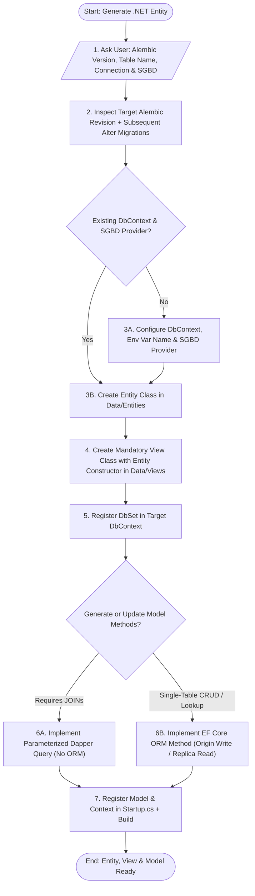

# .NET Entity, View & Data Access Generator Skill

## 1. Overview & Purpose

This skill defines the interactive workflow and standards for creating **.NET Entities**, **mandatory Entity Views**, **DbContext/Connection configurations**, and **Model data-access methods** from existing database migrations.

> [!IMPORTANT]
> **Four Non-Negotiable Rules**:
> 1. **Mandatory Interactive Inputs**: Always ask the user for the **Alembic revision/version**, **target table name**, **database connection**, and **SGBD** before generating code.
> 2. **Mandatory View with Entity Constructor**: Whenever an Entity is generated, **ALWAYS** generate a corresponding View class whose constructor receives the Entity itself (plus a parameterless constructor for Dapper/serialization).
> 3. **ORM vs Non-ORM (Dapper) Split**: When a query or business rule requires `JOIN`s, **DO NOT use ORM** (no EF Core `.Include()` or LINQ `.Join()`)—use parameterized **Dapper** SQL mapped to a View. When no `JOIN` is needed (single-table CRUD/lookups), **ALWAYS prefer ORM (EF Core)**.
> 4. **Default `active = true` Filtering**: Every read query (both EF Core ORM and Dapper SQL, including joined tables that have an `active` column) **MUST** always filter by `active = true` by default, unless the business rule explicitly specifies querying `active = false` (or explicitly requests inactive/all records).

---

## 2. Entity & Data-Layer Generation Workflow



### Step 1: Mandatory Interactive Discovery
Before writing any C# file, **always ask the user** (for any item not already explicitly provided):
1. **Alembic Version / Revision**: Which Alembic revision ID or migration file defines the table (e.g., `05dfe2dffece`)?
2. **Table Name & Schema**: Exact table name and schema (e.g., `payment.transaction`).
3. **Database Connection**: Which connection/context should own this entity (e.g., existing `CoreOrigin`/`CoreReplica`, `AuthOrigin`/`AuthReplica`, or a new connection string environment variable)?
4. **SGBD**: Which database management system is targeted (`PostgreSQL`, `SQL Server`, `MySQL`, `ClickHouse`, `Redis`, `SQLite`, etc.)?
5. **Model & Queries Needed**: Whether to generate/update a Model class in `Application/Models/` and whether any queries require `JOIN`s.

### Step 2: Inspect Alembic Migration Chain
1. Read the specified Alembic revision file in `<Service>/alembic/versions/` to extract exact column names, SQL types, primary key, nullability, defaults, and schema.
2. Scan **subsequent** migrations in chronological/revision order for any `ALTER TABLE` statements adding columns or constraints to the same table (e.g., a later migration adding `transaction_situation_id`), so the C# Entity matches the current schema state.
3. Never read `.env` files; inspect only `env-example.txt` / `.env-example` to verify connection string variable names.

---

## 3. Entity & View Standards

### 3.1 SQL-to-C# Type Mapping Reference

| PostgreSQL / SQL Type | SGBD Alternatives | C# Property Type | `[Column(..., TypeName = "...")]` |
| :--- | :--- | :--- | :--- |
| `SERIAL` / `INT` / `INTEGER` | `INT IDENTITY` / `INT` | `int` (or `int?`) | `"SERIAL"` / `"INT"` |
| `BIGSERIAL` / `BIGINT` | `BIGINT` | `long` (or `long?`) | `"BIGINT"` |
| `UUID` | `UNIQUEIDENTIFIER` / `CHAR(36)` | `Guid` (or `Guid?`) | `"Guid"` / `"UUID"` |
| `VARCHAR(n)` / `TEXT` | `NVARCHAR(n)` | `string` (or `string?`) | `"VARCHAR(n)"` |
| `BOOLEAN` / `BOOL` | `BIT` / `TINYINT(1)` | `bool` | `"BOOLEAN"` |
| `DECIMAL` / `NUMERIC` | `DECIMAL(p,s)` | `Decimal` (or `Decimal?`) | `"DECIMAL"` |
| `TIMESTAMP` / `DATETIME` | `DATETIME2` / `DATETIME` | `DateTime` (or `DateTime?`) | `"TIMESTAMP"` |
| `JSONB` / `JSON` | `NVARCHAR(MAX)` / `JSON` | `object?` / `string?` | `"JSONB"` |

### 3.2 Entity Class Template (`Application/Data/Entities/<Name>Entity.cs`)
- Apply `[Table("<table_name>", Schema = "<schema>")]`.
- Apply `[Key]`, `[JsonPropertyName("<snake_case_col>")]`, and `[Column("<snake_case_col>", TypeName = "<SQL_TYPE>")]` on every property.
- Include the mandatory audit columns (`Active`, `CreatedAt`, `UpdatedAt`).
- Add XML `<summary>` doc comments to the class and every property.

```csharp
using System.ComponentModel.DataAnnotations;
using System.ComponentModel.DataAnnotations.Schema;
using System.Text.Json.Serialization;

namespace <RootNamespace>.Application.Data.Entities;

/// <summary>
/// <Name> entity
/// </summary>
[Table("<table_name>", Schema = "<schema>")]
public class <Name>Entity
{
    /// <summary>
    /// Id
    /// </summary>
    [JsonPropertyName("id")]
    [Key]
    [Column("id", TypeName = "SERIAL")]
    public int Id { get; set; }

    /// <summary>
    /// Name
    /// </summary>
    [JsonPropertyName("name")]
    [Column("name", TypeName = "VARCHAR(150)")]
    public string Name { get; set; }

    /// <summary>
    /// Active
    /// </summary>
    [JsonPropertyName("active")]
    [Column("active", TypeName = "BOOLEAN")]
    public bool Active { get; set; }

    /// <summary>
    /// Created at
    /// </summary>
    [JsonPropertyName("created_at")]
    [Column("created_at", TypeName = "TIMESTAMP")]
    public DateTime CreatedAt { get; set; }

    /// <summary>
    /// Updated at
    /// </summary>
    [JsonPropertyName("updated_at")]
    [Column("updated_at", TypeName = "TIMESTAMP")]
    public DateTime? UpdatedAt { get; set; }
}
```

### 3.3 Mandatory View Class Template (`Application/Data/Views/<Name>View.cs`)
Whenever an Entity is generated, **always** create `<Name>View.cs` containing:
1. A parameterless constructor `public <Name>View() { }` (required by Dapper materialization and serializers).
2. A constructor accepting `<Name>Entity` (`public <Name>View(<Name>Entity entity)`) mapping entity fields to view properties.
3. `[JsonPropertyName("snake_case")]` attributes on public fields and `[JsonIgnore] public int Records { get; set; }` for paginated window counts.

```csharp
using System.Text.Json.Serialization;
using <RootNamespace>.Application.Data.Entities;

namespace <RootNamespace>.Application.Data.Views;

/// <summary>
/// View for <Name>
/// </summary>
public class <Name>View
{
    /// <summary>
    /// Default constructor
    /// </summary>
    public <Name>View() { }

    /// <summary>
    /// Constructor from entity
    /// </summary>
    /// <param name="entity"><Name>Entity</param>
    public <Name>View(<Name>Entity entity)
    {
        Id = entity.Id;
        Name = entity.Name;
        Active = entity.Active;
        CreatedAt = entity.CreatedAt;
        UpdatedAt = entity.UpdatedAt;
    }

    /// <summary>
    /// Id
    /// </summary>
    [JsonPropertyName("id")]
    public int Id { get; set; }

    /// <summary>
    /// Name
    /// </summary>
    [JsonPropertyName("name")]
    public string Name { get; set; }

    /// <summary>
    /// Active
    /// </summary>
    [JsonPropertyName("active")]
    public bool Active { get; set; }

    /// <summary>
    /// Created at
    /// </summary>
    [JsonPropertyName("created_at")]
    public DateTime CreatedAt { get; set; }

    /// <summary>
    /// Updated at
    /// </summary>
    [JsonPropertyName("updated_at")]
    public DateTime? UpdatedAt { get; set; }

    /// <summary>
    /// Total records for paginated queries
    /// </summary>
    [JsonIgnore]
    public int Records { get; set; }
}
```

---

## 4. DbContext, Connection & SGBD Configuration

1. **Existing DbContext**: Add `public DbSet<<Name>Entity> <Name> { get; set; }` to the base DbContext (e.g., `EasyFinDbContext`), and ensure both `*Origin` and `*Replica` contexts inherit it.
2. **New Connection / SGBD**:
   - Follow Origin (read-write) and Replica (read-only) context separation when applicable.
   - Load connection strings via `DotNetEnv.Env.GetString("<ENV_VAR_NAME>")` (never hardcode secrets; add placeholder key to `env-example.txt`).
   - Configure the SGBD-specific provider inside `OnConfiguring` (e.g., `optionsBuilder.UseNpgsql(connectionString)` for PostgreSQL, `UseSqlServer(...)` for SQL Server, `UseMySql(...)` for MySQL, or dedicated client contexts for ClickHouse/Redis).
   - Register the DbContext in `Startup.cs` via `services.AddDbContext<<ContextClass>>();`.

---

## 5. Model Data-Access Rules (ORM vs Dapper)

Models inherit the Entity (`public class <Name>Model : <Name>Entity`) and inject both `*Origin` and `*Replica` contexts.

> [!IMPORTANT]
> **Mandatory Default `active = true` Filtering**:
> All read queries in Models (single-table EF Core ORM and multi-table Dapper queries, across both the primary table and any joined tables that contain an `active` column) **MUST** always filter by `active = true` by default.
> Querying `active = false` (or omitting the `active` filter to include inactive records) is **only** permitted when explicitly specified by the business rule.

### 5.1 Single-Table Operations (NO `JOIN`s) — Always Prefer ORM
Use EF Core (`*Origin` for writes, `*Replica` for reads), enforcing `x.Active == true` on reads unless `active = false` is explicitly required:

```csharp
public async Task<<Name>Entity?> GetByIdAsync(int id)
    => await _ReplicaDatabase.<Name>.FirstOrDefaultAsync(x => x.Id == id && x.Active == true);

public async Task<<Name>Entity> CreateAsync(string name)
{
    <Name>Entity entity = new()
    {
        Name = name,
        Active = true,
        CreatedAt = DateTime.Now,
        UpdatedAt = DateTime.Now
    };

    await _OriginDatabase.<Name>.AddAsync(entity);
    await _OriginDatabase.SaveChangesAsync();
    return entity;
}
```

### 5.2 Multi-Table / `JOIN` Queries — NEVER Use ORM (Use Dapper)
When a query requires `JOIN`s (or complex window pagination), **do not** use EF Core `.Include()` or LINQ `.Join()`. Use parameterized raw SQL with **Dapper** against `_ReplicaDatabase.Database.GetDbConnection()`, enforcing `active = true` on the primary and joined tables (unless `active = false` is explicitly requested by the business rule), and map directly to `<Name>View`:

```csharp
public async Task<(List<<Name>View>, int)> GetPaginatedWithJoinAsync(int page, int pageSize, int userId)
{
    List<<Name>View> items = new();
    StringBuilder query = new();
    DynamicParameters parameters = new();

    query.Append(@"
        SELECT
            t.id AS Id,
            t.name AS Name,
            t.active AS Active,
            t.created_at AS CreatedAt,
            t.updated_at AS UpdatedAt,
            COUNT(*) OVER() AS Records
        FROM <schema>.<table_name> t
            INNER JOIN <other_schema>.<other_table> o
                ON t.other_id = o.id
        WHERE t.user_id = @userId
          AND t.active = true
          AND o.active = true
        ORDER BY t.id
        LIMIT @limit
        OFFSET @offset
    ");

    parameters.Add("userId", userId);
    parameters.Add("limit", pageSize);
    parameters.Add("offset", (page - 1) * pageSize);

    var connection = _ReplicaDatabase.Database.GetDbConnection();
    items.AddRange(await connection.QueryAsync<<Name>View>(query.ToString(), parameters));

    int records = items.Any() ? items.FirstOrDefault()!.Records : 0;
    return (items, records);
}
```

> [!CAUTION]
> Always parameterize every dynamic filter using `DynamicParameters`. Never concatenate user input directly into SQL strings.

### 5.3 Register Model in DI
Add `services.AddScoped<<Name>Model>();` in `Startup.cs`.

---

## 6. Verification Checklist

- [ ] Asked user for Alembic version, table name, database connection, and SGBD (and confirmed column/alter chain).
- [ ] Entity matches Alembic DDL (`[Table]`, `[Column]`, `[Key]`, `[JsonPropertyName]`, nullability, audit fields).
- [ ] Mandatory View created with both parameterless constructor and `public <Name>View(<Name>Entity entity)` constructor.
- [ ] `DbSet<<Name>Entity>` added to DbContext and connection/SGBD provider configured (using `env-example.txt` only for env var reference).
- [ ] Model uses EF Core ORM for single-table operations and Dapper (never ORM) for any query requiring `JOIN`s.
- [ ] All read queries (EF Core ORM and Dapper, including joined tables with an `active` column) enforce `active = true` by default unless `active = false` (or unfiltered) is explicitly specified by business rules.
- [ ] Model registered in `Startup.cs` and `dotnet build` passes cleanly.
