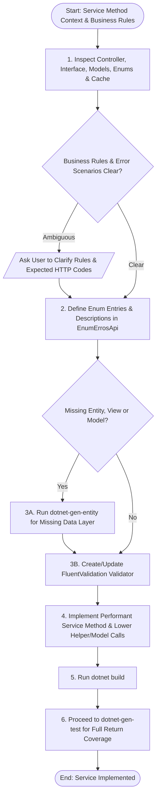

# .NET Service Implementation Skill

## 1. Overview & Purpose

This skill defines the standards and workflow for implementing business logic inside **.NET Service classes** (`Application/Services/Base/<Context>Service.cs`).

Implementations must prioritize **maximum runtime performance**, strictly enforce **business-rule-driven Enum scenarios**, return **structured payloads containing both the numeric Enum ID and message**, and **complement missing lower-layer components or downstream artifacts** (Entities/Views/Models, Validators, Cache helpers, and Tests) whenever required.

> [!IMPORTANT]
> **Mandatory Return Structure (Numeric Enum ID + Message)**:
> Every handled return produced by a Service (validation errors, business-rule errors, and handled status/confirmation returns) **MUST** expose both:
> 1. **Numeric Enum ID**: `(int)enumValue`
> 2. **Message**: `enumValue.GetDescription()`
>
> Example JSON item inside `ResponseApiError.Messages` or `ResponseApiSucess.Data`:
> ```json
> { "code": 102, "message": "Not found any user with this identification." }
> ```

---

## 2. Service Implementation Workflow



### Step 1: Inspect Existing Components & Clarify Rules
1. Locate and inspect:
   - Service interface (`Interfaces/Services/I<Context>Service.cs`) and stub (`Services/Base/<Context>Service.cs`)
   - Request/Response contracts (`Interfaces/Request/`, `Interfaces/Response/`)
   - `Interfaces/Enum/EnumErrosApi.cs` and `Extensions/EnumExtensions.cs`
   - Existing Models (`Application/Models/`), Cache services (`Services/Cache/`), and `Startup.cs`
2. If any business rule, boundary condition, or HTTP status code is ambiguous, ask the user before writing code.

### Step 2: Business Rules Define Enum & Error Scenarios
Every validation check, error path, and handled success confirmation is driven strictly by the business rules and must be registered in `Application/Interfaces/Enum/EnumErrosApi.cs`:
- Group entries under `#region <MethodName> ... #endregion`.
- Follow the naming convention: `<ENDPOINT>_<SERVICE>_<HTTP_STATUS>_<ERROR_OR_STATUS_NAME>` (e.g., `POSTPAYMENTTRANSACTIONASYNC_CORESERVICE_404_USER_NOT_FOUND`).
- Add XML `<summary>` documentation and `[Description("...")]` attribute on **every** enum member so `GetDescription()` always returns a clear human-readable message.
- Keep existing enum numeric ordering stable when appending new members (never renumber existing members in production enums).

### Step 3: Orchestrate Downstream Skills & Lower Code Layers
When a service method requires capabilities not yet present in the codebase, complement it using both lower code layers and downstream skills:
1. **Downstream Skills**:
   - Missing Entity, View, DbContext `DbSet`, or Model query? Invoke/follow `dotnet-gen-entity` ([dotnet-gen-entity.md](./dotnet-gen-entity.md)).
   - Ready for automated verification? Invoke/follow `dotnet-gen-test` ([dotnet-gen-test.md](./dotnet-gen-test.md)) once the service and controller are ready.
2. **Lower Code Layers**:
   - **Validators** (`Interfaces/Validator/<Verb><Action>ValidatorAsync.cs`): isolate input validation via `FluentValidation`.
   - **Models** (`Application/Models/<Entity>Model.cs`): encapsulate all EF Core / Dapper database queries and writes (never place raw SQL or `DbContext` queries directly inside a Service).
   - **Cache Layer** (`Services/Cache/AuthDbCacheService.cs` or domain cache): implement private Cache-Aside helpers in the Service (`Get<Entity>WithCacheAsync`) to check Redis before falling back to Replica DB.
   - **Private Helpers / Application Helpers**: decompose multi-step logic into cohesive private methods or `Application/Helper/` utilities instead of duplicating logic.
   - **DI Registration**: register any newly created Model or Helper in `Startup.cs`.

---

## 3. Structured Enum ID + Message Contract

### 3.1 Message Item Model (`ApiMessageItem`)
Represent every handled message item with both the numeric Enum ID and its description:

```csharp
using System.Text.Json.Serialization;
using <RootNamespace>.Application.Extensions.Enum;

namespace <RootNamespace>.Application.Interfaces.Response;

/// <summary>
/// Structured API message containing the numeric enum identifier and description.
/// </summary>
public class ApiMessageItem
{
    /// <summary>
    /// Numeric identifier of the enum entry.
    /// </summary>
    [JsonPropertyName("code")]
    public int Code { get; set; }

    /// <summary>
    /// Human-readable message associated with the enum entry.
    /// </summary>
    [JsonPropertyName("message")]
    public string Message { get; set; }

    public ApiMessageItem() { }

    public ApiMessageItem(int code, string message)
    {
        Code = code;
        Message = message;
    }

    public ApiMessageItem(System.Enum enumValue)
    {
        Code = Convert.ToInt32(enumValue);
        Message = enumValue.GetDescription();
    }
}
```

### 3.2 `ResponseApiError` & `ResponseApiSucess` Usage
- **Error Envelope (`ResponseApiError`)**: Ensure `Messages` returns `List<ApiMessageItem>` (with `Error = true` and `Errors = Messages.Count`). Provide factory/constructor helpers for single or multiple `EnumErrosApi` values and for FluentValidation `ValidationFailure` collections. *(When updating an existing codebase where legacy tests/endpoints pass `List<string>`, preserve or migrate callers cleanly without breaking existing contracts unexpectedly—confirm with the user if changing legacy shared types.)*
- **Success Envelope (`ResponseApiSucess`)**:
  - When returning a handled status message (e.g., `201 Created`, `200 OK` confirmation), return `new ApiMessageItem(EnumErrosApi.<SUCCESS_CODE>)` inside `ResponseApiSucess`.
  - When returning domain data or paginated lists, return `ResponsePaginationBase<T>` or the View/Response DTO inside `ResponseApiSucess`.

### 3.3 FluentValidation Mapping with Enum ID
Bind both the numeric Enum ID and message to every FluentValidation rule:

```csharp
RuleFor(x => x.Amount)
    .GreaterThan(0.00m)
        .WithErrorCode(((int)EnumErrosApi.POSTPAYMENTTRANSACTIONASYNC_CORESERVICE_400_INVALID_AMOUNT).ToString())
        .WithMessage(EnumErrosApi.POSTPAYMENTTRANSACTIONASYNC_CORESERVICE_400_INVALID_AMOUNT.GetDescription());
```

Convert validation failures cleanly into `ApiMessageItem`:

```csharp
if (!validatorResult.IsValid)
{
    var errors = validatorResult.Errors
        .Select(e => new ApiMessageItem(
            int.TryParse(e.ErrorCode, out var code) ? code : 0,
            e.ErrorMessage))
        .ToList();

    return BadRequest(new ResponseApiError(errors));
}
```

---

## 4. Performance-First Engineering Rules

1. **Fail Fast Before I/O**: Always run FluentValidation before hitting Redis or the database.
2. **Read/Write Split**: Route all read queries through `*Replica` contexts and writes through `*Origin` contexts (inside Models).
3. **Cache-Aside for Hot Reference Data**: Check Redis before querying PostgreSQL for frequently read, slowly changing entities (banks, bank types, providers, active flags); populate Redis on cache miss.
4. **Eliminate N+1 Queries**: Never query inside loops. Delegate multi-table lookups or paginated aggregations to a single parameterized Dapper query using `JOIN`s and `COUNT(*) OVER()` (per `dotnet-gen-entity`).
5. **Short-Circuit Empty Datasets**: Return `Ok(new ResponseApiSucess(new ResponsePaginationBase<T>(page, pageSize, 0, new())))` immediately when a paginated query yields no rows—skip mapping allocations.
6. **True Asynchronous Execution**: Use `await` end-to-end; never block threads with `.Result`, `.Wait()`, or `Task.Run` wrappers around async I/O.
7. **Reuse & Decompose**: Keep service methods concise and readable; extract repeated lookup/cache/mapping blocks into private helper methods or lower-layer Model methods.

---

## 5. Verification Checklist

- [ ] Every business rule and edge case is mapped to an explicit `EnumErrosApi` member with `[Description("...")]`.
- [ ] Every handled service return outputs `{ code: (int)enumValue, message: ... }` (or typed View/Pagination payload for data queries).
- [ ] FluentValidation validator exists and binds numeric `ErrorCode` + `[Description]` message for every rule.
- [ ] All database operations are delegated to Model classes (no direct `DbContext`/SQL inside Service).
- [ ] Cache-Aside and Origin/Replica separation applied where appropriate, with zero N+1 queries.
- [ ] Missing Entities/Views/Models triggered `dotnet-gen-entity`; new dependencies registered in `Startup.cs`.
- [ ] `dotnet build` passes cleanly, and `dotnet-gen-test` is invoked next to verify every handled return.
