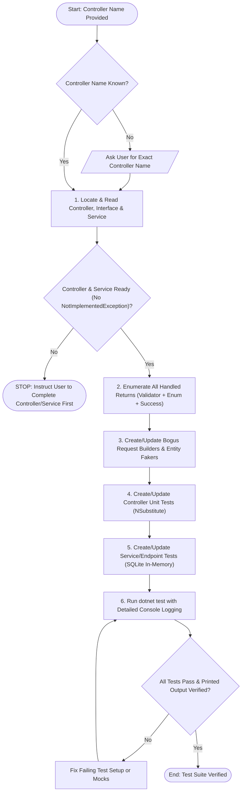

# .NET Test Generator Skill

## 1. Overview & Purpose

This skill defines the mandatory standards for creating and running **xUnit** unit and integration tests for `.NET` API endpoints.

> [!CAUTION]
> **Mandatory Pre-Flight Requirements**:
> 1. **Controller Name & Readiness Gate**: You **MUST** always require the **Controller name** from the user and verify that the Controller and its target endpoint(s) and Service methods are **already implemented and ready**. If the Controller is missing, lacks the endpoint, or the Service still throws `NotImplementedException`, **STOP** and instruct the user to complete `dotnet-gen-controller` and `dotnet-gen-service` first.
> 2. **100% Handled Return Coverage**: Every handled return path (every FluentValidation failure rule, every business-rule error branch in `EnumErrosApi`, and every success branch) **MUST** have a dedicated test.
> 3. **Mandatory Output Logging**: Every test **MUST** print to test output (`ITestOutputHelper`) both the **serialized return content** (including numeric Enum ID + message or data payload) and **whether the test succeeded**.

---

## 2. Test Generation & Execution Workflow



### Step 1: Mandatory Controller Pre-Flight Verification
1. If the user did not supply the **Controller name**, ask for it immediately before doing anything else.
2. Search `<ApiProject>/Controllers/` for `<ControllerName>.cs` and read it completely.
3. Read the injected Service interface (`I<Context>Service.cs`), the concrete Service (`<Context>Service.cs`), and associated FluentValidation validators.
4. **Hard Stop Condition**:
   - If the Controller file does not exist, OR
   - If the target endpoint method is missing from the Controller, OR
   - If the target Service method throws `NotImplementedException` or is an unfinished stub:
   **STOP immediately**, explain the exact missing piece, and tell the user to finish it via [dotnet-gen-controller.md](./dotnet-gen-controller.md) / [dotnet-gen-service.md](./dotnet-gen-service.md) before generating tests.

### Step 2: Build the Handled-Return Coverage Matrix
List every single `return ...` path and validation rule for each endpoint on the Controller:
- **FluentValidation (`400 BadRequest`)**: 1 `[Fact]` per rule/branch (empty, null, invalid format, out-of-range, length bounds).
- **Business Rule Errors (`400`, `401`, `403`, `404`, `409`, etc.)**: 1 `[Fact]` per `EnumErrosApi` return path.
- **Success Cases (`200`, `201`, etc.)**: 1 `[Fact]` per handled success branch (empty paginated list, populated data, optional filters, domain mutations like `Entrada`/`Saida`, DB persistence assertions).

---

## 3. Dual Test Suite Structure

### 3.1 Supporting Test Infrastructure
- **Request Builders** (`<TestsProject>/Build/Request/<Verb><Action>RequestBuilder.cs`): inherit the Request class, populate valid defaults with `Bogus.Faker("pt_BR")`, and expose fluent `.With<Property>(...)` and `.WithInvalid<Property>(...)` methods.
- **Entity Fakers** (`<TestsProject>/Mocks/Fakers/<Entity>Faker.cs`): static `Bogus.Faker<TEntity>` factory producing valid entities.
- **In-Memory SQLite Contexts**: reuse `AccountsServiceTestBase` / `UsersServiceTestBase` / `DbContextMockFactory` (`ATTACH DATABASE ':memory:' AS <schema>`). When testing new tables, add their `CREATE TABLE IF NOT EXISTS <schema>.<table> (...)` DDL and `INSERT OR REPLACE INTO <schema>.<table> SELECT * FROM main.<table>;` sync statements to the test base so Dapper `JOIN` queries see EF Core inserts.

### 3.2 Controller Unit Tests (`<TestsProject>/API/<Service>/<Scope>/<Controller><Scope>Test.cs`)
Test Controller routing/delegation, JWT claim extraction, and HTTP result forwarding using `NSubstitute` + `FluentAssertions` + `ITestOutputHelper`:

```csharp
using System.Text.Json;
using FluentAssertions;
using Microsoft.AspNetCore.Mvc;
using NSubstitute;
using Xunit.Abstractions;

namespace <RootNamespace>.Tests.API.<Service>.<Scope>;

public class <Context>Controller<Scope>Test
{
    private readonly I<Context>Service _mockService;
    private readonly JsonWebTokenService _jwtService;
    private readonly <Context>Controller _controller;
    private readonly ITestOutputHelper _output;

    public <Context>Controller<Scope>Test(ITestOutputHelper output)
    {
        _output = output;
        _mockService = Substitute.For<I<Context>Service>();
        _jwtService = new JsonWebTokenService(null!);
        _controller = new <Context>Controller(_mockService, _jwtService);
    }

    [Fact(DisplayName = "<MethodName> delegates to I<Context>Service and returns expected result")]
    public async Task <MethodName>_ValidRequest_CallsServiceAndReturnsResult()
    {
        // Arrange
        var expected = new OkObjectResult(new ResponseApiSucess("ok"));
        _mockService.<MethodName>(Arg.Any<<Verb><Action>Request>())
            .Returns(Task.FromResult<IActionResult>(expected));
        var request = new <Verb><Action>RequestBuilder();

        // Act
        var result = await _controller.<MethodName>("fake-token", request);

        // Assert
        result.Should().BeSameAs(expected);
        await _mockService.Received(1).<MethodName>(request);

        _output.WriteLine($"[PASS] Controller.<MethodName> | Status={expected.StatusCode} | Content={JsonSerializer.Serialize(expected.Value)}");
    }
}
```

### 3.3 Service / Endpoint Tests (`<TestsProject>/API/<Service>/<Scope>/<EndpointMethod>Test.cs`)
Organize tests cleanly with `#region BadRequest Errors`, `#region NotFound Errors` (plus other applicable HTTP error regions), and `#region Success`.

---

## 4. Mandatory Output Logging Helper

**Every `[Fact]` test MUST print the serialized response content and explicit pass confirmation via `ITestOutputHelper`:**

```csharp
protected void LogTestResult(string scenario, IActionResult result, bool passed)
{
    var objectResult = result as ObjectResult;
    var statusCode = objectResult?.StatusCode ?? (result as StatusCodeResult)?.StatusCode;
    var payloadJson = JsonSerializer.Serialize(
        objectResult?.Value,
        new JsonSerializerOptions { WriteIndented = true }
    );

    Output.WriteLine($"[{(passed ? "PASS" : "FAIL")}] {scenario}");
    Output.WriteLine($"StatusCode: {statusCode}");
    Output.WriteLine($"Content: {payloadJson}");
}
```

Usage inside every test after assertions pass:

```csharp
// Assert
result.Should().BeOfType<NotFoundObjectResult>();
var notFound = (NotFoundObjectResult)result;
var response = (ResponseApiError)notFound.Value!;
response.Messages.Should().Contain(m =>
    m.Code == (int)EnumErrosApi.<EXPECTED_ENUM> &&
    m.Message == EnumErrosApi.<EXPECTED_ENUM>.GetDescription());

LogTestResult(nameof(<TestMethodName>), result, passed: true);
```

---

## 5. Execution & Verification

Always run the newly created/updated tests with detailed console output so printed payloads and pass status are directly observable:

```bash
dotnet test --filter "FullyQualifiedName~<TestClassName>" --logger "console;verbosity=detailed"
```

Verify:
1. Zero test failures or skipped tests.
2. Every `[Fact]` prints both the response payload content (including Enum numeric `code` and `message` or data) and `[PASS]` confirmation.
3. Run the full test suite (`dotnet test`) before finishing to ensure zero regressions.

---

## 6. Verification Checklist

- [ ] Controller name obtained from user and Controller + Service verified as ready (no missing endpoints, no `NotImplementedException`).
- [ ] Dedicated `[Fact]` test created for every FluentValidation rule, every `EnumErrosApi` business error branch, and every success branch.
- [ ] Controller unit tests (`*Controller*Test.cs`) and Service/Endpoint tests (`*Test.cs`) both implemented.
- [ ] Request Builders (`Bogus`) and Entity Fakers created/updated; SQLite test base DDL/sync updated for any new tables.
- [ ] Every test prints serialized response content and explicit pass status via `ITestOutputHelper`.
- [ ] `dotnet test` executed with `--logger "console;verbosity=detailed"` and all tests pass with visible output.
