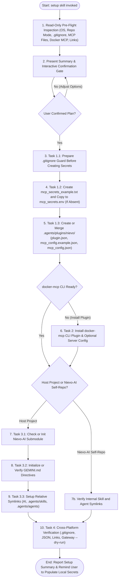

# NIEVO Project & MCP Setup Skill (`setup`)

## 1. Overview & Purpose

This skill performs the complete interactive onboarding of a project into the **NIEVO AI** ecosystem on **Linux** and **Windows**, prioritizing **strictly project-scoped MCP configuration** as its first task.

> [!IMPORTANT]
> **Strictly Project-Scoped Configuration (Never Global)**:
> - **All configurations created or modified by `setup` live inside the project workspace** (`.gitignore`, `mcp_secrets_example.txt`, `mcp_secrets.env`, `.agents/plugins/<plugin-name>/`, `GEMINI.md`, `AI/`, `.agents/skills/`, `.agents/agents/`).
> - **Never** create, edit, or recommend global MCP configuration files or global user-home secret files. Every project owns its own isolated `mcp_secrets.env` and `.agents/plugins/nievo/mcp_config.json`.

> [!IMPORTANT]
> **Why Catalog + `--servers` + `--secrets` Instead of `--profile` + `--secrets`**:
> - In `docker-mcp v0.44.3+`, `--profile` is **mutually exclusive** with `--secrets`, `--catalog`, and `--servers` (`cannot use --profile with ... --secrets ...`).
> - Using `--catalog https://desktop.docker.com/mcp/catalog/v3/catalog.yaml` + `--servers ...` + `--secrets "<PROJECT_ROOT>/mcp_secrets.env"` works identically on **Linux (without Docker Desktop / `docker pass`)** and **Windows**, reading secrets strictly from the project's local `mcp_secrets.env`.
> - The default server set (`brave,github-official,postman,gemini-api-docs,docker-docs,javadocs,terraform`) already bundles `github-official`, so do **not** add a separate duplicate GitHub MCP entry unless explicitly requested.

> [!NOTE]
> **Host Project vs. Self-Repo Mode**:
> - **Host/Consumer Project**: Runs all tasks in order — Task 1 (MCP mold, `.gitignore` guard, `.agents/plugins/nievo/`), Task 2 (`docker-mcp` CLI & server/config setup), Task 3 (`Nievo-AI` submodule, `GEMINI.md`, relative symlinks), and Task 4 (cross-platform verification).
> - **Self-Repo (`Nievo-AI` itself)**: Runs Task 1, Task 2, and Task 4 only if requested, and skips creating `Nievo-AI/...` consumer symlinks or consumer `GEMINI.md` bootstrapping (instead validating internal `.agents/skills/*/SKILL.md` and `.agents/agents/*.md` links).

It covers:
1. **MCP Mold & Project Plugin Config (Always First)**: Preparing `.gitignore`, creating `mcp_secrets_example.txt` and copying it to `mcp_secrets.env`, and scaffolding `.agents/plugins/nievo/plugin.json`, `mcp_config.example.json`, and `mcp_config.json` (`nievo_ai` via `--catalog` + `--servers` + `--secrets`, plus `stitch`).
2. **Cross-Platform Docker MCP CLI Setup (Linux & Windows)**: Installing/verifying the `docker-mcp` CLI plugin and customizing optional servers or local `--config` YAML if needed.
3. **Submodule, Directives & Relative Symbolic Links**: Initializing `./Nievo-AI/`, `GEMINI.md`, and portable relative symlinks (`AI/`, `.agents/skills/*`, `.agents/agents/*`) on Linux and Windows.
4. **Verification & Health Checks**: Validating `.gitignore` protection, JSON syntax, symlinks, `GEMINI.md` references, and `docker mcp gateway run --catalog ... --servers ... --secrets ... --dry-run`.

---

## 2. Interactive Setup Workflow



---

## 3. Step-by-Step Execution Protocol

### Phase 1: Read-Only Pre-Flight Inspection

Before modifying any file or prompting the user, inspect the OS, workspace, `.gitignore`, existing plugin files, and Docker MCP environment in read-only mode (**never** read `mcp_secrets.env` or any `.env` file).

#### Linux (Bash)
```bash
# Detect OS and repository root
uname -s
git rev-parse --show-toplevel
git remote get-url origin 2>/dev/null || true

# Check project structure, .gitignore, and MCP files (existence only; never read .env files)
ls -ld Nievo-AI AI GEMINI.md .gitignore mcp_secrets_example.txt mcp_secrets.env .agents .agents/skills .agents/agents .agents/plugins .agents/plugins/nievo 2>/dev/null || true

# Check Docker and docker-mcp CLI plugin
docker --version 2>/dev/null || echo "docker-missing"
docker info >/dev/null 2>&1 && echo "docker-running" || echo "docker-unavailable"
docker mcp version 2>/dev/null || echo "docker-mcp-missing"
```

#### Windows (PowerShell)
```powershell
# Detect OS architecture and repository root
$env:OS; $env:PROCESSOR_ARCHITECTURE
git rev-parse --show-toplevel
git remote get-url origin 2>$null

# Check project structure, .gitignore, and MCP files (existence only; never read .env files)
Get-Item Nievo-AI, AI, GEMINI.md, .gitignore, mcp_secrets_example.txt, mcp_secrets.env, .agents, .agents\plugins\nievo -ErrorAction SilentlyContinue | Select-Object Name, LinkType, Target

# Check Docker and docker-mcp CLI plugin
docker --version
docker info *> $null; if ($LASTEXITCODE -eq 0) { "docker-running" } else { "docker-unavailable" }
docker mcp version
```

From this inspection, determine:
- **Target OS**: Linux (`amd64` / `arm64`) or Windows (`amd64` / `arm64`).
- **Repository mode**: Consumer host project (has `./Nievo-AI` or needs submodule added) vs. `Nievo-AI` canonical repository.
- **Project MCP & `.gitignore` state**: Whether `.gitignore` already ignores `mcp_secrets.env` and `.agents/plugins/nievo/mcp_config.json`, whether `mcp_secrets_example.txt` / `mcp_secrets.env` exist, and whether `.agents/plugins/nievo/` already contains `plugin.json` or `mcp_config.json`.
- **Docker MCP state**: Whether `docker` is running and whether the `docker-mcp` CLI plugin is installed.
- **Security rule**: **Never** read `.env` or `mcp_secrets.env` during inspection or execution. Only inspect `mcp_secrets_example.txt` or `.env-example`.

---

### Phase 2: Interactive Confirmation Gate

Present a concise summary of what was detected and confirm the setup parameters with the user **before** creating or modifying files:

1. **Project-Scoped Plugin Directory**: Confirm `.agents/plugins/<plugin-name>/` (default: `nievo`, producing `.agents/plugins/nievo/plugin.json`, `.agents/plugins/nievo/mcp_config.example.json`, and `.agents/plugins/nievo/mcp_config.json`).
2. **`.gitignore` & Secrets Mold (`mcp_secrets_example.txt` -> `mcp_secrets.env`)**: Confirm adding `mcp_secrets.env` and `.agents/plugins/<plugin-name>/mcp_config.json` to `.gitignore`, creating `mcp_secrets_example.txt`, and copying it to `mcp_secrets.env` (if not already present) at the project root.
3. **`nievo_ai` + `stitch` Base MCP Config**: Confirm generating `.agents/plugins/<plugin-name>/mcp_config.json` with:
   - `nievo_ai` running `docker mcp gateway run --catalog https://desktop.docker.com/mcp/catalog/v3/catalog.yaml --servers brave,github-official,postman,gemini-api-docs,docker-docs,javadocs,terraform --secrets "<PROJECT_ROOT>/mcp_secrets.env"` (using the project-local absolute path for the current OS).
   - Optional extra servers (e.g., `prometheus`, `kubernetes`, `kubectl-mcp-server`, `sonarqube`, `dockerhub`, `clickhouse`, `redis`, `mcp-discord`, `mcp-reddit`, `openapi-schema`) and optional `--config "<PROJECT_ROOT>/.agents/plugins/nievo/mcp_servers_config.yaml"` if any added server requires local endpoint/path settings.
   - `stitch` (`type: "http"`, `url: "https://stitch.googleapis.com/mcp"`, `headers.X-Goog-Api-Key: "<SUA_CHAVE_API_STITCH>"`).
4. **Docker MCP CLI Plugin**: Confirm whether to install `docker-mcp` (if missing).
5. **Host Onboarding Actions** (host projects only): Confirm initializing/verifying `Nievo-AI` submodule, `GEMINI.md`, and cross-platform relative symbolic links (`AI/`, `.agents/skills/*`, `.agents/agents/*`).

Wait for explicit user confirmation before proceeding to Phase 3.

---

### Phase 3 (Task 1 — Always First): MCP Mold, `.gitignore` Guard & `.agents/plugins/nievo/` Setup

Always execute this phase **first** so every project starts with a clean, protected, project-scoped MCP setup.

#### 3.1 Prepare `.gitignore` Before Creating `mcp_secrets.env`

Ensure `.gitignore` exists at the project root and ignores both `mcp_secrets.env` and `.agents/plugins/nievo/mcp_config.json` (which contains the machine-local absolute `--secrets` path and the user's Stitch API key).

- **Entries to ensure in `.gitignore`** (append idempotently without duplicating existing lines):
  ```gitignore
  # NIEVO MCP local secrets and machine-local plugin config (project-scoped, never commit)
  mcp_secrets.env
  .agents/plugins/nievo/mcp_config.json
  ```
  *(If `<plugin-name>` was customized, use `.agents/plugins/<plugin-name>/mcp_config.json`.)*

- **Linux (Bash)**:
  ```bash
  touch .gitignore
  grep -qxF 'mcp_secrets.env' .gitignore || printf '\n# NIEVO MCP local secrets and machine-local plugin config\nmcp_secrets.env\n' >> .gitignore
  grep -qxF '.agents/plugins/nievo/mcp_config.json' .gitignore || printf '.agents/plugins/nievo/mcp_config.json\n' >> .gitignore
  git check-ignore -v mcp_secrets.env .agents/plugins/nievo/mcp_config.json
  ```

- **Windows (PowerShell)**:
  ```powershell
  if (-not (Test-Path .gitignore)) { New-Item -ItemType File -Path .gitignore | Out-Null }
  $entries = @("mcp_secrets.env", ".agents/plugins/nievo/mcp_config.json")
  $existing = Get-Content .gitignore -ErrorAction SilentlyContinue
  foreach ($entry in $entries) {
    if ($existing -notcontains $entry) { Add-Content -Path .gitignore -Value $entry }
  }
  git check-ignore -v mcp_secrets.env .agents/plugins/nievo/mcp_config.json
  ```

> [!CAUTION]
> **Do not proceed to creating `mcp_secrets.env` until `git check-ignore -v mcp_secrets.env` confirms `.gitignore` matches it.**

#### 3.2 Create `mcp_secrets_example.txt` and Transform Into `mcp_secrets.env`

1. Create `mcp_secrets_example.txt` at the project root using the canonical template at `AI/GEMINI/skills/setup/templates/mcp_secrets_example.txt` (or `Nievo-AI/AI/GEMINI/skills/setup/templates/mcp_secrets_example.txt` in host projects). If unavailable, create it with the following mold:

   ```dotenv
   # NIEVO MCP Secrets Template (mcp_secrets_example.txt -> mcp_secrets.env)
   github.personal_access_token=<SEU_GITHUB_PAT>
   brave.api_key=<SUA_BRAVE_API_KEY>
   postman.postman-api-key=<SUA_POSTMAN_API_KEY>
   sonarqube.token=<SEU_SONARQUBE_TOKEN>
   # sonarqube.url=https://sonarqube.exemplo.com
   dockerhub.pat_token=<SEU_DOCKERHUB_PAT>
   # dockerhub.username=<SEU_DOCKERHUB_USERNAME>
   discord.token=<SEU_DISCORD_BOT_TOKEN>
   reddit.client_id=<SEU_REDDIT_CLIENT_ID>
   reddit.client_secret=<SEU_REDDIT_CLIENT_SECRET>
   ```

2. Transform `mcp_secrets_example.txt` into `mcp_secrets.env` **only if `mcp_secrets.env` does not already exist** (never read, print, or overwrite an existing `mcp_secrets.env`):

   - **Linux (Bash)**:
     ```bash
     if [ ! -e mcp_secrets.env ]; then
       cp mcp_secrets_example.txt mcp_secrets.env
       chmod 600 mcp_secrets.env
     fi
     ```
   - **Windows (PowerShell)**:
     ```powershell
     if (-not (Test-Path mcp_secrets.env)) {
       Copy-Item -Path mcp_secrets_example.txt -Destination mcp_secrets.env
     }
     ```
     *(Optional on Windows: restrict NTFS ACLs with `icacls mcp_secrets.env /inheritance:r /grant:r "$($env:USERNAME):F"` if sharing the machine.)*

#### 3.3 Create `.agents/plugins/nievo/` (`plugin.json`, `mcp_config.example.json`, `mcp_config.json`)

Create the plugin directory `.agents/plugins/<plugin-name>/` (default: `.agents/plugins/nievo/`).

1. **Create `.agents/plugins/nievo/plugin.json`** (from `templates/plugin.json` if absent):
   ```json
   {
     "name": "nievo",
     "repository": "https://github.com/pedrovtof/Nievo-Skills"
   }
   ```
   *(Update `"name"` if the user chose a custom `<plugin-name>`.)*

2. **Create `.agents/plugins/nievo/mcp_config.example.json`** (versioned template safe to commit, from `templates/mcp_config.example.json`):
   ```json
   {
     "mcpServers": {
       "nievo_ai": {
         "command": "docker",
         "args": [
           "mcp",
           "gateway",
           "run",
           "--catalog",
           "https://desktop.docker.com/mcp/catalog/v3/catalog.yaml",
           "--servers",
           "brave,github-official,postman,gemini-api-docs,docker-docs,javadocs,terraform",
           "--secrets",
           "<PROJECT_ROOT>/mcp_secrets.env"
         ]
       },
       "stitch": {
         "type": "http",
         "url": "https://stitch.googleapis.com/mcp",
         "headers": {
           "X-Goog-Api-Key": "<SUA_CHAVE_API_STITCH>"
         }
       }
     }
   }
   ```

3. **Create or Safely Merge `.agents/plugins/nievo/mcp_config.json`** (ignored by `.gitignore` — project-local active config):
   Resolve `<PROJECT_ROOT>` to the current workspace root path for the active OS:
   - **Linux example**: `"/path/to/project/mcp_secrets.env"`
   - **Windows example** (JSON-escaped or forward slashes): `"C:\\path\\to\\project\\mcp_secrets.env"` (or `"C:/path/to/project/mcp_secrets.env"`)

   ```json
   {
     "mcpServers": {
       "nievo_ai": {
         "command": "docker",
         "args": [
           "mcp",
           "gateway",
           "run",
           "--catalog",
           "https://desktop.docker.com/mcp/catalog/v3/catalog.yaml",
           "--servers",
           "brave,github-official,postman,gemini-api-docs,docker-docs,javadocs,terraform",
           "--secrets",
           "<RESOLVED_PROJECT_ROOT>/mcp_secrets.env"
         ]
       },
       "stitch": {
         "type": "http",
         "url": "https://stitch.googleapis.com/mcp",
         "headers": {
           "X-Goog-Api-Key": "<SUA_CHAVE_API_STITCH>"
         }
       }
     }
   }
   ```

   **Safe Merge & Customization Rules**:
   - If `.agents/plugins/nievo/mcp_config.json` already exists, parse the JSON and preserve all existing keys and other entries inside `mcpServers`; add or update `mcpServers.nievo_ai` and `mcpServers.stitch` (preserving an existing non-placeholder `X-Goog-Api-Key` if already configured by the user).
   - If the project enables servers requiring local non-secret configuration (such as `prometheus` with `prometheus_url`, or `kubernetes` / `kubectl-mcp-server` with `config_path` / `kubeconfig`), create `.agents/plugins/nievo/mcp_servers_config.yaml` and pass `"--config", "<RESOLVED_PROJECT_ROOT>/.agents/plugins/nievo/mcp_servers_config.yaml"` inside `nievo_ai.args`.
   - Never hardcode real secrets in `templates/`, `mcp_secrets_example.txt`, `mcp_config.example.json`, or any tracked file.

---

### Phase 4 (Task 2): Docker MCP CLI Plugin & Server Customization (Linux & Windows)

#### 4.1 Install the `docker-mcp` CLI Plugin (If `docker mcp version` Fails)

##### Linux (`x86_64` / `amd64` or `arm64`)
1. Create the Docker CLI plugins directory and download the [`docker/mcp-gateway`](https://github.com/docker/mcp-gateway/releases) binary (example `v0.44.3`):
   - **x86_64 (`amd64`)**:
     ```bash
     mkdir -p ~/.docker/cli-plugins
     curl -fsSL https://github.com/docker/mcp-gateway/releases/download/v0.44.3/docker-mcp-linux-amd64.tar.gz \
       | tar -xz -C ~/.docker/cli-plugins/
     chmod +x ~/.docker/cli-plugins/docker-mcp
     docker mcp version
     ```
   - **ARM64 (`arm64`)**:
     ```bash
     mkdir -p ~/.docker/cli-plugins
     curl -fsSL https://github.com/docker/mcp-gateway/releases/download/v0.44.3/docker-mcp-linux-arm64.tar.gz \
       | tar -xz -C ~/.docker/cli-plugins/
     chmod +x ~/.docker/cli-plugins/docker-mcp
     docker mcp version
     ```

##### Windows
- **Option A (Recommended — Docker Desktop with MCP Toolkit)**:
  1. Ensure **Docker Desktop for Windows** is installed and running.
  2. Open **Settings > Features / Beta features** and enable **MCP Toolkit**.
  3. Validate in PowerShell:
     ```powershell
     docker mcp version
     ```
- **Option B (Standalone PowerShell CLI, without Docker Desktop MCP Toolkit)**:
  1. Create the plugins folder and download `v0.44.3` using native `curl.exe` and `tar`:
     - **x64 (`amd64`)**:
       ```powershell
       New-Item -ItemType Directory -Force -Path "$env:USERPROFILE\.docker\cli-plugins" | Out-Null
       curl.exe -fsSL -L "https://github.com/docker/mcp-gateway/releases/download/v0.44.3/docker-mcp-windows-amd64.tar.gz" -o "$env:TEMP\docker-mcp.tar.gz"
       tar -xzf "$env:TEMP\docker-mcp.tar.gz" -C "$env:USERPROFILE\.docker\cli-plugins"
       Remove-Item "$env:TEMP\docker-mcp.tar.gz"
       docker mcp version
       ```
     - **ARM64 (`arm64`)**:
       ```powershell
       New-Item -ItemType Directory -Force -Path "$env:USERPROFILE\.docker\cli-plugins" | Out-Null
       curl.exe -fsSL -L "https://github.com/docker/mcp-gateway/releases/download/v0.44.3/docker-mcp-windows-arm64.tar.gz" -o "$env:TEMP\docker-mcp.tar.gz"
       tar -xzf "$env:TEMP\docker-mcp.tar.gz" -C "$env:USERPROFILE\.docker\cli-plugins"
       Remove-Item "$env:TEMP\docker-mcp.tar.gz"
       docker mcp version
       ```

#### 4.2 Optional Server List & Project `--config` Customization

- Default project-scoped servers in `--servers`:
  `brave,github-official,postman,gemini-api-docs,docker-docs,javadocs,terraform`
- Available optional servers from the Docker MCP catalog that can be appended to `--servers` per project:
  `kubernetes`, `clickhouse`, `redis`, `kubectl-mcp-server`, `sonarqube`, `dockerhub`, `mcp-discord`, `openapi-schema`, `mcp-reddit`, `prometheus`.
- Note on `docker.io/pedrovotf/nievo_ai:latest`: that OCI artifact is a **Docker MCP Profile** (`docker mcp profile pull docker.io/pedrovotf/nievo_ai:latest`) for Docker Desktop / `docker pass` keychain environments and **cannot** be combined with `--secrets <PROJECT_ROOT>/mcp_secrets.env` in `docker-mcp v0.44.3+`. Keep `--catalog` + `--servers` + `--secrets` in `mcp_config.json` so every project remains isolated and cross-platform.

If Docker is unavailable or the daemon is stopped, inform the user clearly without failing the file configuration steps, and list the commands above to run once Docker is started.

---

### Phase 5 (Task 3): Submodule, `GEMINI.md` & Relative Symbolic Links (Host Projects)

*(Skip Phase 5 when operating in self-check mode inside `Nievo-AI` itself; instead validate existing `.agents/skills/*/SKILL.md` and `.agents/agents/*.md` links.)*

#### 5.1 Verify or Add the `Nievo-AI` Submodule
- If `./Nievo-AI/` is missing in a host project:
  ```bash
  git submodule add https://github.com/pedrovtof/Nievo-Skills.git ./Nievo-AI/
  git submodule update --init --recursive
  ```
- If `./Nievo-AI/` exists as an uninitialized submodule directory (empty):
  ```bash
  git submodule update --init --recursive
  ```

#### 5.2 Initialize or Verify `GEMINI.md`
- **If `GEMINI.md` does not exist**: create it at the project root using the canonical template from [README.md](../../../README.md):
  ```markdown
  # Diretrizes Obrigatórias do Projeto

  Em toda inicialização e execução neste projeto, o agente DEVE seguir e considerar ativas as regras e instruções dos seguintes arquivos essenciais:

  ## Arquivos Base e Regras Globais

  @[AI/Start-here.md](AI/Start-here.md)

  @[AI/Default.md](AI/Default.md)

  @[AI/Rules.md](AI/Rules.md)

  ---

  ## Instruções de Inicialização (Checklist Padrão)

  Toda vez que interagir no projeto:

  1. Respeitar o fluxo de [AI/Default.md](AI/Default.md):
     - Solicitar um breve resumo de contexto, se necessário.
     - Perguntar se o usuário deseja uma opinião/sugestão ou uma implementação/correção direta.
     - Se a tarefa envolver design/front-end, consultar `AI/Desing/`.
  2. Cumprir integralmente todas as exigências de [AI/Rules.md](AI/Rules.md) (Changelog, README, Documentação, Testes, Diagramas Mermaid/dbdiagram, políticas de commit/branch e não leitura de `.env`).
  3. Para procedimentos especializados (git, documentação, banco de dados, linguagens), consultar as skills e agentes correspondentes em `AI/GEMINI/skills/`, `AI/GEMINI/agents/`, `.agents/skills/` e `.agents/agents/`.
  ```
- **If `GEMINI.md` already exists**: verify it includes `@[AI/Start-here.md](AI/Start-here.md)`, `@[AI/Default.md](AI/Default.md)`, and `@[AI/Rules.md](AI/Rules.md)`. Append missing directives cleanly without deleting or overwriting project-specific instructions.

#### 5.3 Setup Relative Symbolic Links

Always use **relative targets** so links remain portable across clones, team members, and containers.

> [!IMPORTANT]
> **Avoid the `ln -sf` Directory Symlink Pitfall**:
> On Linux and macOS, running `ln -sf <target> <existing-dir-symlink>` follows an existing directory symlink and creates a nested link *inside* the target directory. Always pass `-n` (`ln -sfn`) for directory symlinks.

##### Linux / macOS (Bash)
```bash
# 1. Link AI/ directory
ln -sfn Nievo-AI/AI AI

# 2. Ensure target customization directories exist
mkdir -p .agents/skills .agents/agents

# 3. Link every skill directory from Nievo-AI/.agents/skills/
for skill in Nievo-AI/.agents/skills/*; do
  [ -d "$skill" ] && ln -sfn "../../$skill" ".agents/skills/$(basename "$skill")"
done

# 4. Link every custom agent from Nievo-AI/.agents/agents/
for agent in Nievo-AI/.agents/agents/*.md; do
  [ -e "$agent" ] && ln -sf "../../$agent" ".agents/agents/$(basename "$agent")"
done
```

##### Windows (PowerShell — Administrator or Developer Mode)
```powershell
New-Item -ItemType SymbolicLink -Force -Path "AI" -Target "Nievo-AI\AI"
New-Item -ItemType Directory -Force -Path ".agents\skills"
New-Item -ItemType Directory -Force -Path ".agents\agents"

Get-ChildItem -Directory -Path "Nievo-AI\.agents\skills" | ForEach-Object {
  New-Item -ItemType SymbolicLink -Force -Path ".agents\skills\$($_.Name)" -Target "..\..\Nievo-AI\.agents\skills\$($_.Name)"
}

Get-ChildItem -File -Filter "*.md" -Path "Nievo-AI\.agents\agents" | ForEach-Object {
  New-Item -ItemType SymbolicLink -Force -Path ".agents\agents\$($_.Name)" -Target "..\..\Nievo-AI\.agents\agents\$($_.Name)"
}
```

##### Windows (CMD)
```cmd
mklink /D AI Nievo-AI\AI
mkdir .agents\skills
mkdir .agents\agents
for /D %s in (Nievo-AI\.agents\skills\*) do mklink /D ".agents\skills\%~nxs" "..\..\Nievo-AI\.agents\skills\%~nxs"
for %a in (Nievo-AI\.agents\agents\*.md) do mklink ".agents\agents\%~nxa" "..\..\Nievo-AI\.agents\agents\%~nxa"
```

---

### Phase 6 (Task 4): Cross-Platform Verification & Post-Setup Checks

Run deterministic validation checks for the current OS after all edits:

#### Linux (Bash)
```bash
# 1. Verify .gitignore protects mcp_secrets.env and .agents/plugins/nievo/mcp_config.json
git check-ignore -v mcp_secrets.env .agents/plugins/nievo/mcp_config.json

# 2. Validate JSON syntax of plugin.json, mcp_config.example.json, and mcp_config.json
python3 -m json.tool .agents/plugins/nievo/plugin.json >/dev/null && echo "plugin.json OK"
python3 -m json.tool .agents/plugins/nievo/mcp_config.example.json >/dev/null && echo "mcp_config.example.json OK"
python3 -m json.tool .agents/plugins/nievo/mcp_config.json >/dev/null && echo "mcp_config.json OK"

# 3. Verify no broken symlinks exist under .agents/ (and AI in host projects)
find .agents -type l ! -exec test -e {} \; -print
ls -la .agents/skills/ .agents/agents/

# 4. Verify GEMINI.md directives (host project)
grep -E "AI/(Start-here|Default|Rules)\.md" GEMINI.md

# 5. Validate Docker MCP Gateway dry-run with the project secrets file (if Docker is running)
docker mcp gateway run \
  --catalog https://desktop.docker.com/mcp/catalog/v3/catalog.yaml \
  --servers brave,github-official,postman,gemini-api-docs,docker-docs,javadocs,terraform \
  --secrets "$PWD/mcp_secrets.env" \
  --dry-run
```

#### Windows (PowerShell)
```powershell
# 1. Verify .gitignore protects mcp_secrets.env and .agents/plugins/nievo/mcp_config.json
git check-ignore -v mcp_secrets.env .agents/plugins/nievo/mcp_config.json

# 2. Validate JSON syntax of plugin.json, mcp_config.example.json, and mcp_config.json
Get-Content .\.agents\plugins\nievo\plugin.json -Raw | ConvertFrom-Json | Out-Null; "plugin.json OK"
Get-Content .\.agents\plugins\nievo\mcp_config.example.json -Raw | ConvertFrom-Json | Out-Null; "mcp_config.example.json OK"
Get-Content .\.agents\plugins\nievo\mcp_config.json -Raw | ConvertFrom-Json | Out-Null; "mcp_config.json OK"

# 3. Verify symlinks (host project)
Get-Item AI -ErrorAction SilentlyContinue | Select-Object Name, LinkType, Target
Get-ChildItem .agents\skills | Select-Object Name, LinkType, Target
Get-ChildItem .agents\agents | Select-Object Name, LinkType, Target

# 4. Verify GEMINI.md directives (host project)
Select-String -Path GEMINI.md -Pattern "AI/(Start-here|Default|Rules)\.md"

# 5. Validate Docker MCP Gateway dry-run with the project secrets file (if Docker is running)
docker mcp gateway run `
  --catalog https://desktop.docker.com/mcp/catalog/v3/catalog.yaml `
  --servers brave,github-official,postman,gemini-api-docs,docker-docs,javadocs,terraform `
  --secrets "$((Get-Location).Path)\mcp_secrets.env" `
  --dry-run
```

#### Next Steps for the Developer
1. Open `mcp_secrets.env` manually and fill in only the tokens for the servers you use (`github.personal_access_token`, `brave.api_key`, `postman.postman-api-key`, etc.).
2. Open `.agents/plugins/nievo/mcp_config.json` manually and replace `<SUA_CHAVE_API_STITCH>` with your Stitch API key.
3. Reload or restart the **Antigravity** session and open **Additional Options (...) > MCP Servers** to confirm `nievo_nievo_ai` and `nievo_stitch` are active.

---

## 4. Quick Troubleshooting (Project-Scoped Only)

| Erro observado | Causa | Solução |
| :--- | :--- | :--- |
| `cannot use --profile with ... --secrets ...` | No `docker-mcp v0.44.3+`, `--profile` é mutuamente exclusivo com `--secrets`, `--catalog` e `--servers` | Usar `--catalog https://desktop.docker.com/mcp/catalog/v3/catalog.yaml --servers ... --secrets "<PROJECT_ROOT>/mcp_secrets.env"` (sem `--profile`) |
| `Reading catalog from [docker-mcp.yaml]` e `0 tools listed` | `--servers` sem `--catalog` procura um `docker-mcp.yaml` local inexistente | Passar `--catalog https://desktop.docker.com/mcp/catalog/v3/catalog.yaml` junto com `--servers` |
| `docker: Error response from daemon: no command specified` | Tentativa de rodar um profile OCI com `docker run` | Usar `docker mcp gateway run --catalog ... --servers ... --secrets "<PROJECT_ROOT>/mcp_secrets.env"` |
| `docker: unknown command: docker mcp` | Plugin `docker-mcp` ausente em `cli-plugins` | Instalar o plugin seguindo a **Fase 4.1** (Linux ou Windows) |
| `docker pass has not been installed` | Ambiente Linux sem Docker Desktop / `docker pass` para keychain | Já resolvido pelo padrão do projeto usando `--catalog` + `--servers` + `--secrets "<PROJECT_ROOT>/mcp_secrets.env"` |
| `Can't start prometheus: failed to connect` | Servidor opcional (ex.: `prometheus`) sem config local ou instância rodando | Remover da lista `--servers` ou passar `--config "<PROJECT_ROOT>/.agents/plugins/nievo/mcp_servers_config.yaml"` |
| Risco de expor `mcp_secrets.env` ou `X-Goog-Api-Key` no Git | `.gitignore` sem as regras locais antes da geração dos arquivos | Garantir `mcp_secrets.env` e `.agents/plugins/nievo/mcp_config.json` no `.gitignore` e versionar apenas `mcp_secrets_example.txt` e `mcp_config.example.json` |

---

## 5. Critical Safety Rules

1. **Strictly Project-Scoped Always**: Never create or edit global MCP configs or reference user-global secret files outside the project.
2. **`.gitignore` Before `mcp_secrets.env`**: Always verify `.gitignore` ignores `mcp_secrets.env` (and `.agents/plugins/<plugin-name>/mcp_config.json`) via `git check-ignore` before creating `mcp_secrets.env`.
3. **Never Read `.env` / `mcp_secrets.env` or Hardcode Secrets**: Never read existing `mcp_secrets.env` or `.env` files, and never write real tokens or API keys into tracked files (`mcp_secrets_example.txt`, `mcp_config.example.json`, `SKILL.md`, `README.md`).
4. **Confirm Before Mutating**: Always inspect the workspace first and obtain user confirmation before creating/updating `.gitignore`, `mcp_secrets*`, `.agents/plugins/`, `GEMINI.md`, or symbolic links.
5. **Preserve Existing Configurations**: Never overwrite custom rules in `GEMINI.md`, existing `mcp_secrets.env` files, or unrelated entries in `mcp_config.json`.
6. **Do Not Duplicate GitHub MCP**: The default `--servers` list already includes `github-official`.
7. **No Git Commits Inside `setup`**: Leave staging, `changelog.md` synchronization, commits, and pushes strictly to `git-admin` / `git-*` skills unless the user separately invokes Git delivery.

---

## 6. Verification Checklist

- [ ] Read-only pre-flight inspection completed (OS, repo mode, `.gitignore`, `mcp_secrets*`, `.agents/plugins/nievo/`, Docker / `docker-mcp`, `Nievo-AI` submodule, `GEMINI.md`, symlinks).
- [ ] User confirmed `.agents/plugins/nievo/`, `.gitignore` entries, `mcp_secrets_example.txt` -> `mcp_secrets.env`, `nievo_ai` (`--catalog` + `--servers` + `--secrets`) + `stitch` config, `docker-mcp` install, and host onboarding actions.
- [ ] `.gitignore` updated and verified via `git check-ignore` **before** creating `mcp_secrets.env`.
- [ ] `mcp_secrets_example.txt` created and copied to `mcp_secrets.env` (only if absent, never reading or overwriting existing secrets).
- [ ] `.agents/plugins/nievo/plugin.json`, `mcp_config.example.json`, and `mcp_config.json` created or safely merged with project-local `--secrets` path (`nievo_ai` + `stitch`).
- [ ] `docker-mcp` CLI plugin installed/verified for Linux or Windows.
- [ ] `Nievo-AI` submodule, `GEMINI.md`, and relative symlinks (`AI`, `.agents/skills/*`, `.agents/agents/*`) verified or initialized (host project).
- [ ] JSON syntax validated, `docker mcp gateway run --catalog ... --servers ... --secrets ... --dry-run` verified (when Docker is running), and manual token fill + Antigravity UI verification steps shared with the user.
