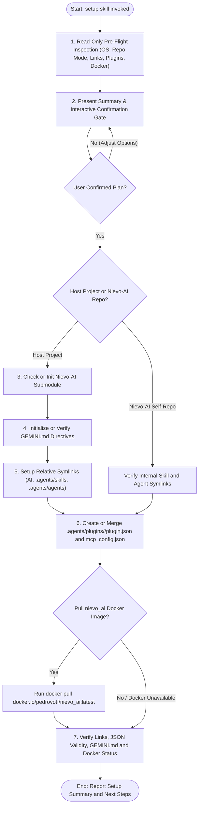

# NIEVO Project & MCP Setup Skill (`setup`)

## 1. Overview & Purpose

This skill performs the complete interactive onboarding of a project into the **NIEVO AI** ecosystem, combining workspace initialization and **project/plugin-scoped MCP configuration** into a single repeatable procedure.

It covers:
1. **Submodule & Directive Initialization**: Verifying or initializing `./Nievo-AI/` and `GEMINI.md` in host projects.
2. **Relative Symbolic Links**: Exposing `AI/`, `.agents/skills/*`, and `.agents/agents/*` cleanly across Linux, macOS, and Windows.
3. **Plugin-Scoped MCP Configuration**: Creating `.agents/plugins/<plugin-name>/plugin.json` and `.agents/plugins/<plugin-name>/mcp_config.json` (default `<plugin-name>`: `nievo-ai`) configured for `docker.io/pedrovotf/nievo_ai:latest`.
4. **Verification & Health Checks**: Validating symlinks, JSON syntax, directive references, and Docker image availability.

> [!IMPORTANT]
> **Bundled GitHub MCP Inside `nievo_ai`**:
> The official Docker image `docker.io/pedrovotf/nievo_ai:latest` **already includes the GitHub MCP server**. Do **not** add a separate duplicate GitHub MCP entry unless the user explicitly asks for an additional standalone server.

> [!NOTE]
> **Host Project vs. Self-Check Mode**:
> - **Host/Consumer Project**: Runs all onboarding steps (submodule check, `GEMINI.md`, `AI/` + `.agents/skills/` + `.agents/agents/` symlinks pointing into `Nievo-AI/`, and `.agents/plugins/<plugin-name>/` MCP setup).
> - **Self-Repo (`Nievo-AI` itself)**: Skips creating `Nievo-AI/...` consumer symlinks and `GEMINI.md` consumer bootstrapping; focuses on verifying internal symlinks and, only if explicitly requested, configuring `.agents/plugins/<plugin-name>/`.

---

## 2. Interactive Setup Workflow



---

## 3. Step-by-Step Execution Protocol

### Phase 1: Read-Only Pre-Flight Inspection

Before modifying any file or prompting the user, inspect the workspace and Docker environment in read-only mode:

```bash
# Detect OS and repository root
uname -s
git rev-parse --show-toplevel
git remote get-url origin 2>/dev/null || true

# Check whether this is a host project (with ./Nievo-AI) or Nievo-AI itself
ls -ld Nievo-AI AI GEMINI.md .agents .agents/skills .agents/agents .agents/plugins 2>/dev/null || true

# Check Docker CLI, daemon status, and nievo_ai image presence
docker --version 2>/dev/null || echo "docker-missing"
docker info >/dev/null 2>&1 && echo "docker-running" || echo "docker-unavailable"
docker image inspect docker.io/pedrovotf/nievo_ai:latest >/dev/null 2>&1 && echo "image-present" || echo "image-absent"
```

From this inspection, determine:
- **Repository mode**: Consumer host project (has `./Nievo-AI` or needs submodule added) vs. `Nievo-AI` canonical repository.
- **Missing or broken artifacts**: Missing `GEMINI.md`, missing/broken `AI` or `.agents/skills/*` / `.agents/agents/*` links, missing `.agents/plugins/<name>/` files.
- **Existing MCP plugin files**: Whether `.agents/plugins/<name>/mcp_config.json` already exists (so its `mcpServers` entries can be preserved/merged rather than overwritten).
- **Security check**: **Never** read `.env` files during inspection. Only inspect `.env-example` or `.env.example` if variable names are needed for optional Docker env pass-through hints.

---

### Phase 2: Interactive Confirmation Gate

Present a concise summary of what was detected and confirm the setup parameters with the user **before** writing files or executing symlinks:

1. **Plugin Name & Path**: Confirm the target plugin directory under `.agents/plugins/<plugin-name>/` (default: `nievo-ai`, producing `.agents/plugins/nievo-ai/plugin.json` and `.agents/plugins/nievo-ai/mcp_config.json`).
2. **Optional Docker Args / Env Pass-Through**: Ask whether `nievo_ai` requires any extra Docker arguments (such as `-e VAR_NAME` forwarding a host environment variable or `-v <host>:<container>` volume mounts).
   > [!CAUTION]
   > Because `.agents/plugins/<plugin-name>/mcp_config.json` lives in the project repository, **never hardcode raw tokens, API keys, or passwords** inside `mcp_config.json`. Use environment variable pass-through flags (e.g., `"-e", "GITHUB_PERSONAL_ACCESS_TOKEN"`) or host-side secret injection instead.
3. **Docker Pull**: Ask whether to execute `docker pull docker.io/pedrovotf/nievo_ai:latest` during setup (skip cleanly if Docker is not installed or daemon is stopped).
4. **Onboarding Actions to Apply**: Confirm creating/updating `GEMINI.md`, relative symbolic links (in host projects), and `.agents/plugins/<plugin-name>/` files.

Wait for explicit user confirmation before proceeding to Phase 3.

---

### Phase 3: Submodule & `GEMINI.md` Setup (Host Projects)

*(Skip Phase 3 when operating in self-check mode inside `Nievo-AI` itself.)*

#### 3.1 Verify or Add the `Nievo-AI` Submodule
- If `./Nievo-AI/` is missing in a host project, guide or initialize it per [README.md](../../../README.md):
  ```bash
  git submodule add https://github.com/pedrovtof/Nievo-Skills.git ./Nievo-AI/
  git submodule update --init --recursive
  ```
- If `./Nievo-AI/` exists as an uninitialized submodule directory (empty):
  ```bash
  git submodule update --init --recursive
  ```

#### 3.2 Initialize or Verify `GEMINI.md`
- **If `GEMINI.md` does not exist**: create it at the project root using the canonical template from [README.md](../../../README.md):
  ```markdown
  # Diretrizes Obrigatórias do Projeto

  Em toda inicialização e execução neste projeto, o agente DEVE seguir e considerar ativas as regras e instruções dos seguintes arquivos essenciais:

  ## Arquivos Base e Regras Globais

  @[AI/Start-here.md](AI/Start-here.md)

  @[AI/Default.md](AI/Default.md)

  @[AI/Rules.md](AI/Rules.md)

  ---

  ## Instruções de Inicialização (Checklist Padrão)

  Toda vez que interagir no projeto:

  1. Respeitar o fluxo de [AI/Default.md](AI/Default.md):
     - Solicitar um breve resumo de contexto, se necessário.
     - Perguntar se o usuário deseja uma opinião/sugestão ou uma implementação/correção direta.
     - Se a tarefa envolver design/front-end, consultar `AI/Desing/`.
  2. Cumprir integralmente todas as exigências de [AI/Rules.md](AI/Rules.md) (Changelog, README, Documentação, Testes, Diagramas Mermaid/dbdiagram, políticas de commit/branch e não leitura de `.env`).
  3. Para procedimentos especializados (git, documentação, banco de dados, linguagens), consultar as skills e agentes correspondentes em `AI/GEMINI/skills/`, `AI/GEMINI/agents/`, `.agents/skills/` e `.agents/agents/`.
  ```
- **If `GEMINI.md` already exists**: verify it includes `@[AI/Start-here.md](AI/Start-here.md)`, `@[AI/Default.md](AI/Default.md)`, and `@[AI/Rules.md](AI/Rules.md)`. Append missing directives cleanly without deleting or overwriting project-specific instructions.

---

### Phase 4: Relative Symbolic Links Setup (Host Projects)

*(Skip creating `Nievo-AI/...` links when operating inside `Nievo-AI` itself; instead validate existing `.agents/skills/*/SKILL.md` and `.agents/agents/*.md` links.)*

Always use **relative targets** so links remain portable across clones, team members, and containers.

> [!IMPORTANT]
> **Avoid the `ln -sf` Directory Symlink Pitfall**:
> On Linux and macOS, running `ln -sf <target> <existing-dir-symlink>` follows an existing directory symlink and creates a nested link *inside* the target directory. Always pass `-n` (`ln -sfn`) for directory symlinks.

#### Linux / macOS (Bash)
```bash
# 1. Link AI/ directory
ln -sfn Nievo-AI/AI AI

# 2. Ensure target customization directories exist
mkdir -p .agents/skills .agents/agents

# 3. Link every skill directory from Nievo-AI/.agents/skills/
for skill in Nievo-AI/.agents/skills/*; do
  [ -d "$skill" ] && ln -sfn "../../$skill" ".agents/skills/$(basename "$skill")"
done

# 4. Link every custom agent from Nievo-AI/.agents/agents/
for agent in Nievo-AI/.agents/agents/*.md; do
  [ -e "$agent" ] && ln -sf "../../$agent" ".agents/agents/$(basename "$agent")"
done
```

#### Windows (PowerShell — Administrator or Developer Mode)
```powershell
New-Item -ItemType SymbolicLink -Force -Path "AI" -Target "Nievo-AI\AI"
New-Item -ItemType Directory -Force -Path ".agents\skills"
New-Item -ItemType Directory -Force -Path ".agents\agents"

Get-ChildItem -Directory -Path "Nievo-AI\.agents\skills" | ForEach-Object {
  New-Item -ItemType SymbolicLink -Force -Path ".agents\skills\$($_.Name)" -Target "..\..\Nievo-AI\.agents\skills\$($_.Name)"
}

Get-ChildItem -File -Filter "*.md" -Path "Nievo-AI\.agents\agents" | ForEach-Object {
  New-Item -ItemType SymbolicLink -Force -Path ".agents\agents\$($_.Name)" -Target "..\..\Nievo-AI\.agents\agents\$($_.Name)"
}
```

#### Windows (CMD)
```cmd
mklink /D AI Nievo-AI\AI
mkdir .agents\skills
mkdir .agents\agents
for /D %s in (Nievo-AI\.agents\skills\*) do mklink /D ".agents\skills\%~nxs" "..\..\Nievo-AI\.agents\skills\%~nxs"
for %a in (Nievo-AI\.agents\agents\*.md) do mklink ".agents\agents\%~nxa" "..\..\Nievo-AI\.agents\agents\%~nxa"
```

---

### Phase 5: Project/Plugin-Scoped MCP Configuration

Configure the `nievo_ai` MCP server inside `.agents/plugins/<plugin-name>/` (default: `.agents/plugins/nievo-ai/`).

#### 5.1 Create Plugin Manifest (`plugin.json`)
Create `.agents/plugins/<plugin-name>/plugin.json` if it does not exist:
```json
{
  "name": "nievo-ai",
  "repository": "https://github.com/pedrovtof/Nievo-Skills"
}
```
*(Update `"name"` if the user chose a custom `<plugin-name>`.)*

#### 5.2 Create or Safely Merge `mcp_config.json`
Create `.agents/plugins/<plugin-name>/mcp_config.json` with the `nievo_ai` Stdio Docker configuration:
```json
{
  "mcpServers": {
    "nievo_ai": {
      "command": "docker",
      "args": [
        "run",
        "-i",
        "--rm",
        "docker.io/pedrovotf/nievo_ai:latest"
      ]
    }
  }
}
```

**Safe Merge Rules**:
- If `.agents/plugins/<plugin-name>/mcp_config.json` already exists, parse the JSON and preserve all existing keys and other entries inside `mcpServers`; only add or update `mcpServers.nievo_ai`.
- If the user confirmed additional Docker arguments (e.g., `-e`, `VAR_NAME`, or `-v`, `<mount>`), insert them **before** the image name `"docker.io/pedrovotf/nievo_ai:latest"` in `"args"`.
- Remember: `nievo_ai` **already embeds the GitHub MCP**, so do not configure a separate GitHub MCP entry unless explicitly requested.

#### 5.3 Pull Docker Image (When Confirmed & Docker Available)
```bash
docker pull docker.io/pedrovotf/nievo_ai:latest
```
If Docker is unavailable or the daemon is stopped, inform the user clearly without failing the file configuration steps, and provide the `docker pull` command to run manually later.

---

### Phase 6: Verification & Post-Setup Checks

Run deterministic validation checks after all edits:

```bash
# 1. Verify no broken symlinks exist under .agents/ (and AI in host projects)
find .agents -type l ! -exec test -e {} \; -print
ls -la .agents/skills/ .agents/agents/

# 2. Validate JSON syntax of plugin.json and mcp_config.json
python3 -m json.tool .agents/plugins/<plugin-name>/plugin.json >/dev/null
python3 -m json.tool .agents/plugins/<plugin-name>/mcp_config.json >/dev/null

# 3. Verify GEMINI.md directives (host project)
grep -E "AI/(Start-here|Default|Rules)\.md" GEMINI.md

# 4. Verify Docker image availability (if Docker daemon is running)
docker image inspect docker.io/pedrovotf/nievo_ai:latest --format '{{.RepoTags}} {{.Id}}'
```

Also remind the user how to confirm the loaded MCP tools inside the Antigravity UI:
- Open **Additional Options (...) > MCP Servers** to verify `nievo_ai` and its bundled tools (including GitHub MCP) are active.

---

## 4. Critical Safety Rules

1. **Confirm Before Mutating**: Always inspect the workspace first and obtain user confirmation before creating/updating `GEMINI.md`, symbolic links, or plugin MCP configs.
2. **Preserve Existing Configurations**: Never overwrite custom rules in `GEMINI.md` or unrelated entries in `mcp_config.json`.
3. **Never Read `.env` or Hardcode Secrets**: Never read `.env` files and never store raw tokens, passwords, or API keys in committed `.agents/plugins/*/mcp_config.json` files.
4. **Do Not Duplicate GitHub MCP**: `docker.io/pedrovotf/nievo_ai:latest` already bundles the GitHub MCP server.
5. **No Git Commits Inside `setup`**: Leave staging, `changelog.md` synchronization, commits, and pushes strictly to `git-admin` / `git-*` skills unless the user separately invokes Git delivery.

---

## 5. Verification Checklist

- [ ] Read-only pre-flight inspection completed (OS, repo mode, `Nievo-AI` submodule, `GEMINI.md`, symlinks, `.agents/plugins/`, Docker status).
- [ ] User confirmed `<plugin-name>`, optional Docker env/mount flags (without hardcoded secrets), Docker pull option, and onboarding actions.
- [ ] `Nievo-AI` submodule and `GEMINI.md` directives verified or initialized (host project).
- [ ] Relative symbolic links created/verified (`AI`, `.agents/skills/*`, `.agents/agents/*`) with zero broken links.
- [ ] `.agents/plugins/<plugin-name>/plugin.json` and `.agents/plugins/<plugin-name>/mcp_config.json` created or safely merged with `nievo_ai`.
- [ ] JSON files validated, Docker image status verified/reported, and Antigravity UI verification path shared with the user.
