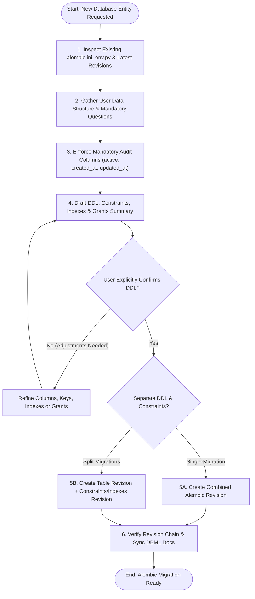

# Python Alembic Entity & DDL Generator Skill

## 1. Overview & Purpose

This skill defines the mandatory interactive workflow and DDL standards for generating **Python Alembic** database migrations from user-provided data structures.

Every table/entity migration generated under this skill must use deterministic naming, explicit user confirmation for keys, indexes, and relationships, raw-SQL execution via `op.execute(...)`, reversible `downgrade()` logic, and the **mandatory audit columns** required across all NIEVO relational entities.

> [!IMPORTANT]
> **Mandatory Audit Columns on Every Entity**:
> Every generated table/entity **MUST** always include the following three audit columns (even if omitted from the user's draft):
> - `active`: boolean defaulting to `true` (`BOOLEAN DEFAULT true NOT NULL`)
> - `created_at`: datetime/timestamp defaulting to `now()` (`TIMESTAMP without time zone DEFAULT now() NOT NULL` in PostgreSQL, or SGBD equivalent `DATETIME DEFAULT NOW() NOT NULL`)
> - `updated_at`: datetime/timestamp defaulting to `now()` (`TIMESTAMP without time zone DEFAULT now() NOT NULL` in PostgreSQL, or SGBD equivalent `DATETIME DEFAULT NOW() NOT NULL`)

---

## 2. Interactive Discovery & DDL Workflow



### Step 1: Inspect Existing Alembic Environment
Before asking questions or creating files, inspect the repository's existing Alembic setup:
1. Locate all `alembic.ini`, `alembic/env.py`, and `alembic/versions/*.py` files in the target backend/service.
2. Read `alembic/env.py` (never read real `.env` files; inspect only `.env-example` or `env-example.txt` if checking connection variable names) to confirm how the target service executes migrations.
3. Read the most recent migration files in `alembic/versions/` to identify:
   - Current head `revision` ID (`down_revision` for the new migration)
   - Existing schemas, roles/users for `GRANT` statements, and naming conventions.

### Step 2: Mandatory User Questioning Protocol
**Always question the user** before generating any migration file. Never guess keys, indexes, relationships, or permissions. Ask clearly for:
1. **Target Service & Alembic Path**: Which service/module owns this table (e.g., `Auth`, `Core`, or another service's `alembic/` folder)?
2. **Target SGBD**: Which database engine is used (e.g., PostgreSQL [default], MySQL, SQL Server)?
3. **Schema & Table Name**: Target schema (e.g., `payment`, `accounts`, `goals`, `user_details`, `journey`) and lowercase `snake_case` table name(s).
4. **Columns & Data Types**: Column names, SQL types, lengths/precisions (e.g., `VARCHAR(150)`, `DECIMAL(18,2)`), nullability (`NOT NULL` vs nullable), and default values.
5. **Primary Key Strategy**: Auto-increment (`SERIAL` / `BIGSERIAL` / `IDENTITY`), `UUID`, or composite primary key.
6. **Relationships & Foreign Keys**: Referenced `schema.table(column)` for each foreign key, plus `ON DELETE` / `ON UPDATE` rules (`CASCADE`, `RESTRICT`, `SET NULL`, `NO ACTION`).
7. **Indexes & Uniqueness**: Single-column or composite indexes, `UNIQUE` constraints/indexes, and filter/lookup columns.
8. **Database Role Permissions (`GRANT`)**: Application role(s) requiring `USAGE ON SCHEMA`, `SELECT, INSERT, UPDATE` (or `DELETE`) on tables, and `SELECT, USAGE ON ALL SEQUENCES` (or cross-database reader roles).
9. **Migration Granularity**: Whether to generate a single migration or split table creation and foreign-key constraints/indexes into two sequential revisions (the common pattern in NIEVO services).

### Step 3: Draft Summary & Mandatory Confirmation
Present the complete planned DDL—including the automatically appended `active`, `created_at`, and `updated_at` columns, keys, indexes, foreign keys, and grants—to the user and **wait for explicit confirmation** before creating the Alembic revision file(s).

---

## 3. DDL & Alembic Migration Standards

### 3.1 Mandatory Audit Columns Standard
Every `CREATE TABLE` statement **must** include:

```sql
active BOOLEAN DEFAULT true NOT NULL,
created_at TIMESTAMP without time zone DEFAULT now() NOT NULL,
updated_at TIMESTAMP without time zone DEFAULT now() NOT NULL
```

*(When targeting MySQL or SQL Server, adapt the timestamp type to `DATETIME DEFAULT CURRENT_TIMESTAMP NOT NULL` / `DATETIME2 DEFAULT GETDATE() NOT NULL` while keeping exact column names `active`, `created_at`, and `updated_at`.)*

### 3.2 Raw-SQL Migration Pattern
Generate the revision file using `alembic revision -m "<short_snake_case_description>"` (or create the `.py` file matching `alembic/script.py.mako` with the exact `revision` and `down_revision` chain).

Follow these SQL rules inside `op.execute(""" ... """)`:
1. **Idempotent Table & Index Creation**:
   - Always use `CREATE TABLE IF NOT EXISTS <schema>.<table> (...)`.
   - Always use `CREATE INDEX IF NOT EXISTS` or `CREATE UNIQUE INDEX IF NOT EXISTS`.
2. **Idempotent Constraints (PostgreSQL)**:
   - Wrap `ALTER TABLE ... ADD CONSTRAINT` inside a `DO $$ BEGIN IF NOT EXISTS (SELECT 1 FROM pg_constraint WHERE conname = '...') THEN ... END IF; END $$;` block.
3. **Reserved Keywords**:
   - Quote reserved SQL identifiers such as `"transaction"` or `"user"` consistently in DDL, grants, and drops.
4. **Deterministic Naming**:
   - Foreign keys: `fk_<schema>_<table>_<target_or_role>` (e.g., `fk_payment_transaction_status`).
   - Indexes: `idx_<schema>_<table>_<column_or_purpose>` or `idx_unic_<schema>_<table>_<column>` for unique indexes.
5. **Reversible `downgrade()`**:
   - Drop constraints (`DROP CONSTRAINT`) and indexes (`DROP INDEX IF EXISTS`) before dropping tables (`DROP TABLE IF EXISTS "<schema>"."<table>" CASCADE;`), and revoke sequence/table privileges where applicable.

### 3.3 Reference Migration Templates

#### Template A: Table Creation Migration
```python
"""create <table_name> table

Revision ID: <new_revision_id>
Revises: <previous_revision_id>
Create Date: <YYYY-MM-DD HH:MM:SS>

"""
from typing import Sequence, Union

from alembic import op
import sqlalchemy as sa


# revision identifiers, used by Alembic.
revision: str = '<new_revision_id>'
down_revision: Union[str, Sequence[str], None] = '<previous_revision_id>'
branch_labels: Union[str, Sequence[str], None] = None
depends_on: Union[str, Sequence[str], None] = None


def upgrade() -> None:
    """Upgrade schema."""
    op.execute("""
        CREATE TABLE IF NOT EXISTS <schema>.<table_name> (
            id SERIAL PRIMARY KEY,
            name VARCHAR(150) NOT NULL,
            description VARCHAR(255),
            active BOOLEAN DEFAULT true NOT NULL,
            created_at TIMESTAMP without time zone DEFAULT now() NOT NULL,
            updated_at TIMESTAMP without time zone DEFAULT now() NOT NULL
        );

        GRANT USAGE ON SCHEMA <schema> TO <app_role>;
        GRANT SELECT, INSERT, UPDATE ON TABLE <schema>."<table_name>" TO <app_role>;
        GRANT SELECT, USAGE ON ALL SEQUENCES IN SCHEMA <schema> TO <app_role>;
    """)


def downgrade() -> None:
    """Downgrade schema."""
    op.execute("""
        DROP TABLE IF EXISTS "<schema>"."<table_name>" CASCADE;
    """)
```

#### Template B: Constraints & Indexes Migration
```python
"""create <table_name> constraints and indexes

Revision ID: <new_revision_id>
Revises: <table_revision_id>
Create Date: <YYYY-MM-DD HH:MM:SS>

"""
from typing import Sequence, Union

from alembic import op
import sqlalchemy as sa


# revision identifiers, used by Alembic.
revision: str = '<new_revision_id>'
down_revision: Union[str, Sequence[str], None] = '<table_revision_id>'
branch_labels: Union[str, Sequence[str], None] = None
depends_on: Union[str, Sequence[str], None] = None


def upgrade() -> None:
    """Upgrade schema."""
    op.execute("""
        DO $$
        BEGIN
            IF NOT EXISTS (SELECT 1 FROM pg_constraint WHERE conname = 'fk_<schema>_<table_name>_<target>') THEN
                ALTER TABLE <schema>.<table_name>
                ADD CONSTRAINT fk_<schema>_<table_name>_<target>
                FOREIGN KEY (<fk_column>) REFERENCES <target_schema>.<target_table>(id);
            END IF;
        END $$;

        CREATE INDEX IF NOT EXISTS idx_<schema>_<table_name>_<col>
            ON <schema>.<table_name> (<col>);
    """)


def downgrade() -> None:
    """Downgrade schema."""
    op.execute("""
        DROP INDEX IF EXISTS <schema>.idx_<schema>_<table_name>_<col>;

        DO $$
        BEGIN
            IF EXISTS (SELECT 1 FROM pg_constraint WHERE conname = 'fk_<schema>_<table_name>_<target>') THEN
                ALTER TABLE <schema>.<table_name>
                DROP CONSTRAINT fk_<schema>_<table_name>_<target>;
            END IF;
        END $$;
    """)
```

---

## 4. Critical Safety & Documentation Rules

1. **Never Read `.env` Files**: Only inspect `.env-example` / `env-example.txt` if connection variable names need to be verified.
2. **Never Invent Unconfirmed Schema Elements**: Keys, foreign-key targets, cascade rules, indexes, and role grants must always come from or be confirmed by the user.
3. **Never Omit Audit Columns**: `active`, `created_at`, and `updated_at` with their defaults (`true` / `now()`) are mandatory on every new entity.
4. **Synchronize Database Documentation**: After generating or updating migrations, update the project's DBML schema documentation following [dbdiagram.md](../../documentation/dbdiagram/diagram.md) and the documentation orchestrator [documentation.md](../../documentation/documentation.md).
5. **Downstream .NET Entity Generation**: When the user also needs the C# Entity, View, and Model for the generated table, proceed to `dotnet-gen-entity` ([dotnet-gen-entity.md](../../programming/dotnet/dotnet-gen-entity.md)).

---

## 5. Verification Checklist

- [ ] Inspected target `alembic/env.py` and latest revision in `alembic/versions/`.
- [ ] Questioned user on table structure, primary key, foreign keys, indexes, SGBD, and grants, and received confirmation.
- [ ] Every generated entity includes `active` (`DEFAULT true`), `created_at` (`DEFAULT now()`), and `updated_at` (`DEFAULT now()`).
- [ ] `down_revision` correctly points to the previous head revision (no broken or branched heads unless intended).
- [ ] `upgrade()` uses idempotent DDL (`IF NOT EXISTS` / `pg_constraint` checks) and `downgrade()` cleanly reverses all changes.
- [ ] No `.env` file was read or modified.
- [ ] DBML schema documentation updated or flagged for update per `dbdiagram` skill.
