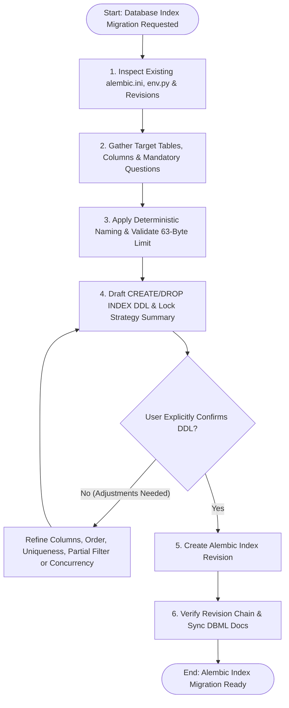

# Python Alembic Index Generator Skill

## 1. Overview & Purpose

This skill defines the mandatory interactive workflow and DDL standards for generating **Python Alembic** database index migrations on existing tables.

Every index migration generated under this skill must use deterministic naming, explicit user confirmation for index type, column ordering, predicates, and locking behavior, idempotent raw-SQL execution via `op.execute(...)`, and complete schema-qualified `downgrade()` reversal.

> [!IMPORTANT]
> **Deterministic Naming & Schema-Qualified `downgrade()`**:
> 1. Every non-unique index **MUST** follow `idx_<schema>_<table>_<column_or_purpose>`, and every unique index **MUST** follow `idx_unic_<schema>_<table>_<column_or_purpose>` (never use `idx_unic_` on a non-unique index; stay within PostgreSQL's 63-byte identifier limit).
> 2. Every `downgrade()` **MUST** explicitly drop every index created in `upgrade()` using schema-qualified `DROP INDEX IF EXISTS <schema>.<index_name>;`.

---

## 2. Interactive Discovery & Index Workflow



### Step 1: Inspect Existing Alembic Environment
Before asking questions or creating files, inspect the repository's existing Alembic setup:
1. Locate all `alembic.ini`, `alembic/env.py`, and `alembic/versions/*.py` files in the target backend/service.
2. Read `alembic/env.py` (never read real `.env` files; inspect only `.env-example` or `env-example.txt` if checking connection variable names) to confirm how transactions and migrations are executed (e.g., `context.begin_transaction()`).
3. Read existing migrations in `alembic/versions/` to identify:
   - Current head `revision` ID (`down_revision` for the new migration)
   - Target table schemas, exact column names/types (including `active`), and already-existing indexes so duplicates are never created.

### Step 2: Mandatory User Questioning Protocol
**Always question the user** before generating any index migration file. Never guess indexed columns, column ordering, uniqueness, or partial filters. Ask clearly for:
1. **Target Service & Alembic Path**: Which service/module owns the table(s) (e.g., `Core`, `Auth`, or another service's `alembic/` folder)?
2. **Target SGBD**: Which database engine is used (e.g., PostgreSQL [default], MySQL, SQL Server)?
3. **Target Schema & Table Name(s)**: Exact `<schema>.<table>` for each index.
4. **Columns & Column Order**: Single column or ordered list of composite columns `(col_a, col_b)` aligned with query equality/range/sort selectivity, plus optional sort direction (`DESC`, `NULLS LAST`) or covering columns (`INCLUDE (...)`).
5. **Index Type & Access Method**:
   - Standard (`INDEX`) vs `UNIQUE INDEX`
   - Access method (`BTREE` [default], `GIN`, `GIST`, `HASH`, `BRIN`)
   - Expression index (e.g., `LOWER("name")`) if case-insensitive lookups are needed.
6. **Partial Index Filter (`WHERE`)**: Whether the index should be filtered (e.g., `WHERE active = true` for active-record queries or `WHERE col IS NOT NULL`, and whether a `UNIQUE` constraint should only enforce uniqueness among `active = true` rows).
7. **Locking Strategy (`CONCURRENTLY`)**: Whether standard transactional `CREATE [UNIQUE] INDEX IF NOT EXISTS` is acceptable (default for new/small tables) or whether zero-downtime `CONCURRENTLY` with `autocommit_block()` is required on large live tables.

### Step 3: Draft Summary & Mandatory Confirmation
Present the exact index names, target tables, column order, uniqueness/partial clauses, lock strategy, and matching schema-qualified `DROP INDEX IF EXISTS` statements to the user and **wait for explicit confirmation** before creating the Alembic revision file.

---

## 3. Index & Alembic Migration Standards

### 3.1 Deterministic Naming Convention
- **Non-Unique Index**: `idx_<schema>_<table>_<column_or_purpose>`
  - Example: `idx_goals_category_user`, `idx_goals_category_active`, `idx_goals_expire_at`
- **Unique Index**: `idx_unic_<schema>_<table>_<column_or_purpose>`
  - Example: `idx_unic_accounts_user_bank`, `idx_unic_accounts_bank_card_flag_name`
- **Naming Guards**:
  - Never use `idx_unic_` for a non-unique index.
  - Keep identifier lengths at or below **63 bytes** (PostgreSQL truncates longer names silently, which can cause `IF NOT EXISTS` / `DROP INDEX` mismatches).

### 3.2 Raw-SQL Index Rules
Generate the revision file using `alembic revision -m "create_<short_snake_case_description>_indexes"` (or create the `.py` file matching `alembic/script.py.mako` with the exact `revision` and `down_revision` chain).

Follow these SQL rules inside `op.execute(""" ... """)`:
1. **Idempotent Creation**:
   - Always use `CREATE INDEX IF NOT EXISTS` or `CREATE UNIQUE INDEX IF NOT EXISTS`.
   - Always schema-qualify the table (`ON <schema>."<table>" (...)`) and quote reserved SQL identifiers such as `"transaction"`, `"name"`, or `"user"`.
2. **Schema-Qualified Idempotent Drops in `downgrade()`**:
   - Always drop every created index in `downgrade()` using `DROP INDEX IF EXISTS <schema>.<index_name>;`.
   - Never omit `<schema>.` in `DROP INDEX IF EXISTS`: PostgreSQL looks up the index in `search_path` (`public`) if the schema prefix is omitted and fails to drop indexes in schemas like `accounts`, `goals`, or `payment`.
3. **Transaction & `CONCURRENTLY` Handling**:
   - Because `alembic/env.py` runs migrations inside `with context.begin_transaction():`, PostgreSQL **forbids** `CREATE INDEX CONCURRENTLY` and `DROP INDEX CONCURRENTLY` inside a transaction block.
   - Use standard `CREATE [UNIQUE] INDEX IF NOT EXISTS` by default.
   - Only when the user explicitly requests `CONCURRENTLY` for large production tables, wrap each `CREATE [UNIQUE] INDEX CONCURRENTLY IF NOT EXISTS` (and matching `DROP INDEX CONCURRENTLY IF EXISTS`) inside `with op.get_context().autocommit_block():`, issuing one statement per `op.execute(...)` call.
4. **SGBD Adaptations**:
   - **PostgreSQL (default)**: `CREATE [UNIQUE] INDEX IF NOT EXISTS idx_... ON <schema>."<table>" (...)` and `DROP INDEX IF EXISTS <schema>.idx_...;`.
   - **SQL Server**: Check `sys.indexes` before `CREATE [UNIQUE] INDEX` and use `DROP INDEX IF EXISTS idx_... ON <schema>.<table>;`.
   - **MySQL**: Use `CREATE [UNIQUE] INDEX` (with index existence check via `information_schema.statistics` on versions without `IF NOT EXISTS`) and `DROP INDEX idx_... ON <schema>.<table>;`.

### 3.3 Reference Migration Templates

#### Template A: Standard, Composite & Unique Indexes Migration
```python
"""create <table_name> indexes

Revision ID: <new_revision_id>
Revises: <previous_revision_id>
Create Date: <YYYY-MM-DD HH:MM:SS>

"""
from typing import Sequence, Union

from alembic import op
import sqlalchemy as sa


# revision identifiers, used by Alembic.
revision: str = '<new_revision_id>'
down_revision: Union[str, Sequence[str], None] = '<previous_revision_id>'
branch_labels: Union[str, Sequence[str], None] = None
depends_on: Union[str, Sequence[str], None] = None


def upgrade() -> None:
    """Upgrade schema."""
    op.execute("""
        CREATE INDEX IF NOT EXISTS idx_<schema>_<table_name>_<col>
            ON <schema>."<table_name>" (<col>);

        CREATE UNIQUE INDEX IF NOT EXISTS idx_unic_<schema>_<table_name>_<col_a>_<col_b>
            ON <schema>."<table_name>" (<col_a>, <col_b>);
    """)


def downgrade() -> None:
    """Downgrade schema."""
    op.execute("""
        DROP INDEX IF EXISTS <schema>.idx_unic_<schema>_<table_name>_<col_a>_<col_b>;

        DROP INDEX IF EXISTS <schema>.idx_<schema>_<table_name>_<col>;
    """)
```

#### Template B: Partial, Expression & Concurrent Index Migration
```python
"""create <table_name> partial and expression indexes

Revision ID: <new_revision_id>
Revises: <previous_revision_id>
Create Date: <YYYY-MM-DD HH:MM:SS>

"""
from typing import Sequence, Union

from alembic import op
import sqlalchemy as sa


# revision identifiers, used by Alembic.
revision: str = '<new_revision_id>'
down_revision: Union[str, Sequence[str], None] = '<previous_revision_id>'
branch_labels: Union[str, Sequence[str], None] = None
depends_on: Union[str, Sequence[str], None] = None


def upgrade() -> None:
    """Upgrade schema."""
    # Standard transactional partial & expression indexes (default):
    op.execute("""
        CREATE UNIQUE INDEX IF NOT EXISTS idx_unic_<schema>_<table_name>_name_active
            ON <schema>."<table_name>" (LOWER("name"))
            WHERE active = true;
    """)

    # Use autocommit_block() ONLY when the user explicitly requests CONCURRENTLY:
    # with op.get_context().autocommit_block():
    #     op.execute("""
    #         CREATE INDEX CONCURRENTLY IF NOT EXISTS idx_<schema>_<table_name>_<col>
    #             ON <schema>."<table_name>" (<col>)
    #             WHERE active = true;
    #     """)


def downgrade() -> None:
    """Downgrade schema."""
    op.execute("""
        DROP INDEX IF EXISTS <schema>.idx_unic_<schema>_<table_name>_name_active;
    """)

    # If created CONCURRENTLY, drop CONCURRENTLY inside autocommit_block():
    # with op.get_context().autocommit_block():
    #     op.execute("""
    #         DROP INDEX CONCURRENTLY IF EXISTS <schema>.idx_<schema>_<table_name>_<col>;
    #     """)
```

---

## 4. Critical Safety & Documentation Rules

1. **Never Read `.env` Files**: Only inspect `.env-example` / `env-example.txt` if connection variable names need to be verified.
2. **Never Invent Unconfirmed Indexes**: Indexed columns, column ordering, uniqueness, partial predicates, and `CONCURRENTLY` usage must always come from or be confirmed by the user.
3. **Never Omit `downgrade()` Drops**: Every index created in `upgrade()` must have a matching schema-qualified `DROP INDEX IF EXISTS <schema>.<index_name>;` in `downgrade()`.
4. **Coordinate with Sibling Alembic Skills**:
   - Table creation & columns: [python-alembic-gen-entity.md](./python-alembic-gen-entity.md)
   - Primary keys & foreign key constraints: [python-alembic-gen-keys.md](./python-alembic-gen-keys.md)
   - Seed / data inserts: [python-alembic-gen-insert.md](./python-alembic-gen-insert.md)
5. **Synchronize Database Documentation**: After generating or updating index migrations, update the `Indexes { ... }` block in the project's DBML schema documentation following [dbdiagram.md](../../documentation/dbdiagram/diagram.md) and the documentation orchestrator [documentation.md](../../documentation/documentation.md).

---

## 5. Verification Checklist

- [ ] Inspected target `alembic/env.py`, table schemas, and existing indexes in `alembic/versions/`.
- [ ] Questioned user on target table(s), columns/order, uniqueness, partial filters, access method, and `CONCURRENTLY` preference, and received confirmation.
- [ ] Index names strictly follow `idx_<schema>_<table>_<col>` or `idx_unic_<schema>_<table>_<col>` and do not exceed 63 bytes.
- [ ] `upgrade()` uses idempotent `CREATE [UNIQUE] INDEX IF NOT EXISTS`, and any `CONCURRENTLY` statement runs inside `with op.get_context().autocommit_block():`.
- [ ] `downgrade()` drops every created index with schema-qualified `DROP INDEX IF EXISTS <schema>.<index_name>;`.
- [ ] `down_revision` correctly points to the previous head revision (no broken or branched heads unless intended).
- [ ] No `.env` file was read or modified.
- [ ] DBML `Indexes` block updated or flagged for update per `dbdiagram` skill.
