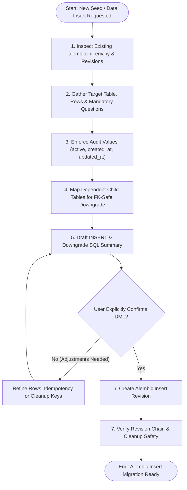

# Python Alembic Data & Seed Insert Generator Skill

## 1. Overview & Purpose

This skill defines the mandatory interactive workflow and DML standards for generating **Python Alembic** seed and reference-data migrations from user-provided records.

Every data-insert migration generated under this skill must use explicit user confirmation for target tables, column mappings, idempotency behavior, and cleanup keys, raw-SQL execution via `op.execute(...)`, explicit population of **mandatory audit columns**, and FK-aware reversible `downgrade()` logic.

> [!IMPORTANT]
> **Mandatory Audit Column Values & FK-Aware `downgrade()`**:
> 1. Every `INSERT` targeting a NIEVO entity **MUST** explicitly populate `active`, `created_at`, and `updated_at` (`true, NOW(), NOW()` in PostgreSQL, or SGBD equivalent `CURRENT_TIMESTAMP` / `GETDATE()`) unless the user explicitly provides custom audit values or confirms relying on database defaults where `updated_at` is nullable.
> 2. Every `downgrade()` **MUST** inspect existing foreign-key relationships and delete referencing child/grandchild rows in reverse dependency order before deleting the seeded parent rows—always using table-aliased, correlated `EXISTS` subqueries so no unrelated records are ever deleted.

---

## 2. Interactive Discovery & Insert Workflow



### Step 1: Inspect Existing Alembic Environment
Before asking questions or creating files, inspect the repository's existing Alembic setup:
1. Locate all `alembic.ini`, `alembic/env.py`, and `alembic/versions/*.py` files in the target backend/service.
2. Read `alembic/env.py` (never read real `.env` files; inspect only `.env-example` or `env-example.txt` if checking connection variable names) to confirm how the target service executes migrations.
3. Read the target table creation migration and all constraint/foreign-key migrations in `alembic/versions/` to identify:
   - Current head `revision` ID (`down_revision` for the new migration)
   - Exact schema name, table name, column names, types, nullability, and defaults (including whether `updated_at` has `DEFAULT now()` or is nullable)
   - Any existing `UNIQUE` constraints/indexes on natural keys
   - All child and grandchild tables with foreign keys referencing the target table (needed for a safe `downgrade()`).

### Step 2: Mandatory User Questioning Protocol
**Always question the user** before generating any insert migration file. Never invent rows, natural keys, conflict behavior, or cleanup scope. Ask clearly for:
1. **Target Service & Alembic Path**: Which service/module owns the target table (e.g., `Core`, `Auth`, or another service's `alembic/` folder)?
2. **Target SGBD**: Which database engine is used (e.g., PostgreSQL [default], MySQL, SQL Server)?
3. **Target Schema & Table Name**: Exact `<schema>.<table>` receiving the rows (e.g., `payment.transaction_type`, `accounts.bank_type`).
4. **Columns & Seed Rows**: Exact columns to populate and the complete list of values/rows to insert (never invent or truncate seed values).
5. **Audit Column Values**: Confirm setting `active = true`, `created_at = NOW()`, `updated_at = NOW()` on every inserted row (or whether any row requires `active = false` or custom timestamps).
6. **Idempotency Strategy**: Whether to use:
   - Plain multi-row `INSERT INTO ... VALUES (...)` (default when inserting fresh seed data into an empty lookup table)
   - `ON CONFLICT (<unique_col>) DO NOTHING` (only valid if a `UNIQUE` constraint/index exists on `<unique_col>`)
   - `INSERT INTO ... SELECT ... FROM (VALUES (...)) AS v(...) WHERE NOT EXISTS (...)` (safe idempotency when no `UNIQUE` constraint exists).
7. **Natural Key for `downgrade()` & Dependent Cleanup**: Which column(s) uniquely identify the inserted rows (e.g., `"name"`, `code`) for `DELETE` in `downgrade()`, and confirmation to cascade-delete referencing child rows in reverse FK order during rollback.

### Step 3: Draft Summary & Mandatory Confirmation
Present the complete planned `INSERT` statement(s), audit column values, idempotency strategy, and the exact FK-ordered `DELETE` statements for `downgrade()` to the user and **wait for explicit confirmation** before creating the Alembic revision file.

---

## 3. Insert & Alembic Migration Standards

### 3.1 Mandatory Audit Values Standard
Every `INSERT` into a NIEVO entity **must** explicitly include the audit columns:

```sql
INSERT INTO <schema>.<table_name> (<columns>, active, created_at, updated_at)
VALUES
    (..., true, NOW(), NOW()),
    (..., true, NOW(), NOW());
```

*(When targeting MySQL or SQL Server, adapt `NOW()` to `CURRENT_TIMESTAMP` / `GETDATE()` and `true` to `1` if required by the engine, while keeping exact column names `active`, `created_at`, and `updated_at`.)*

### 3.2 Raw-SQL Insert & Downgrade Rules
Generate the revision file using `alembic revision -m "insert_<short_snake_case_description>"` (or create the `.py` file matching `alembic/script.py.mako` with the exact `revision` and `down_revision` chain).

Follow these SQL rules inside `op.execute(""" ... """)`:
1. **Explicit Column Lists**:
   - Always list target columns explicitly in `INSERT INTO <schema>."<table>" (col1, col2, active, created_at, updated_at)`. Never rely on positional `INSERT INTO <schema>.<table> VALUES (...)`.
2. **Idempotency Guards (User-Confirmed)**:
   - Never emit `ON CONFLICT (<col>) DO NOTHING` unless you verified in `alembic/versions/` that a `UNIQUE` index or `UNIQUE` constraint actually exists on `<col>`. PostgreSQL raises an error (`there is no unique or exclusion constraint matching the ON CONFLICT specification`) otherwise.
   - When idempotency is requested without a unique index/constraint, use `INSERT INTO ... SELECT ... FROM (VALUES (...)) AS v(...) WHERE NOT EXISTS (SELECT 1 FROM <schema>."<table>" t WHERE t.<natural_key> = v.<natural_key>);`.
3. **Quoting & String Escaping**:
   - Escape single quotes inside SQL string literals by doubling them (`''`).
   - Quote reserved SQL identifiers such as `"name"`, `"transaction"`, or `"user"` consistently in both `upgrade()` and `downgrade()`.
4. **FK-Aware Reversible `downgrade()`**:
   - Inspect all foreign keys pointing to `<schema>.<table>` and delete dependent rows in **reverse dependency order** (grandchild -> child -> seeded table) before deleting the seeded rows.
   - **Always alias both tables and qualify every column inside `EXISTS`**: write `b."name" IN (...)` and correlate `WHERE a.<fk_col> = b.id`. Never write unqualified `name IN (...)` inside a correlated subquery—if the child table also has a `name` column (like `accounts.bank` or `payment.transaction`), SQL resolves `name` to the outer table instead of the lookup table!
   - **Always correlate every nested `EXISTS` level** (`WHERE grandchild.<fk> = child.id` and `WHERE child.<fk> = parent.id`) so `downgrade()` never wipes unrelated rows in child or grandchild tables.

### 3.3 Reference Migration Templates

#### Template A: Standard Seed / Lookup Insert with FK-Aware Downgrade
```python
"""insert <table_name> values

Revision ID: <new_revision_id>
Revises: <previous_revision_id>
Create Date: <YYYY-MM-DD HH:MM:SS>

"""
from typing import Sequence, Union

from alembic import op
import sqlalchemy as sa


# revision identifiers, used by Alembic.
revision: str = '<new_revision_id>'
down_revision: Union[str, Sequence[str], None] = '<previous_revision_id>'
branch_labels: Union[str, Sequence[str], None] = None
depends_on: Union[str, Sequence[str], None] = None


def upgrade() -> None:
    """Upgrade schema."""
    op.execute("""
        INSERT INTO <schema>."<table_name>" ("name", description, active, created_at, updated_at)
        VALUES
            ('<Value 1>', '<Description 1>', true, NOW(), NOW()),
            ('<Value 2>', '<Description 2>', true, NOW(), NOW());
    """)


def downgrade() -> None:
    """Downgrade schema."""
    op.execute("""
        -- Delete grandchild rows first when a multi-level FK chain exists:
        -- DELETE FROM <grandchild_schema>."<grandchild_table>" gc
        -- WHERE EXISTS (
        --     SELECT 1
        --     FROM <child_schema>."<child_table>" c
        --     JOIN <schema>."<table_name>" p ON c.<fk_column> = p.id
        --     WHERE gc.<child_fk_column> = c.id
        --       AND p."name" IN ('<Value 1>', '<Value 2>')
        -- );

        DELETE FROM <child_schema>."<child_table>" a
        WHERE EXISTS (
            SELECT 1
            FROM <schema>."<table_name>" b
            WHERE a.<fk_column> = b.id
              AND b."name" IN (
                  '<Value 1>',
                  '<Value 2>'
              )
        );

        DELETE FROM <schema>."<table_name>"
        WHERE "name" IN (
            '<Value 1>',
            '<Value 2>'
        );
    """)
```

#### Template B: Idempotent Seed Insert (`WHERE NOT EXISTS` / `ON CONFLICT`)
```python
"""insert <table_name> values idempotent

Revision ID: <new_revision_id>
Revises: <previous_revision_id>
Create Date: <YYYY-MM-DD HH:MM:SS>

"""
from typing import Sequence, Union

from alembic import op
import sqlalchemy as sa


# revision identifiers, used by Alembic.
revision: str = '<new_revision_id>'
down_revision: Union[str, Sequence[str], None] = '<previous_revision_id>'
branch_labels: Union[str, Sequence[str], None] = None
depends_on: Union[str, Sequence[str], None] = None


def upgrade() -> None:
    """Upgrade schema."""
    op.execute("""
        -- Option 1: Safe when no UNIQUE index/constraint exists on the natural key
        INSERT INTO <schema>."<table_name>" ("name", description, active, created_at, updated_at)
        SELECT v."name", v.description, true, NOW(), NOW()
        FROM (
            VALUES
                ('<Value 1>', '<Description 1>'),
                ('<Value 2>', '<Description 2>')
        ) AS v("name", description)
        WHERE NOT EXISTS (
            SELECT 1
            FROM <schema>."<table_name>" t
            WHERE t."name" = v."name"
        );

        -- Option 2 (use ONLY if a verified UNIQUE index/constraint exists on ("name")):
        -- INSERT INTO <schema>."<table_name>" ("name", description, active, created_at, updated_at)
        -- VALUES
        --     ('<Value 1>', '<Description 1>', true, NOW(), NOW()),
        --     ('<Value 2>', '<Description 2>', true, NOW(), NOW())
        -- ON CONFLICT ("name") DO NOTHING;
    """)


def downgrade() -> None:
    """Downgrade schema."""
    op.execute("""
        DELETE FROM <child_schema>."<child_table>" a
        WHERE EXISTS (
            SELECT 1
            FROM <schema>."<table_name>" b
            WHERE a.<fk_column> = b.id
              AND b."name" IN (
                  '<Value 1>',
                  '<Value 2>'
              )
        );

        DELETE FROM <schema>."<table_name>"
        WHERE "name" IN (
            '<Value 1>',
            '<Value 2>'
        );
    """)
```

---

## 4. Critical Safety & Documentation Rules

1. **Never Read `.env` Files**: Only inspect `.env-example` / `env-example.txt` if connection variable names need to be verified.
2. **Never Invent Seed Values or Natural Keys**: Target table, columns, values, idempotency behavior, and cleanup scope must always come from or be confirmed by the user.
3. **Always Populate Audit Columns**: Explicitly supply `active`, `created_at`, and `updated_at` values (`true, NOW(), NOW()` by default) on every inserted row.
4. **Coordinate with Sibling Alembic Skills**:
   - Table creation & columns: [python-alembic-gen-entity.md](./python-alembic-gen-entity.md)
   - Indexes & unique indexes (required before using `ON CONFLICT`): [python-alembic-gen-index.md](./python-alembic-gen-index.md)
   - Primary keys & foreign key constraints: [python-alembic-gen-keys.md](./python-alembic-gen-keys.md)
5. **Synchronize Database Documentation (When Applicable)**: If seed rows establish fixed enum/lookup semantics documented in DBML notes, update documentation per [dbdiagram.md](../../documentation/dbdiagram/diagram.md) and [documentation.md](../../documentation/documentation.md).

---

## 5. Verification Checklist

- [ ] Inspected target `alembic/env.py`, table DDL, unique indexes, referencing FKs, and latest head revision in `alembic/versions/`.
- [ ] Questioned user on target table, columns, exact rows, audit values, idempotency mode, and `downgrade()` cleanup scope, and received confirmation.
- [ ] `INSERT` uses an explicit column list and populates `active`, `created_at`, and `updated_at`.
- [ ] `ON CONFLICT` is only used when a matching `UNIQUE` index/constraint was verified; otherwise `WHERE NOT EXISTS` or plain multi-row `INSERT` is used.
- [ ] `downgrade()` deletes referencing child/grandchild records in reverse FK order using aliased, qualified, correlated `EXISTS` clauses before deleting the seeded rows.
- [ ] `down_revision` correctly points to the previous head revision (no broken or branched heads unless intended).
- [ ] No `.env` file was read or modified.
