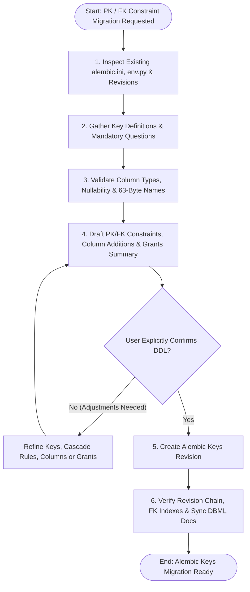

# Python Alembic Primary & Foreign Keys Generator Skill

## 1. Overview & Purpose

This skill defines the mandatory interactive workflow and DDL standards for generating **Python Alembic** Primary Key (`PK`) and Foreign Key (`FK`) migrations on existing tables (including adding new FK columns alongside their constraints).

Every key/constraint migration generated under this skill must use deterministic naming, explicit user confirmation for key columns, referenced tables, `ON DELETE` / `ON UPDATE` rules, and grants, idempotent raw-SQL execution via `op.execute(...)`, and cleanly ordered reversible `downgrade()` logic.

> [!IMPORTANT]
> **Idempotent Constraint Guards & Dependency-Ordered `downgrade()`**:
> 1. Every `ADD CONSTRAINT` in PostgreSQL **MUST** be wrapped in an idempotent `DO $$ BEGIN IF NOT EXISTS (SELECT 1 FROM pg_constraint WHERE conname = '...') THEN ... END IF; END $$;` block, with deterministic names (`pk_<schema>_<table>` and `fk_<schema>_<table>_<target_or_role>`).
> 2. When adding a new FK column and constraint together, `upgrade()` **MUST** add the column (`ADD COLUMN IF NOT EXISTS`) before `ADD CONSTRAINT`, and `downgrade()` **MUST** execute `DROP CONSTRAINT` **before** `DROP COLUMN IF EXISTS`.

---

## 2. Interactive Discovery & Keys Workflow



### Step 1: Inspect Existing Alembic Environment
Before asking questions or creating files, inspect the repository's existing Alembic setup:
1. Locate all `alembic.ini`, `alembic/env.py`, and `alembic/versions/*.py` files in the target backend/service.
2. Read `alembic/env.py` (never read real `.env` files; inspect only `.env-example` or `env-example.txt` if checking connection variable names) to confirm how the target service executes migrations.
3. Read existing table and constraint migrations in `alembic/versions/` to identify:
   - Current head `revision` ID (`down_revision` for the new migration)
   - Exact schemas, table names, column names, and data types on both the source and referenced tables (including whether a PK already exists on the table)
   - Whether sequence grants (`GRANT SELECT, USAGE ON ALL SEQUENCES IN SCHEMA ...`) were already applied in earlier migrations.

### Step 2: Mandatory User Questioning Protocol
**Always question the user** before generating any key migration file. Never guess key columns, referenced targets, `ON DELETE` / `ON UPDATE` actions, or grants. Ask clearly for:
1. **Target Service & Alembic Path**: Which service/module owns the constraint(s) (e.g., `Core`, `Auth`, or another service's `alembic/` folder)?
2. **Target SGBD**: Which database engine is used (e.g., PostgreSQL [default], MySQL, SQL Server)?
3. **Constraint Kind (`PK`, `FK`, or Both)**:
   - For **Primary Keys**: target `<schema>.<table>`, single or composite key columns `(col_a, col_b)`, whether existing data is guaranteed unique and `NOT NULL` (or whether `SET NOT NULL` / `ADD COLUMN` is needed), and whether an existing PK must be replaced.
   - For **Foreign Keys**: source `<schema>.<table>(<fk_cols>)` and referenced `<target_schema>.<target_table>(<target_cols>)` (including cross-schema or self-referencing FKs).
4. **New Column Creation (If Applicable)**: If the FK or PK column does not yet exist on `<schema>.<table>`, confirm the exact column name, compatible SQL type, nullability (`NULL` vs `NOT NULL`), and any default or backfill requirement for populated tables.
5. **Referential Actions (`ON DELETE` / `ON UPDATE`)**: Explicitly confirm `NO ACTION` (default), `RESTRICT`, `CASCADE`, `SET NULL`, or `SET DEFAULT`. Never silently default to `CASCADE`.
6. **Supporting FK Indexes**: Confirm whether accompanying indexes on the FK column(s) should also be created (PostgreSQL does **not** automatically create indexes on FK columns; if needed, follow `python-alembic-gen-index`).
7. **Sequence Grants (`GRANT`)**: Whether `GRANT SELECT, USAGE ON ALL SEQUENCES IN SCHEMA <schema> TO <app_role>;` is required (if not already granted during table creation).

### Step 3: Draft Summary & Mandatory Confirmation
Present the complete planned constraints, deterministic constraint names, column type checks, referential actions, optional grants, and matching `downgrade()` steps to the user and **wait for explicit confirmation** before creating the Alembic revision file.

---

## 3. Keys & Alembic Migration Standards

### 3.1 Deterministic Naming Convention
- **Primary Key**: `pk_<schema>_<table>`
  - Example: `pk_accounts_user_bank`, `pk_payment_transaction`
- **Foreign Key**: `fk_<schema>_<table>_<target_or_role>`
  - Example: `fk_payment_transaction_status`, `fk_payment_transaction_user_card`, `fk_goals_category_goal`
- **Identifier Limit**: Keep all constraint names at or below **63 bytes** in PostgreSQL to avoid silent truncation.

### 3.2 Raw-SQL Key & Constraint Rules
Generate the revision file using `alembic revision -m "create_<short_snake_case_description>_keys"` (or create the `.py` file matching `alembic/script.py.mako` with the exact `revision` and `down_revision` chain).

Follow these SQL rules inside `op.execute(""" ... """)`:
1. **Idempotent Constraint Blocks (PostgreSQL)**:
   - Wrap every `ALTER TABLE ... ADD CONSTRAINT` inside:
     ```sql
     DO $$
     BEGIN
         IF NOT EXISTS (
             SELECT 1 FROM pg_constraint
             WHERE conname = '<constraint_name>'
               AND connamespace = '<schema>'::regnamespace
         ) THEN
             ALTER TABLE <schema>."<table>"
             ADD CONSTRAINT <constraint_name> ...;
         END IF;
     END $$;
     ```
     *(When `conname` is globally unique across schemas via the `<schema>_<table>` prefix, `WHERE conname = '<constraint_name>'` is also valid; adding `connamespace` prevents cross-schema collisions.)*
   - Wrap every `ALTER TABLE ... DROP CONSTRAINT` in `downgrade()` with the matching `IF EXISTS (...)` check.
2. **Primary Key Validation Rules**:
   - Before adding a PK on an existing table, verify no primary key (`contype = 'p'`) already exists unless the migration explicitly drops the prior PK first.
   - Ensure every PK column is `NOT NULL` (`ALTER TABLE <schema>."<table>" ALTER COLUMN <col> SET NOT NULL;` when needed) and free of duplicate values.
   - Support composite primary keys cleanly: `ADD CONSTRAINT pk_<schema>_<table> PRIMARY KEY (<col_a>, <col_b>)`.
3. **Foreign Key Type & Dependency Rules**:
   - Verify exact data-type compatibility between the FK column and referenced PK (`INT`/`INTEGER` <-> `SERIAL`, `BIGINT` <-> `BIGSERIAL`, `UUID` <-> `UUID`).
   - Support same-schema, cross-schema (e.g., `payment.transaction` -> `accounts.user_bank_card`), self-referencing (e.g., `goals.category(parent_category)` -> `goals.category(id)`), and composite FKs (`FOREIGN KEY (col_a, col_b) REFERENCES target(col_a, col_b)`).
   - Always quote reserved identifiers such as `"transaction"` or `"user"` consistently in both `upgrade()` and `downgrade()`.
4. **Adding an FK Column + Constraint Together**:
   - If the FK column does not exist yet, execute `ALTER TABLE <schema>."<table>" ADD COLUMN IF NOT EXISTS <fk_col> <type>;` before `ADD CONSTRAINT`.
   - Note that adding a `NOT NULL` column without a `DEFAULT` fails if the table already contains rows; confirm a `DEFAULT` or two-step backfill (`NULL` -> backfill -> `SET NOT NULL`) with the user first.
   - In `downgrade()`, always `DROP CONSTRAINT` **before** `DROP COLUMN IF EXISTS <fk_col>`.
5. **Grants & Reversal**:
   - Include `GRANT SELECT, USAGE ON ALL SEQUENCES IN SCHEMA <schema> TO <app_role>;` (and matching `REVOKE` in `downgrade()`) only when requested/confirmed by the user and not already applied in an earlier migration.
6. **SGBD Adaptations**:
   - **PostgreSQL (default)**: `DO $$ ... pg_constraint ... END $$;`.
   - **SQL Server**: Check `sys.key_constraints` / `sys.foreign_keys` before `ALTER TABLE ... ADD CONSTRAINT` / `DROP CONSTRAINT IF EXISTS`.
   - **MySQL**: Check `information_schema.table_constraints` before `ALTER TABLE ... ADD CONSTRAINT` / `DROP PRIMARY KEY` / `DROP FOREIGN KEY`.

### 3.3 Reference Migration Templates

#### Template A: Adding Primary Key & Foreign Key Constraints to Existing Tables
```python
"""create <table_name> keys

Revision ID: <new_revision_id>
Revises: <previous_revision_id>
Create Date: <YYYY-MM-DD HH:MM:SS>

"""
from typing import Sequence, Union

from alembic import op
import sqlalchemy as sa


# revision identifiers, used by Alembic.
revision: str = '<new_revision_id>'
down_revision: Union[str, Sequence[str], None] = '<previous_revision_id>'
branch_labels: Union[str, Sequence[str], None] = None
depends_on: Union[str, Sequence[str], None] = None


def upgrade() -> None:
    """Upgrade schema."""
    op.execute("""
        DO $$
        BEGIN
            -- Primary Key (single or composite) on existing table
            IF NOT EXISTS (
                SELECT 1 FROM pg_constraint
                WHERE conname = 'pk_<schema>_<table_name>'
                  AND connamespace = '<schema>'::regnamespace
            ) THEN
                ALTER TABLE <schema>."<table_name>"
                ADD CONSTRAINT pk_<schema>_<table_name>
                PRIMARY KEY (<pk_col_a>, <pk_col_b>);
            END IF;

            -- Foreign Key (same-schema, cross-schema, or self-referencing)
            IF NOT EXISTS (
                SELECT 1 FROM pg_constraint
                WHERE conname = 'fk_<schema>_<table_name>_<target>'
                  AND connamespace = '<schema>'::regnamespace
            ) THEN
                ALTER TABLE <schema>."<table_name>"
                ADD CONSTRAINT fk_<schema>_<table_name>_<target>
                FOREIGN KEY (<fk_column>)
                REFERENCES <target_schema>."<target_table>"(<target_column>)
                ON DELETE NO ACTION
                ON UPDATE NO ACTION;
            END IF;
        END $$;

        GRANT SELECT, USAGE ON ALL SEQUENCES IN SCHEMA <schema> TO <app_role>;
    """)


def downgrade() -> None:
    """Downgrade schema."""
    op.execute("""
        DO $$
        BEGIN
            IF EXISTS (
                SELECT 1 FROM pg_constraint
                WHERE conname = 'fk_<schema>_<table_name>_<target>'
                  AND connamespace = '<schema>'::regnamespace
            ) THEN
                ALTER TABLE <schema>."<table_name>"
                DROP CONSTRAINT fk_<schema>_<table_name>_<target>;
            END IF;

            IF EXISTS (
                SELECT 1 FROM pg_constraint
                WHERE conname = 'pk_<schema>_<table_name>'
                  AND connamespace = '<schema>'::regnamespace
            ) THEN
                ALTER TABLE <schema>."<table_name>"
                DROP CONSTRAINT pk_<schema>_<table_name>;
            END IF;
        END $$;

        REVOKE SELECT, USAGE ON ALL SEQUENCES IN SCHEMA <schema> FROM <app_role>;
    """)
```

#### Template B: Adding a New FK Column + Foreign Key Constraint to an Existing Table
```python
"""add <fk_column> key to <table_name>

Revision ID: <new_revision_id>
Revises: <previous_revision_id>
Create Date: <YYYY-MM-DD HH:MM:SS>

"""
from typing import Sequence, Union

from alembic import op
import sqlalchemy as sa


# revision identifiers, used by Alembic.
revision: str = '<new_revision_id>'
down_revision: Union[str, Sequence[str], None] = '<previous_revision_id>'
branch_labels: Union[str, Sequence[str], None] = None
depends_on: Union[str, Sequence[str], None] = None


def upgrade() -> None:
    """Upgrade schema."""
    op.execute("""
        DO $$
        BEGIN
            ALTER TABLE <schema>."<table_name>"
            ADD COLUMN IF NOT EXISTS <fk_column> <fk_sql_type>;

            IF NOT EXISTS (
                SELECT 1 FROM pg_constraint
                WHERE conname = 'fk_<schema>_<table_name>_<target>'
                  AND connamespace = '<schema>'::regnamespace
            ) THEN
                ALTER TABLE <schema>."<table_name>"
                ADD CONSTRAINT fk_<schema>_<table_name>_<target>
                FOREIGN KEY (<fk_column>)
                REFERENCES <target_schema>."<target_table>"(id)
                ON DELETE NO ACTION
                ON UPDATE NO ACTION;
            END IF;
        END $$;
    """)


def downgrade() -> None:
    """Downgrade schema."""
    op.execute("""
        DO $$
        BEGIN
            IF EXISTS (
                SELECT 1 FROM pg_constraint
                WHERE conname = 'fk_<schema>_<table_name>_<target>'
                  AND connamespace = '<schema>'::regnamespace
            ) THEN
                ALTER TABLE <schema>."<table_name>"
                DROP CONSTRAINT fk_<schema>_<table_name>_<target>;
            END IF;

            ALTER TABLE <schema>."<table_name>"
            DROP COLUMN IF EXISTS <fk_column>;
        END $$;
    """)
```

---

## 4. Critical Safety & Documentation Rules

1. **Never Read `.env` Files**: Only inspect `.env-example` / `env-example.txt` if connection variable names need to be verified.
2. **Never Invent Unconfirmed Keys or Cascade Rules**: Primary key columns, foreign-key targets, `ON DELETE` / `ON UPDATE` rules, column additions, and grants must always come from or be confirmed by the user.
3. **Never Leave Unindexed FKs Unmentioned**: PostgreSQL does not auto-create indexes on foreign-key columns; confirm with the user whether a supporting FK index is needed and generate it using `python-alembic-gen-index`.
4. **Coordinate with Sibling Alembic Skills**:
   - Table creation & columns: [python-alembic-gen-entity.md](./python-alembic-gen-entity.md)
   - Indexes & unique indexes: [python-alembic-gen-index.md](./python-alembic-gen-index.md)
   - Seed / data inserts: [python-alembic-gen-insert.md](./python-alembic-gen-insert.md)
5. **Synchronize Database Documentation**: After generating or updating key migrations, update `[pk]` attributes and `Ref:` relationship declarations in the project's DBML schema documentation following [dbdiagram.md](../../documentation/dbdiagram/diagram.md) and [documentation.md](../../documentation/documentation.md).

---

## 5. Verification Checklist

- [ ] Inspected target `alembic/env.py`, source/target table columns, existing constraints, and latest head revision in `alembic/versions/`.
- [ ] Questioned user on PK/FK columns, referenced targets, `ON DELETE` / `ON UPDATE` actions, supporting FK indexes, and grants, and received confirmation.
- [ ] Constraint names strictly follow `pk_<schema>_<table>` and `fk_<schema>_<table>_<target_or_role>` and do not exceed 63 bytes.
- [ ] Column data types match between FK and referenced PK (`INT` <-> `SERIAL`, `BIGINT` <-> `BIGSERIAL`, `UUID` <-> `UUID`).
- [ ] `upgrade()` wraps every `ADD CONSTRAINT` in an idempotent `pg_constraint` check (adding any new FK column first with `ADD COLUMN IF NOT EXISTS`).
- [ ] `downgrade()` drops constraints before dropping newly added columns, and reverses any sequence grants.
- [ ] `down_revision` correctly points to the previous head revision (no broken or branched heads unless intended).
- [ ] No `.env` file was read or modified.
- [ ] DBML `[pk]` / `Ref:` documentation updated or flagged for update per `dbdiagram` skill.
